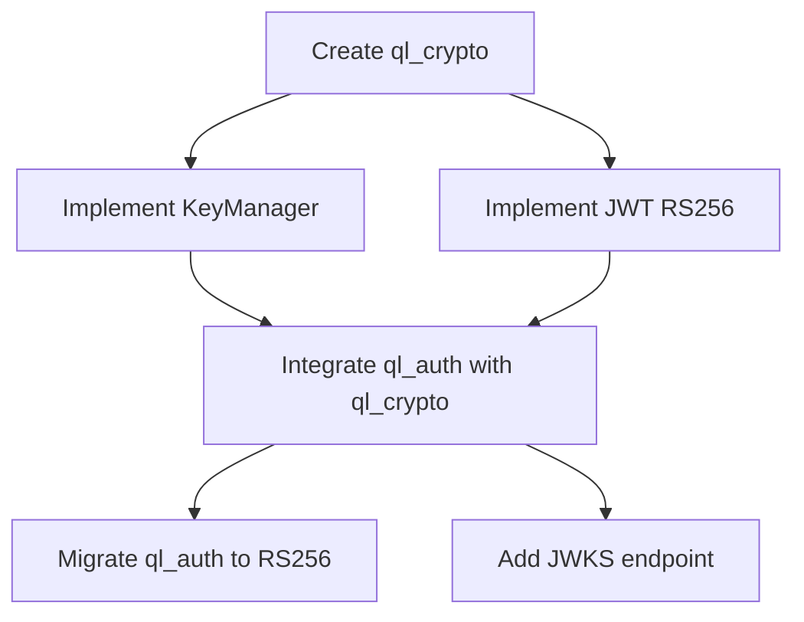

# Issue Forge Handoff Reference

## Handoff Overview

The Ultra Planner produces implementation-ready specifications that the `issue-forge` skill (or equivalent) decomposes into small, actionable GitHub Issues. This reference defines the handoff contract.

### Handoff Principles

1. **Specification Completeness** — Specs must contain sufficient detail for decomposition
2. **Traceability** — Every issue traces to spec sections and original requirements
3. **Independence** — Issues should be independently implementable where possible
4. **Verifiability** — Each issue has clear acceptance criteria and verification method
4. **Dependency Clarity** — Blocking relationships explicit

## Handoff Artifacts

### Primary Artifact: Implementation Specification

The specification (per `specification-engineering.md`) is the primary handoff artifact. It must include:

- **Spec ID** — Stable identifier (SPEC-XXX)
- **Acceptance Criteria** — Verifiable, testable (AC-XXX)
- **Functional Behavior** — Inputs, outputs, workflows, states
- **Technical Design** — Modules, interfaces, data flow
- **Data Contracts** — Entities, schemas, migrations
- **API Contracts** — Endpoints, request/response, auth
- **Security Requirements** — Threats, mitigations, sensitive data
- **Testing Requirements** — Unit, integration, contract, E2E cases
- **Implementation Constraints** — Conventions, prohibited approaches
- **Dependencies** — Other specs, packages, external systems

### Secondary Artifact: Specification Index

```markdown
# Specification Index: [Project/Feature]

## Specifications
| Spec ID | Title | Status | Priority | Target Phase | Depends On |
|---------|-------|--------|----------|--------------|------------|
| SPEC-001 | Cryptographic Standards | READY | P0 | Phase 1 | — |
| SPEC-002 | Auth Migration to RS256 | READY | P0 | Phase 1 | SPEC-001 |
| SPEC-003 | Billing Stripe Integration | READY | P1 | Phase 2 | SPEC-002 |
| SPEC-004 | Multi-tenancy RLS | DRAFT | P2 | Phase 3 | SPEC-002 |

## Traceability Matrix
| Requirement | Spec(s) | AC(s) | Test Cases |
|-------------|---------|-------|------------|
| FR-001 (Register) | SPEC-002 | AC-001..005 | TC-AUTH-001..005 |
| NFR-001 (Performance) | SPEC-001, SPEC-003 | AC-006, AC-008 | TC-PERF-001 |
| SEC-001 (Crypto) | SPEC-001 | AC-001..003 | TC-SEC-001..003 |
```

## Issue Decomposition Guidelines

### Issue Granularity

| Issue Type | Scope | Typical Effort | Example |
|------------|-------|----------------|---------|
| **Package Creation** | New ql_* package | S-M | "Create ql_crypto package with RS256 support" |
| **Module Implementation** | Single module/class | XS-S | "Implement KeyManager class in ql_crypto" |
| **API Endpoint** | Single endpoint | S | "Implement POST /api/v1/auth/register" |
| **Database Migration** | Single migration | XS-S | "Add users table with RLS policies" |
| **Integration** | Connect two components | S-M | "Integrate ql_auth with ql_crypto" |
| **Test Implementation** | Test suite for feature | S | "Add integration tests for auth registration" |
| **Documentation** | Spec section or guide | XS-S | "Document ql_crypto public API" |
| **Refactoring** | Improve existing code | S | "Extract shared types to ql_shared" |
| **Configuration** | Config/secret setup | XS | "Add Vault secrets for RSA keys" |

### Issue Template (for Issue Forge)

```markdown
# Issue: [Title from Spec]

## Source
- **Specification:** SPEC-XXX ([Title])
- **Section:** [Section reference, e.g., "4.1 Package: ql_crypto"]
- **Acceptance Criteria:** AC-XXX, AC-YYY
- **Original Finding:** UR-XXXX-XXX (if from Ultra Review)

## Context
[1-2 sentences from spec Purpose/Scope]

## Problem Statement
[What needs to be built/fixed]

## Desired Outcome
[Specific, measurable outcome]

## Scope
### In Scope
- [Specific deliverable 1]
- [Specific deliverable 2]

### Out of Scope
- [Related but not in this issue]

## Technical Details
**Files to Create/Modify:**
- `packages/ql_xxx/src/...` — [Purpose]
- `packages/ql_xxx/tests/...` — [Test purpose]

**Key Interfaces:**
```typescript
// From spec section X.Y
interface KeyManager {
  generateKeyPair(algorithm: 'RS256'): Promise<KeyPair>;
  rotateKey(keyId: KeyId): Promise<void>;
}
```

**Dependencies:**
- Requires: [Other issue IDs]
- Blocks: [Other issue IDs]

## Acceptance Criteria
- [ ] AC-XXX: [Criterion from spec]
- [ ] AC-YYY: [Criterion from spec]
- [ ] All existing tests pass
- [ ] New tests added per spec testing requirements
- [ ] TypeScript compilation passes (`tsc --noEmit`)
- [ ] Linting passes (`eslint .`)
- [ ] Security scan passes (`npm audit`)

## Verification Requirements
### Automated
- [ ] Unit test: [Description from spec]
- [ ] Integration test: [Description from spec]
- [ ] Contract test: [Description from spec]

### Manual
- [ ] [Step 1: e.g., "Verify JWKS endpoint returns valid keys"]
- [ ] [Step 2: e.g., "Confirm RS256 tokens validate"]

## Implementation Constraints
- [ ] Follow ql_* package structure
- [ ] Use ql_shared Result<T> for errors
- [ ] No direct ql_db imports (use repository interface)
- [ ] Emit domain events for state changes
- [ ] Follow MoonWitness naming conventions (feat-/fix-/chore-)

## Effort Estimate
**Size:** XS / S / M / L / XL
**Duration:** [Estimate]
**Skills:** [backend / frontend / database / security / infra]

## Labels
`type:feature|bug|enhancement|tech-debt|docs`, `priority:p0|p1|p2|p3`, `component:ql_xxx`, `spec:SPEC-XXX`
```

## Dependency Management

### Dependency Types

| Type | Description | Handling |
|------|-------------|----------|
| **Hard Dependency** | Issue B cannot start until Issue A complete | Sequential, block in project board |
| **Soft Dependency** | Issue B benefits from Issue A but can start | Parallel with coordination |
| **Shared Dependency** | Both need same prerequisite | Prerequisite issue created first |
| **Mutual Exclusion** | Cannot work simultaneously (same files) | Sequence, communicate |

### Dependency Visualization



## Parallelization Strategy

### Identify Parallel Tracks

| Track | Issues | Shared Dependencies | Can Start |
|-------|--------|---------------------|-----------|
| **Track A: Crypto Foundation** | SPEC-001 issues | None | Immediately |
| **Track B: Auth Migration** | SPEC-002 issues | Track A complete | After Track A |
| **Track C: Billing** | SPEC-003 issues | Track B (auth) | After Track B |
| **Track D: Platform** | Infrastructure | Track A (secrets) | Parallel with Track B |

### Parallelization Rules

1. **Different Packages** → Can parallelize
2. **Same Package, Different Modules** → Can parallelize with coordination
3. **Same Module** → Sequence (mutual exclusion)
4. **Shared External Dependency** → Sequence or coordinate

## Handoff Checklist

### From Ultra Planner to Issue Forge

- [ ] All specifications at READY status
- [ ] Specification index complete with dependencies
- [ ] Traceability matrix links requirements → specs → ACs
- [ ] Each spec has verifiable acceptance criteria
- [ ] Implementation constraints documented per spec
- [ ] Testing requirements specified per spec
- [ ] Security requirements specified per spec
- [ ] Migration constraints documented (if applicable)
- [ ] Dependency graph between specs created
- [ ] Priority assigned per spec (P0-P3)
- [ ] Target phase assigned per spec
- [ ] Open questions resolved or tracked with owners
- [ ] Conditional readiness items tracked
- [ ] Sign-offs obtained for READY specs

### From Issue Forge to Implementation

- [ ] Issues created from specs with all template fields
- [ ] Dependency graph matches spec dependencies
- [ ] Parallel tracks identified
- [ ] Labels applied per convention
- [ ] Milestones assigned per phase
- [ ] Project board columns reflect workflow
- [ ] WIP limits set per column
- [ ] Issue templates configured in repository

## Handoff Validation

Before declaring handoff complete:

```markdown
# Handoff Validation: [Project]

## Specification Coverage
- [ ] All P0/P1 specs at READY
- [ ] All ACs have verification methods
- [ ] All specs have implementation constraints
- [ ] Cross-spec dependencies resolved

## Issue Quality
- [ ] Every issue traces to spec section
- [ ] Every issue has verifiable ACs
- [ ] Dependencies correctly modeled
- [ ] No orphan issues (all link to spec)
- [ ] Effort estimates provided
- [ ] Labels consistent

## Project Setup
- [ ] Milestones created for phases
- [ ] Project board configured
- [ ] WIP limits set
- [ ] Issue templates installed
- [ ] Automation rules configured (auto-assign, move on close)

## Team Readiness
- [ ] Package owners assigned
- [ ] Domain experts identified
- [ ] Onboarding docs current
- [ ] Development environment verified

## Sign-off
- **Planner:** [Name] — [Date]
- **Issue Forge Lead:** [Name] — [Date]
- **Engineering Manager:** [Name] — [Date]
```