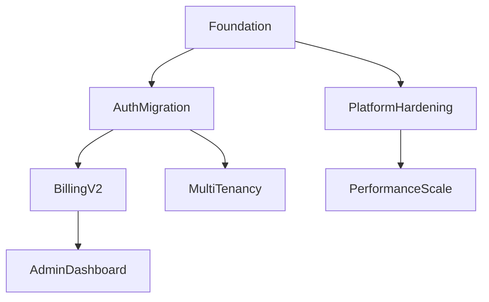

# Roadmap and Phasing Reference

## Roadmap Engineering Principles

### 1. Roadmap vs Plan

| Aspect | Roadmap | Plan |
|--------|---------|------|
| **Time Horizon** | 6 months - 3 years | 2 weeks - 3 months |
| **Certainty** | Directional, evolving | Committed, detailed |
| **Audience** | Stakeholders, leadership | Team, implementers |
| **Detail Level** | Themes, outcomes | Tasks, dependencies |
| **Flexibility** | High (adapts to learning) | Low (execution-focused) |

### 2. Roadmap Structure

**Time Horizons:**
- **Now** (0-3 months): Committed, detailed, high certainty
- **Next** (3-6 months): Planned, moderate detail, some flexibility
- **Later** (6-18 months): Directional, themes, high flexibility
- **Future** (18+ months): Visionary, exploratory

### 3. Phasing Principles

**Phase Definition:**
- **Clear Objective:** Single, measurable outcome
- **Defined Scope:** What's in/out
- **Entry Criteria:** What must be true to start
- **Exit Criteria:** What must be true to finish
- **Deliverables:** Tangible outputs
- **Dependencies:** What must complete first
- **Risks:** What could derail

**Phase Sequencing:**
1. **Foundation** — Infrastructure, shared packages, core contracts
2. **Architecture Preparation** — Refactoring, debt reduction, platform work
3. **Core Functionality** — Highest value features first
4. **Integration** — Cross-cutting features, system integration
5. **Hardening** — Testing, performance, security, observability
6. **Release Preparation** — Documentation, migration, rollout
7. **Post-Release** — Stabilization, feedback, iteration

### 4. Prioritization Frameworks

#### RICE Score
| Factor | Scale | Description |
|--------|-------|-------------|
| **Reach** | People/events per period | How many users affected |
| **Impact** | 3=Massive, 2=High, 1=Medium, 0.5=Low, 0.25=Minimal | Effect on goal |
| **Confidence** | 100%, 80%, 50% | Evidence for estimates |
| **Effort** | Person-months | Total team time |

**RICE = (Reach × Impact × Confidence) / Effort**

#### WSJF (Weighted Shortest Job First)
```
WSJF = Cost of Delay / Job Duration

Cost of Delay = User-Business Value + Time Criticality + Risk Reduction/Opportunity Enablement
```

#### MoSCoW + Dependencies
- **Must Have** — Non-negotiable for release
- **Should Have** — Important, workaround exists
- **Could Have** — Nice to have, low cost
- **Won't Have** — Explicitly excluded this cycle

Then sequence by dependency graph.

### 5. Roadmap Template

```markdown
# Engineering Roadmap: [Product/System]

## Vision & Strategy
- **Vision:** [One sentence]
- **Strategic Goals:** [3-5 measurable goals]
- **Success Metrics:** [KPIs with targets]

## Themes by Horizon

### NOW (0-3 months) — Committed
| Theme | Objective | Key Results | Owner | Dependencies |
|-------|-----------|-------------|-------|--------------|
| Foundation | Stabilize platform | 99.9% uptime, <500ms p99 | @team-platform | — |
| Auth Migration | Migrate to JWT + MFA | 100% users migrated, 0 security incidents | @team-auth | Foundation |
| Billing V2 | Stripe integration | Process $1M/mo, <0.1% failure | @team-billing | Auth Migration |

### NEXT (3-6 months) — Planned
| Theme | Objective | Key Results | Owner | Dependencies |
|-------|-----------|-------------|-------|--------------|
| Admin Dashboard | Internal ops tool | 90% manual ops automated | @team-platform | Billing V2 |
| Multi-tenancy | Enterprise readiness | 3 pilot tenants onboarded | @team-core | Auth Migration |
| Performance | Scale to 10k RPS | p99 < 200ms at 10k RPS | @team-platform | Foundation |

### LATER (6-18 months) — Directional
| Theme | Objective | Success Indicators |
|-------|-----------|-------------------|
| Internationalization | Global launch | 5 locales, RTL support |
| AI Features | Smart recommendations | 15% conversion lift |
| Mobile App | Native iOS/Android | 4.5+ store rating |

### FUTURE (18+ months) — Visionary
| Theme | Exploration Areas |
|-------|-------------------|
| Platform Ecosystem | Third-party marketplace |
| Real-time Collaboration | Multi-user editing |
| Advanced Analytics | Predictive insights |

## Phase Details (NOW Horizon)

### Phase 1: Foundation (Weeks 1-4)
**Objective:** Production-ready platform foundation
**Entry Criteria:** Team assembled, requirements baselined
**Exit Criteria:** CI/CD passing, observability live, staging env
**Deliverables:**
- [ ] Kubernetes cluster (staging + prod)
- [ ] CI/CD pipeline with quality gates
- [ ] Observability stack (metrics, logs, traces)
- [ ] Shared package structure (ql_shared, ql_kernel)
- [ ] Developer environment (local + preview)
**Dependencies:** None
**Risks:** Cloud provisioning delays, team onboarding

### Phase 2: Auth Migration (Weeks 5-8)
**Objective:** Modern authentication with MFA
**Entry Criteria:** Foundation complete, auth requirements approved
**Exit Criteria:** 100% users migrated, zero critical vulns
**Deliverables:**
- [ ] JWT-based auth with RS256
- [ ] MFA (TOTP + backup codes)
- [ ] Session management (refresh rotation)
- [ ] Migration script for existing users
- [ ] Security audit passed
**Dependencies:** Phase 1 complete
**Risks:** User migration friction, legacy integration

### Phase 3: Billing V2 (Weeks 9-14)
**Objective:** Scalable billing with Stripe
**Entry Criteria:** Auth Migration complete, Stripe account ready
**Exit Criteria:** Processing live traffic, <0.1% failure
**Deliverables:**
- [ ] Stripe integration (checkout, portal, webhooks)
- [ ] Subscription management (plans, trials, proration)
- [ ] Invoice generation + email
- [ ] Dunning management
- [ ] Financial reporting
**Dependencies:** Phase 2 complete
**Risks:** Stripe API changes, edge cases in proration

## Dependency Graph



## Capacity Planning

| Team | Capacity (person-weeks/quarter) | Allocated | Buffer |
|------|--------------------------------|-----------|--------|
| Platform | 12 | 10 | 2 |
| Auth | 8 | 7 | 1 |
| Billing | 8 | 7 | 1 |
| Core | 10 | 8 | 2 |

## Review Cadence
- **Weekly:** Team standup — progress, blockers
- **Bi-weekly:** Roadmap review — scope, priority, risk
- **Monthly:** Stakeholder update — outcomes, metrics
- **Quarterly:** Strategic review — direction, investment

## Communication
- **Internal:** Roadmap doc (living), Slack announcements
- **Stakeholders:** Monthly email + quarterly presentation
- **Customers:** Public roadmap (high-level only), release notes
```

### 6. Phasing Anti-Patterns

| Anti-Pattern | Symptom | Fix |
|--------------|---------|-----|
| **Waterfall Phases** | Each phase must complete 100% before next | Overlap phases, incremental delivery |
| **No Buffer** | 100% capacity allocated | 20% buffer for unknowns |
| **Big Bang Release** | All features at once | Incremental releases, feature flags |
| **Ignoring Dependencies** | Parallel work blocked | Dependency graph first, then sequence |
| **Fixed Scope + Fixed Date** | Quality sacrificed | Fix date, flex scope (or vice versa) |
| **No Technical Phases** | Only feature phases | Include foundation, hardening phases |
| **Optimistic Estimates** | Consistent delays | Use ranges, track velocity, adjust |

### 7. Roadmap Checklist

- [ ] Vision and strategic goals defined
- [ ] Horizons (Now/Next/Later/Future) populated
- [ ] Themes have objectives and measurable key results
- [ ] Phases have entry/exit criteria
- [ ] Dependency graph created and validated
- [ ] Capacity planning matches team availability
- [ ] Buffer included (20% recommended)
- [ ] Risks identified per phase
- [ ] Review cadence established
- [ ] Communication plan defined
- [ ] Roadmap is a living document (versioned, dated)