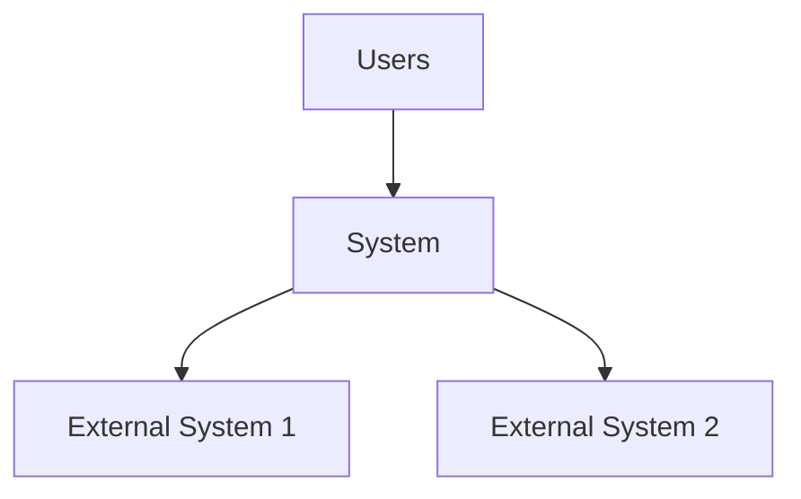
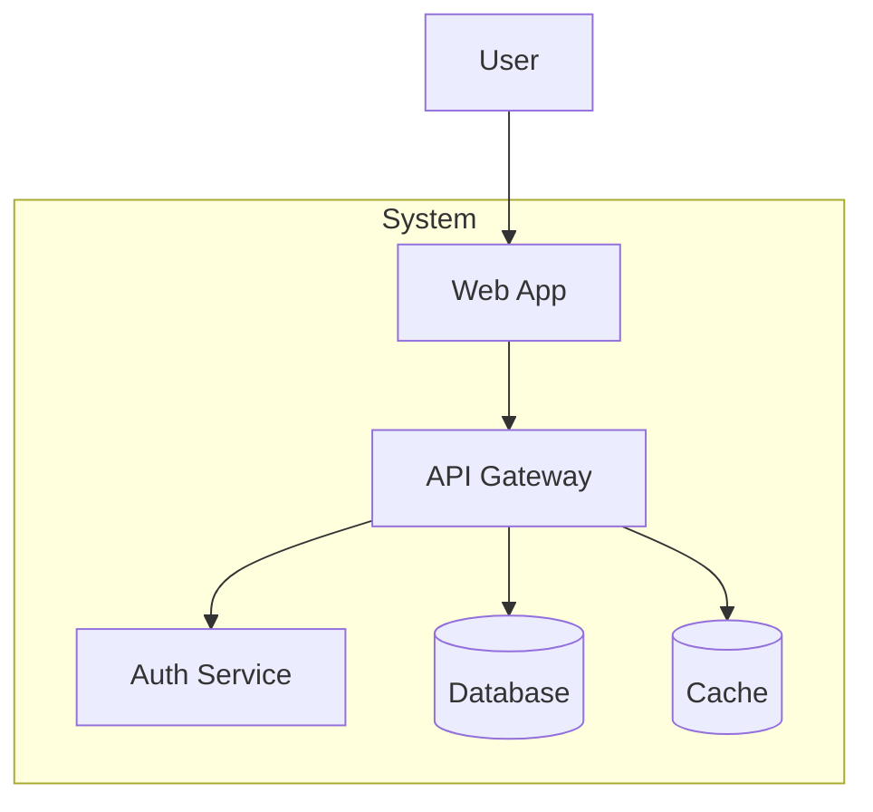
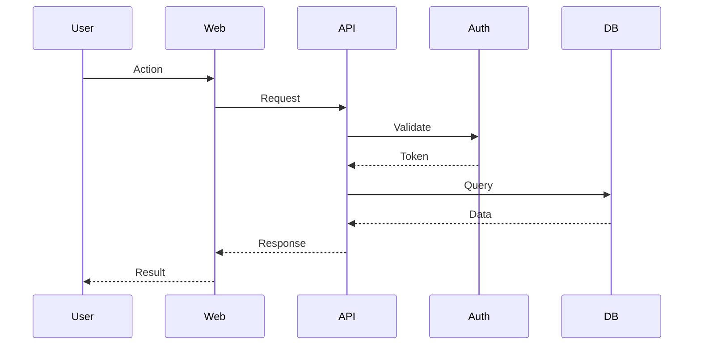
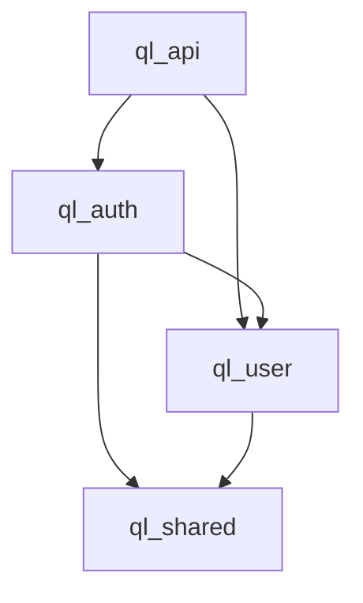
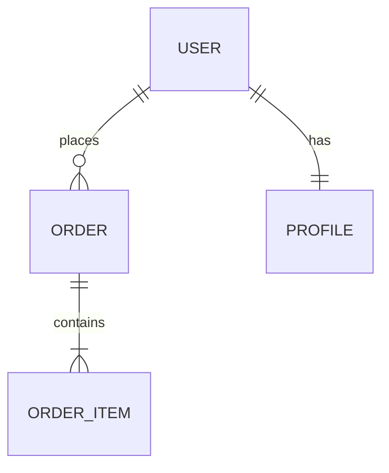
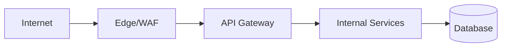
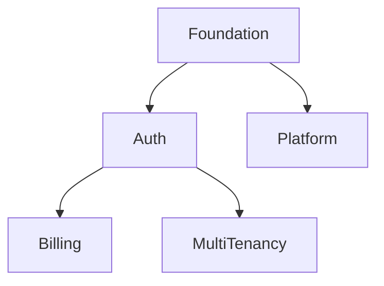

# Master Blueprint Template

**Project:** [Project Name]
**Blueprint ID:** BP-<YYYY-MM-DD>-<SEQ>
**Version:** 1.0.0
**Status:** DRAFT / REVIEW / APPROVED / BASELINED
**Date:** YYYY-MM-DD
**Author:** [Name]
**Reviewers:** [Names]

---

## 00. Executive Overview

**Vision:** [One sentence]
**Scope:** [What's included/excluded]
**Strategic Goals:** [3-5 measurable goals]
**Success Metrics:** [KPIs with targets]
**Timeline:** [High-level phases with dates]
**Investment:** [Team capacity, budget reference]
**Key Risks:** [Top 3 risks with mitigations]

---

## 01. Product Vision

**Problem Statement:** [What problem does this solve?]
**Target Users:** [Personas, roles, segments]
**Value Proposition:** [Why users choose this]
**Key User Journeys:** [Journey 1, Journey 2, Journey 3]
**Product Boundaries:** [In scope / Out of scope]
**Competitive Landscape:** [Key differentiators]
**Monetization/Business Model:** [If applicable]

---

## 02. Project Scope

### In Scope
- [Capability 1]
- [Capability 2]
- [Capability 3]

### Out of Scope
- [Excluded 1] — Reason: [Why]
- [Excluded 2] — Reason: [Why]

### Constraints
- **Technical:** [Constraints]
- **Budget:** [Constraints]
- **Timeline:** [Hard dates]
- **Compliance:** [Requirements]
- **Team:** [Capacity, skills]

---

## 03. Requirements

### Functional Requirements
| ID | Requirement | Priority | Source | Acceptance Criteria |
|----|-------------|----------|--------|---------------------|
| FR-001 | ... | MUST | Vision 3.1 | AC-001, AC-002 |
| FR-002 | ... | SHOULD | Stakeholder | AC-003 |

### Non-Functional Requirements
| ID | Requirement | Category | Priority | Target | Verification |
|----|-------------|----------|----------|--------|--------------|
| NFR-001 | ... | Performance | MUST | p99 < 200ms | Load test |
| NFR-002 | ... | Security | MUST | Zero critical | Audit |

### User Stories
| ID | Story | Acceptance Criteria |
|----|-------|---------------------|
| US-001 | As a... I want... so that... | AC-001..AC-005 |

### Out of Scope
| ID | Item | Reason | Future Reference |
|----|------|--------|------------------|
| OOS-001 | ... | ... | FR-XXX |

---

## 04. Current State Analysis

### Existing Architecture
[Description of current system, packages, technologies]

### Technical Debt Inventory
| Area | Debt Description | Impact | Remediation Effort |
|------|------------------|--------|-------------------|
| [Area] | [Description] | HIGH/MED/LOW | S/M/L |

### Capability Assessment
| Capability | Current State | Target State | Gap |
|------------|---------------|--------------|-----|
| [Capability] | [Description] | [Description] | [Gap] |

### Constraints & Dependencies
- [Constraint 1]
- [Dependency 1]

---

## 05. Target Architecture

### Architecture Style
[Modular monolith / Microservices / Serverless / etc. — with justification]

### System Context (C4 Level 1)

### Container Diagram (C4 Level 2)

### Component Diagram (C4 Level 3) — Key Areas
[Component diagrams for complex containers]

### Sequence Diagrams — Critical Workflows

---

## 06. System Boundaries

| Boundary | Components | Communication | Failure Isolation |
|----------|------------|---------------|-------------------|
| [Boundary] | [Components] | Sync/Async | [Mechanism] |

---

## 07. Domain Architecture

### Bounded Contexts
| Context | Domain | Owner | Key Aggregates |
|---------|--------|-------|----------------|
| [Context] | [Domain] | [Team] | [Aggregates] |

### Context Map
[Relationships between contexts: Shared Kernel, Customer/Supplier, etc.]

### Ubiquitous Language (Key Terms)
| Term | Definition | Code Representation |
|------|------------|---------------------|
| [Term] | [Definition] | [Type/Entity] |

---

## 08. Package Architecture

### Package Map
| Package | Type | Responsibility | Dependencies | Owner |
|---------|------|----------------|--------------|-------|
| ql_xxx | Domain | [Responsibility] | [Deps] | [Team] |

### Dependency Graph

### Shared Kernel
[What's in ql_shared, ql_kernel — types, utilities, base classes]

---

## 09. Data Architecture

### Entity Relationship Diagram

### Data Ownership
| Entity | Owner | Readers | Writers |
|--------|-------|---------|---------|
| User | ql_user | ql_auth, ql_billing | ql_user |

### Migration Strategy
[Expand-contract, zero-downtime, rollback plan]

### Retention & Compliance
| Data Type | Retention | Archive | Deletion |
|-----------|-----------|---------|----------|
| [Type] | [Period] | [Strategy] | [Method] |

---

## 10. API Architecture

### API Style
[REST / GraphQL / gRPC / tRPC — with justification]

### API Boundaries
| API | Consumers | Auth | Versioning |
|-----|-----------|------|------------|
| [API] | [Consumers] | JWT/OAuth | URL path |

### Contract Management
[OpenAPI, schema registry, consumer-driven contracts]

### Resilience Patterns
[Timeouts, retries, circuit breakers, bulkheads]

---

## 11. Security Architecture

### Trust Boundaries

### Authentication & Authorization
- **AuthN:** [JWT + MFA / OAuth / etc.]
- **AuthZ:** [RBAC / ABAC / ReBAC]
- **Token Strategy:** [Access/Refresh/API keys]

### Data Protection
- **In Transit:** TLS 1.2+, mTLS internal
- **At Rest:** AES-256-GCM, KMS
- **Field-Level:** PII encryption

### Secrets Management
[Vault, rotation, injection, audit]

### Threat Model Summary (STRIDE)
| Threat | Mitigation |
|--------|------------|
| Spoofing | MFA, cert pinning |
| Tampering | Signatures, integrity checks |
| ... | ... |

---

## 12. UI/UX Architecture

### Design Direction
[Reference to DESIGN.md, aesthetic: Industrial/Futuristic/etc.]

### Information Architecture
- **Global Nav:** [Items]
- **Page Types:** [Dashboard, List, Detail, Form, Settings, Auth, Error]

### Component Architecture
- **Primitives:** [Button, Input, Select, ...]
- **Composites:** [Card, Modal, Table, ...]
- **Layouts:** [Container, Grid, Stack, ...]

### State Management
- **Server State:** TanStack Query / SWR
- **Client State:** Zustand / Jotai / Context
- **Forms:** React Hook Form + Zod
- **URL State:** Router

### Accessibility
- WCAG 2.1 AA mandatory
- Design tokens only
- Reduced motion respected

---

## 13. Infrastructure Architecture

### Environment Strategy
| Environment | Purpose | Parity | Data |
|-------------|---------|--------|------|
| Local | Development | Code | Seed |
| Preview | PR validation | Infra subset | Anonymized |
| Staging | Integration | Full mirror | Prod-like |
| Production | Live | N/A | Real |

### Container & Orchestration
- **Base Images:** Distroless, non-root, signed
- **Kubernetes:** Resources, probes, HPA, NetworkPolicies
- **Service Mesh:** [Linkerd/Cilium/None — justified]

### Configuration & Secrets
- **Config:** ConfigMaps, External Secrets Operator
- **Secrets:** Vault, never in images

### CI/CD Pipeline
[Stages, quality gates, deployment strategies]

### GitOps
[ArgoCD/Flux, drift detection, declarative]

### Observability
- **Metrics:** Prometheus + Grafana (RED/USE)
- **Logs:** Loki (structured, correlation IDs)
- **Traces:** Tempo (W3C TraceContext)
- **Alerting:** Symptom-based, runbook links

---

## 14. Testing Strategy

### Test Pyramid
| Level | Target % | Tools | Scope |
|-------|----------|-------|-------|
| Unit | 70% | Vitest/Jest | Functions, classes |
| Integration | 20% | Testcontainers | Module interactions |
| E2E | 10% | Playwright | Critical user journeys |
| Contract | Variable | Pact | API/Event schemas |

### Quality Gates
- Coverage thresholds
- Flaky test < 1%
- Mutation testing (if applicable)

### Chaos Engineering
[Failure scenarios, tooling, cadence]

---

## 15. Observability Strategy

### Key Metrics (RED)
| Service | Rate | Errors | Duration (p99) |
|---------|------|--------|----------------|
| [Service] | [Target] | < 0.1% | < [Target] |

### Key Metrics (USE)
| Resource | Utilization | Saturation | Errors |
|----------|-------------|------------|--------|
| CPU | < 70% | < 90% | 0 |
| Memory | < 70% | < 85% | 0 |

### Distributed Tracing
[W3C TraceContext, sampling, service graph]

### Alerting
| Alert | Severity | Runbook |
|-------|----------|---------|
| [Alert] | Page/Ticket/Log | [Link] |

---

## 16. Deployment Strategy

### Deployment Patterns
| Service | Strategy | Rollback |
|---------|----------|----------|
| [Service] | Rolling/Blue-Green/Canary | < 5 min |

### Release Process
1. Version bump (changesets/semantic-release)
2. Changelog generation
3. Build + security scan
4. Staging deploy (auto)
5. Smoke tests
6. Production deploy (manual approval)
7. Post-deploy verification

### Disaster Recovery
- **RPO:** < 1 hour (WAL archiving)
- **RTO:** < 4 hours (tested quarterly)
- **Cross-region:** Yes

---

## 17. Migration Strategy

### Approach
[Strangler Fig / Expand-Contract / Parallel Run — with justification]

### Phases
| Phase | Objective | Duration | Key Deliverables |
|-------|-----------|----------|------------------|
| 1 | Foundation | 2 weeks | [Deliverables] |
| 2 | Core Migration | 6 weeks | [Deliverables] |
| 3 | Cutover | 2 weeks | [Deliverables] |

### Data Migration
[Expand-contract steps, validation, rollback]

### Compatibility Matrix
| Component | Old | New | Compatibility |
|-----------|-----|-----|---------------|
| [Component] | v1 | v2 | Breaking/Compatible |

### Rollback Plan
[Triggers, procedure, time targets]

---

## 18. Risk Register

| Risk ID | Risk | Likelihood | Impact | Mitigation | Contingency | Owner |
|---------|------|------------|--------|------------|-------------|-------|
| R-001 | [Risk] | H/M/L | H/M/L | [Mitigation] | [Contingency] | [Owner] |

---

## 19. Engineering Roadmap

### NOW (0-3 months)
| Theme | Objective | Key Results | Owner | Dependencies |
|-------|-----------|-------------|-------|--------------|
| [Theme] | [Objective] | [KRs] | [Owner] | [Deps] |

### NEXT (3-6 months)
| Theme | Objective | Key Results | Owner | Dependencies |
|-------|-----------|-------------|-------|--------------|

### LATER (6-18 months)
| Theme | Objective | Success Indicators |
|-------|-----------|-------------------|

### Dependency Graph

### Capacity Plan
| Team | Capacity (pw/qtr) | Allocated | Buffer |
|------|-------------------|-----------|--------|

---

## 20. Acceptance & Readiness

### Implementation Readiness Gate
- [ ] All 16 criteria met (see implementation-readiness.md)
- [ ] Evidence cited for each
- [ ] Blockers tracked with owners/dates
- [ ] Sign-offs obtained

### Handoff to Issue Forge
- [ ] Spec index complete
- [ ] Traceability matrix complete
- [ ] Issues decomposed with ACs
- [ ] Dependencies modeled
- [ ] Project board configured

### Success Criteria
- [ ] [Measurable criterion 1]
- [ ] [Measurable criterion 2]

---

## Appendices

### A. Glossary
### B. References
### C. Decision Log (key decisions with trade-offs)
### D. Open Questions