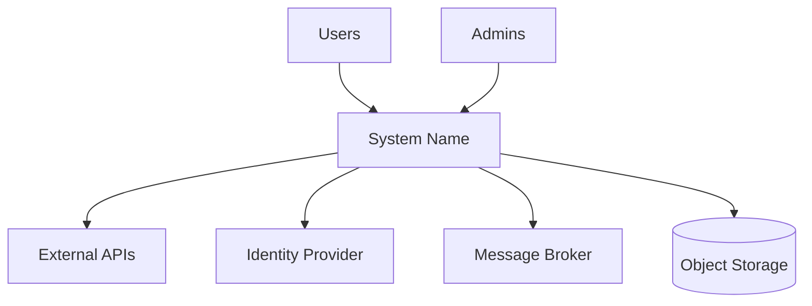
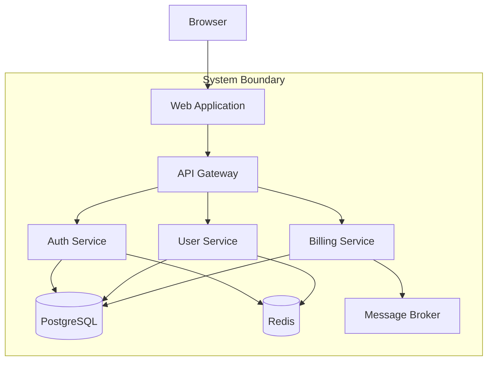
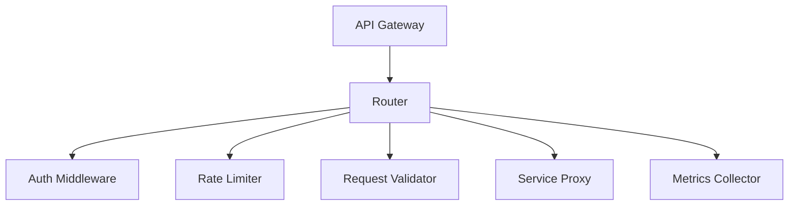
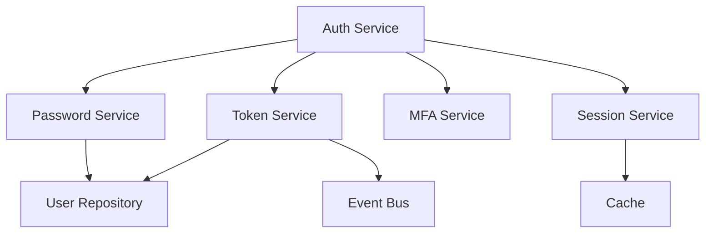
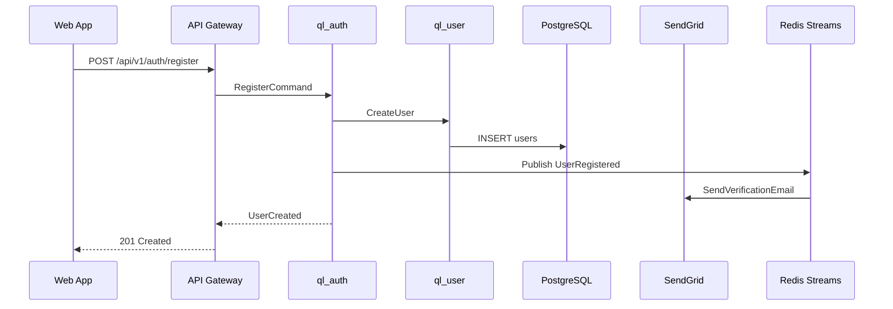
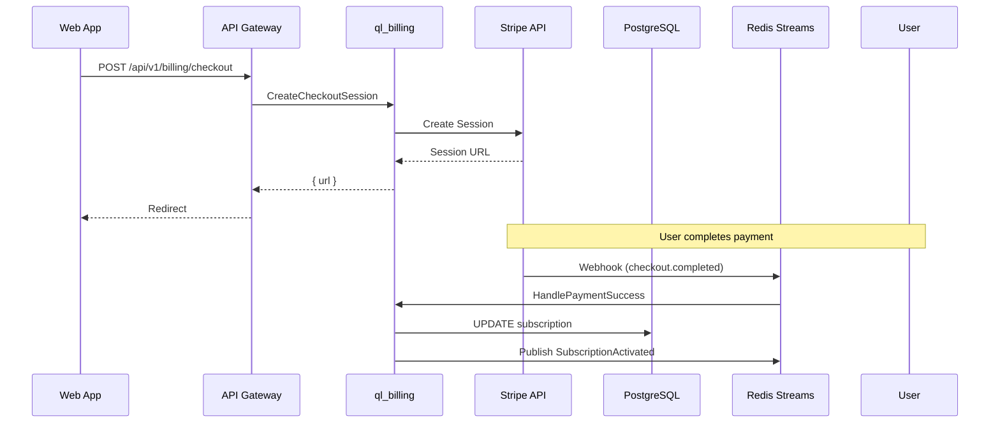
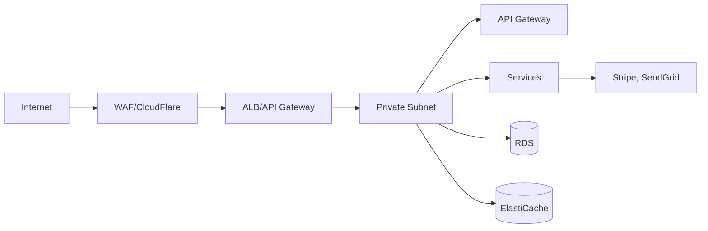
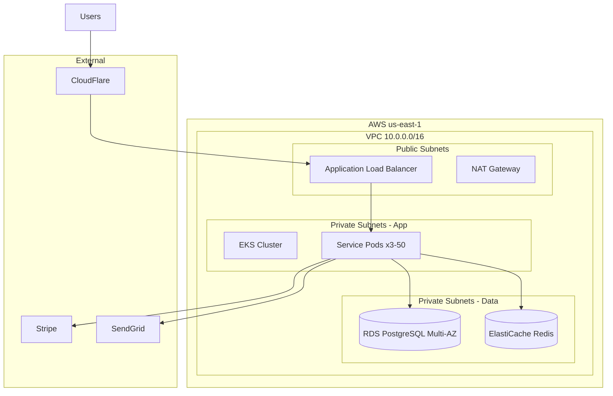

# System Architecture Template

**Project:** [Project Name]
**Document ID:** ARCH-<YYYY-MM-DD>-<SEQ>
**Version:** 1.0.0
**Status:** DRAFT / REVIEW / APPROVED / BASELINED
**Date:** YYYY-MM-DD
**Author:** [Name]
**Reviewers:** [Names]

---

## 1. Architecture Overview

**Architecture Style:** [Modular Monolith / Microservices / Serverless / Hybrid — with justification]
**Key Characteristics:** [Event-driven, CQRS, Layered, Clean, etc.]
**Technology Stack Summary:** [Languages, frameworks, databases, infrastructure]

---

## 2. System Context (C4 Level 1)



**External Systems:**
| System | Purpose | Integration | Contract |
|--------|---------|-------------|----------|
| [System] | [Purpose] | REST/gRPC/Async | [Link] |

---

## 3. Container Diagram (C4 Level 2)



### Containers

| Container | Technology | Responsibility | Scaling | Data |
|-----------|------------|----------------|---------|------|
| Web App | Next.js + React | UI, SSR | Horizontal (Vercel/K8s) | None |
| API Gateway | Fastify/Node.js | Routing, auth, rate limit | Horizontal (K8s) | None |
| Auth Service | TypeScript/Node.js | Authentication, tokens | Horizontal (K8s) | PostgreSQL, Redis |
| User Service | TypeScript/Node.js | User management | Horizontal (K8s) | PostgreSQL |
| Billing Service | TypeScript/Node.js | Payments, subscriptions | Horizontal (K8s) | PostgreSQL, Queue |

---

## 4. Component Diagram (C4 Level 3) — Key Containers

### API Gateway Components


### Auth Service Components


---

## 5. Module/Package Architecture

### Package Map
| Package | Type | Responsibility | Public API | Dependencies |
|---------|------|----------------|------------|--------------|
| ql_shared | Kernel | Types, Result<T>, base classes | Types, utilities | None |
| ql_kernel | Kernel | Events, Clock, UUID, Config | Interfaces, base | ql_shared |
| ql_auth | Domain | Authentication, authorization | Register, Login, MFA, Tokens | ql_user, ql_shared, ql_kernel |
| ql_user | Domain | User management | CRUD, Profile, Preferences | ql_shared, ql_kernel |
| ql_billing | Domain | Payments, subscriptions | Checkout, Portal, Webhooks | ql_user, ql_shared, ql_kernel |
| ql_api | Application | API Gateway, routing | REST endpoints | ql_auth, ql_user, ql_billing |
| ql_db | Infrastructure | Database (Prisma, migrations) | Repository implementations | ql_auth, ql_user, ql_billing |
| ql_cache | Infrastructure | Redis client, caching | Cache interface | ql_shared |

### Dependency Rules
```
✓ Allowed: ql_auth → ql_user, ql_shared, ql_kernel
✓ Allowed: ql_api → ql_auth, ql_user, ql_billing
✓ Allowed: ql_db → ql_auth (implements interface)
✗ Forbidden: ql_user → ql_auth (circular)
✗ Forbidden: ql_auth → ql_db (domain → infra)
✗ Forbidden: ql_shared → ql_* (kernel → domain)
```

---

## 6. Communication Patterns

| Interaction | Pattern | Protocol | Use Case |
|-------------|---------|----------|----------|
| Client → API | Sync | HTTPS/REST | Queries, commands |
| API → Services | Sync | HTTP/REST (internal) | Orchestration |
| Services → Services | Async | Redis Streams/Kafka | Domain events |
| Billing → External | Sync | HTTPS/REST | Stripe, SendGrid |
| Services → DB | Sync | PostgreSQL protocol | Persistence |
| Services → Cache | Sync | Redis protocol | Caching, sessions |

---

## 7. Data Flow — Critical Workflows

### User Registration


### Payment Processing


---

## 8. Failure Boundaries

| Boundary | Components | Isolation Mechanism | Blast Radius | Recovery |
|----------|------------|---------------------|--------------|----------|
| Auth Zone | ql_auth, Redis | Circuit breaker (10s), bulkhead (pool) | Auth only | Auto-recover |
| Billing Zone | ql_billing, Stripe | Queue, DLQ, idempotency keys | Billing delayed | Manual replay |
| Database | PostgreSQL, PgBouncer | Read replicas, connection limits | Read degraded | Failover |
| Cache | Redis Cluster | Graceful degradation | Performance | Auto-reconnect |

---

## 9. Security Boundaries



### Trust Zones
| Zone | Trust Level | Controls |
|------|-------------|----------|
| Internet | Untrusted | WAF, rate limit, DDoS |
| Edge | Semi-trusted | TLS, JWT validation |
| Application | Trusted (internal) | mTLS, service mesh |
| Data | Trusted (internal) | Network policies, least privilege |
| External | Untrusted | TLS, signed requests, webhook verification |

---

## 10. Deployment Topology



### Environment Parity
| Environment | Infra | Config | Data | Purpose |
|-------------|-------|--------|------|---------|
| Local | Docker Compose | .env.local | Seed | Development |
| Preview | K8s (namespace) | ConfigMap/Secret | Anonymized | PR validation |
| Staging | K8s (cluster) | ConfigMap/Secret | Prod-like | Integration |
| Production | K8s (cluster) | ConfigMap/Secret + Vault | Production | Live |

---

## 11. Observability Architecture

### Metrics (Prometheus)
- **RED per service:** Rate, Errors, Duration
- **USE per resource:** Utilization, Saturation, Errors
- **Business:** Revenue, signups, conversion

### Logs (Loki)
- Structured JSON
- Correlation IDs (trace_id, span_id)
- Labels: service, environment, level

### Traces (Tempo)
- W3C TraceContext propagation
- 10% baseline sampling, 100% errors
- Service graph generation

### Alerting (Alertmanager + PagerDuty)
- Symptom-based with runbook links
- Tiered: Page → Ticket → Log

---

## 12. Technology Decisions Summary

| Decision | Choice | Rationale | Alternatives Considered |
|----------|--------|-----------|------------------------|
| Architecture Style | Modular Monolith | Team size, domain clarity, ops simplicity | Microservices (rejected: premature) |
| Primary Language | TypeScript | Type safety, full-stack, team expertise | Go (rejected: frontend mismatch) |
| API Framework | Fastify | Performance, schema validation, TypeScript | NestJS (rejected: complexity) |
| Database | PostgreSQL | Relational, JSONB, mature, team expertise | MongoDB (rejected: consistency needs) |
| ORM | Prisma | Type-safe, migrations, productivity | Drizzle (considered: performance) |
| Message Broker | Redis Streams | Simple, integrated, sufficient throughput | Kafka (rejected: overkill) |
| Cache | Redis | Sub-ms, pub/sub, streams | Memcached (rejected: features) |
| Orchestration | EKS | AWS integration, managed | ECS (considered: less flexible) |
| Service Mesh | None (initially) | Complexity not justified yet | Linkerd (future: when needed) |
| IaC | Terraform | Portability, team expertise | Pulumi (considered: TS native) |

---

## 13. Open Questions

- [ ] Question 1 — Blocker: [What prevents resolution]
- [ ] Question 2 — Blocker: [What prevents resolution]