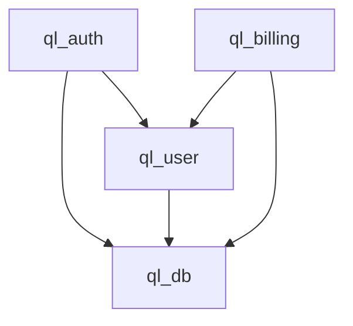
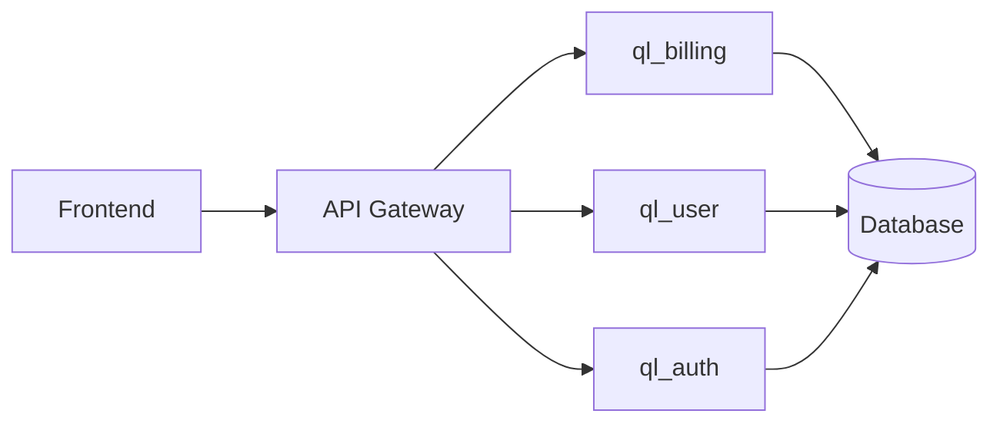

# Architecture Review Reference

## Architecture Evaluation Criteria

### 1. Module Boundaries & Separation of Concerns

| Criterion | Excellent (90-100) | Good (70-89) | Fair (50-69) | Poor (<50) |
|-----------|-------------------|--------------|--------------|------------|
| Boundary Clarity | Explicit, documented, enforced | Clear but not enforced | Implicit, some leakage | Unclear, significant leakage |
| Single Responsibility | Each module has one clear purpose | Most modules focused | Some modules mixed | God modules present |
| Interface Contracts | Well-defined, versioned, validated | Defined but not validated | Informal | None |

**Red Flags:**
- Circular dependencies between modules
- Shared mutable state across boundaries
- Business logic in infrastructure layers
- Presentation logic in domain layers
- Database schema leaking into domain models

### 2. Dependency Direction & Layering

| Criterion | Excellent | Good | Fair | Poor |
|-----------|-----------|------|------|------|
| Dependency Rule | Strict: inner never depends on outer | Mostly followed | Frequent violations | Inverted dependencies |
| Layering | Clean: domain → application → infrastructure | Mostly clean | Mixed | No layering |
| Shared Kernel | Minimal, well-defined | Some shared | Excessive shared | Everything shared |

**Check:** `pnpm ls --depth=0` / `cargo tree` / `go mod graph` for cycles

### 3. Cohesion & Coupling

| Metric | Target | Warning | Critical |
|--------|--------|---------|----------|
| Afferent Coupling (Ca) | Low for domain, high for shared | Domain Ca > 5 | Domain Ca > 10 |
| Efferent Coupling (Ce) | Low for all | Ce > 10 | Ce > 20 |
| Instability (I = Ce/(Ca+Ce)) | Domain: ~0, Shared: ~1 | Domain I > 0.2 | Domain I > 0.5 |
| Abstractness | High for domain, low for concrete | Domain A < 0.5 | Domain A < 0.3 |

### 4. Domain Boundaries (DDD)

| Pattern | Assessment |
|---------|------------|
| Bounded Contexts | Explicit, aligned with business capabilities |
| Aggregates | Consistency boundaries respected |
| Domain Events | Used for cross-aggregate communication |
| Repositories | Abstract persistence, not leaky |
| Value Objects | Immutable, no identity |
| Entities | Identity + lifecycle management |

### 5. Runtime Architecture

| Aspect | Evaluation |
|--------|------------|
| Process Boundaries | Monolith, modular monolith, services |
| Communication | Sync (REST/gRPC), Async (events/message queue) |
| State Management | Stateless, session, distributed cache |
| Failure Isolation | Bulkheads, circuit breakers, timeouts |
| Observability | Logs, metrics, traces, correlation IDs |

### 6. Configuration Architecture

| Aspect | Good Practice | Anti-Pattern |
|--------|---------------|--------------|
| Config Source | Env vars, config files, secrets manager | Hardcoded, checked-in secrets |
| Config Validation | Schema validation at startup | No validation, runtime failures |
| Feature Flags | Explicit, documented, removable | Scattered conditionals |
| Environment Parity | Same config schema, different values | Different schemas per env |

### 7. Extensibility & Plugin Architecture

| Criterion | Assessment |
|-----------|------------|
| Extension Points | Well-defined interfaces, documented |
| Plugin Isolation | Sandboxed, versioned, hot-reloadable |
| Core Stability | Core changes don't break plugins |
| Discovery | Automatic or explicit registration |

### 8. Architecture Decision Records

| Requirement | Status |
|-------------|--------|
| ADRs exist for major decisions | Yes/No |
| ADRs are current | Yes/No/Outdated |
| ADRs are discoverable | Yes/No |
| ADRs include trade-offs | Yes/No |

## Common Architectural Smells

| Smell | Detection | Impact |
|-------|-----------|--------|
| God Module | Single module > 20% of codebase | Change coupling, testing difficulty |
| Circular Dependency | `import A from B; import B from A` | Deployment coupling, reasoning difficulty |
| Leaky Abstraction | Implementation details in interface | Coupling to implementation |
| Distributed Monolith | Services share DB, deploy together | Microservice complexity without benefits |
| Anemic Domain | Logic in services, not domain objects | Business rules scattered |
| Fat Interface | Interface with many unused methods | Implementation burden, ISP violation |
| Premature Abstraction | Abstract for hypothetical future | Unnecessary complexity |
| Configuration Explosion | Too many env vars / config options | Operational complexity |

## Architecture Map Template

```markdown
# Architecture Map — [Project]

## Module Responsibility Map

| Module | Responsibility | Domain | Dependencies | Consumers |
|--------|---------------|--------|--------------|-----------|
| ql_auth | Authentication & authorization | Security | ql_user, crypto | All |
| ql_user | User management | Identity | ql_db | ql_auth, ql_billing |

## Dependency Graph



## Data Flow Map



## Critical Workflow: User Registration

1. UI → POST /api/auth/register
2. API → ql_auth.register()
3. ql_auth → ql_user.create()
4. ql_user → DB INSERT
5. ql_auth → send verification email
6. API → 201 Created

## Failure Boundaries

| Boundary | Isolation Mechanism | Blast Radius |
|----------|---------------------|--------------|
| Auth service | Circuit breaker, timeout | Auth only |
| Billing service | Queue, retry, DLQ | Billing delayed |
| Database | Read replicas, connection pool | Read degraded |

## Migration Difficulty Assessment

| Change | Difficulty | Reason |
|--------|------------|--------|
| Split ql_user from ql_auth | HIGH | Tight coupling, shared DB |
| Add new payment provider | LOW | ql_billing uses adapter pattern |
| Migrate to microservices | VERY HIGH | Distributed monolith currently |