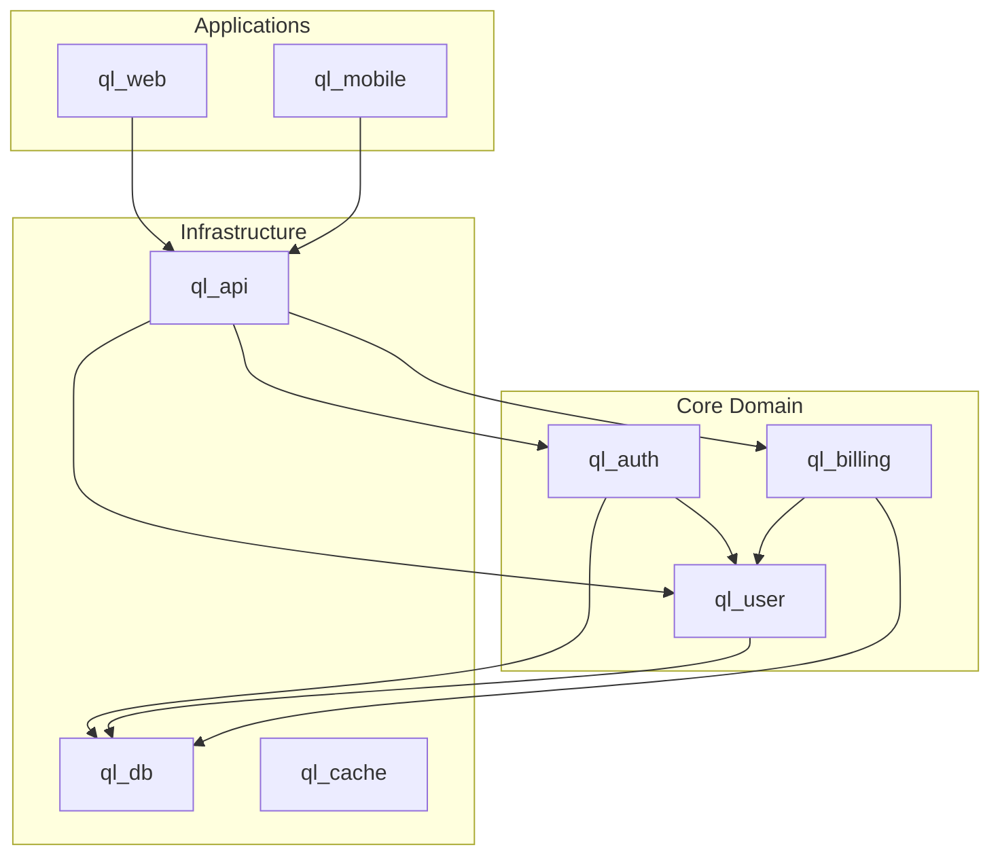
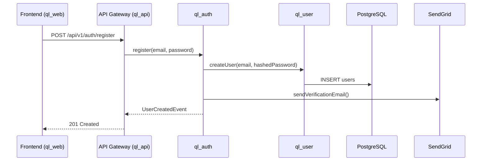
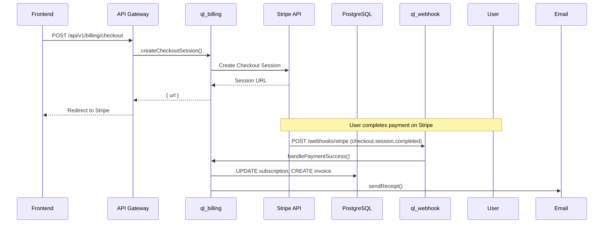
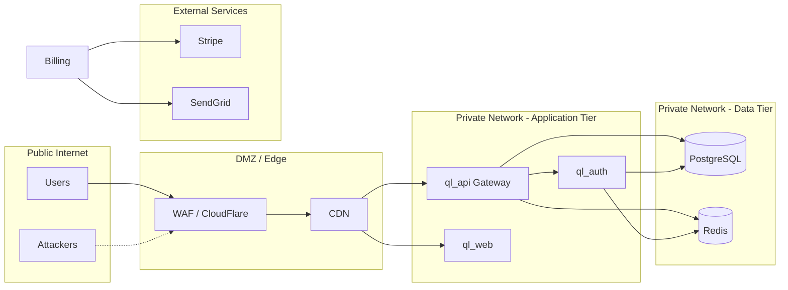
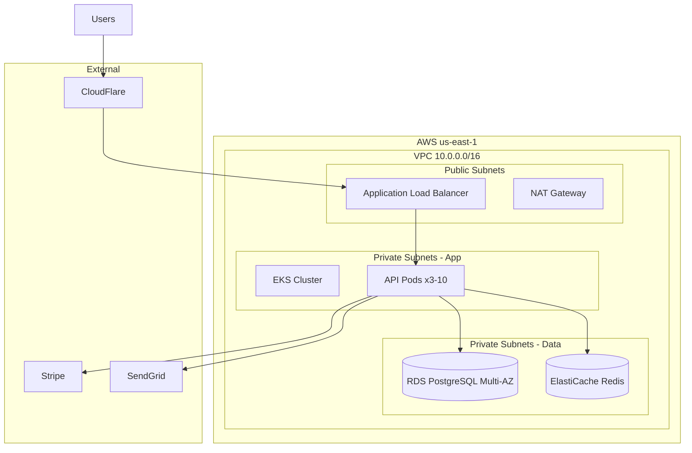
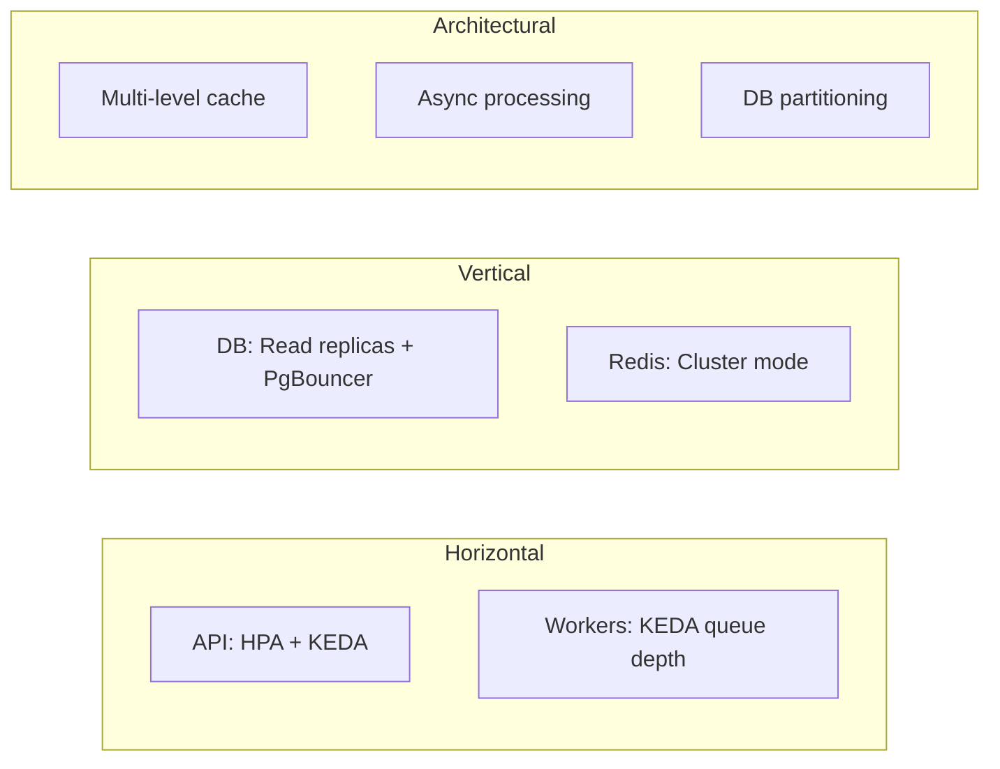

# Architecture Map Template

**Review ID:** UR-<REVIEW_ID>
**Project:** <Project Name>
**Date:** <ISO Date>

---

## Module Responsibility Map

| Module | Responsibility | Domain | Type | Key Dependencies | Consumers | Owner |
|--------|---------------|--------|------|------------------|-----------|-------|
| ql_auth | Authentication & authorization | Security | Core | ql_user, ql_db, crypto | All | @team-security |
| ql_user | User management | Identity | Core | ql_db | ql_auth, ql_billing, ql_profile | @team-identity |
| ql_billing | Payment processing | Billing | Core | ql_user, ql_db, stripe | ql_webhook | @team-billing |
| ql_api | API gateway & routing | Platform | Infra | ql_auth, ql_user, ql_billing | External | @team-platform |
| ql_web | Frontend application | UI | App | ql_api, ql_ui | Users | @team-frontend |

---

## Dependency Graph

### Package Dependencies (Internal)



### External Dependencies

| Dependency | Purpose | Version | Risk |
|------------|---------|---------|------|
| PostgreSQL | Primary database | 15.x | Low |
| Redis | Caching, sessions | 7.x | Low |
| Stripe | Payments | 2023-10 | Medium (vendor) |
| SendGrid | Email | Latest | Low |
| S3 | File storage | API v4 | Low |

---

## Data Flow Maps

### Critical Workflow: User Registration



### Critical Workflow: Payment Processing



---

## Failure Boundaries

| Boundary | Components | Isolation Mechanism | Blast Radius | Recovery |
|----------|------------|---------------------|--------------|----------|
| Auth Zone | ql_auth | Circuit breaker (10s timeout), bulkhead (separate pool) | Auth only (login, token refresh) | Auto-recover on dependency restore |
| Billing Zone | ql_billing, Stripe | Queue (RabbitMQ), DLQ, idempotency keys | Billing operations delayed | Manual replay from DLQ |
| Database | PostgreSQL | Read replicas, connection pool (PgBouncer), max connections | Read degraded, writes blocked | Failover to replica, alert |
| Cache | Redis Cluster | Graceful degradation (cache miss → DB), TTL fallback | Performance degradation | Auto-reconnect, warmup |
| API Gateway | ql_api | Rate limiting, request timeout, circuit breaker per upstream | All external traffic | Auto-recover, health checks |

---

## Security Boundaries



### Trust Boundaries

| Boundary | Trust Level | Controls |
|----------|-------------|----------|
| Internet → Edge | Untrusted | WAF, rate limit, DDoS protection |
| Edge → API Gateway | Semi-trusted | TLS, API keys, JWT validation |
| API Gateway → Services | Trusted (internal) | mTLS, service mesh, mutual auth |
| Services → Database | Trusted (internal) | Network policies, least privilege roles |
| Services → External APIs | Untrusted | TLS, signed requests, webhook verification |

---

## Deployment Topology



### Environment Parity

| Environment | Infra | Config | Data | Purpose |
|-------------|-------|--------|------|---------|
| Local | Docker Compose | `.env.local` | Seed | Development |
| Preview | Kubernetes (namespace) | ConfigMap/Secret | Anonymized subset | PR validation |
| Staging | Kubernetes (cluster) | ConfigMap/Secret | Production-like | Integration testing |
| Production | Kubernetes (cluster) | ConfigMap/Secret + Vault | Production | Live traffic |

---

## Migration Difficulty Assessment

| Change | Difficulty | Reason | Strategy |
|--------|------------|--------|----------|
| Split ql_user from ql_auth | HIGH | Tight coupling, shared DB tables, circular deps | Strangler fig: new service, dual write, migrate |
| Add new payment provider | LOW | ql_billing uses adapter pattern | Implement PaymentProvider interface |
| Migrate to microservices | VERY HIGH | Distributed monolith, shared DB, sync calls | Domain-driven, incremental extraction |
| Upgrade PostgreSQL 14→16 | MEDIUM | Version jump, extension changes | Blue-green, test on staging first |
| Extract ql_cache as separate service | MEDIUM | Currently embedded, used by 5 packages | Library first, then service if needed |

---

## Scaling Architecture

### Current Capacity

| Component | Current | Limit | Headroom | Scaling Trigger |
|-----------|---------|-------|----------|-----------------|
| API Pods | 3 | 10 (HPA) | 3x | CPU > 70% |
| DB Connections | 50 | 200 (PgBouncer) | 4x | Pool > 80% |
| Redis Memory | 2GB | 10GB | 5x | Memory > 75% |
| Queue Consumers | 2 | 10 | 5x | Lag > 5 min |

### Scaling Strategy



---

## Observability Map

### Key Metrics by Component

| Component | RED Metrics | USE Metrics | Business Metrics |
|-----------|-------------|-------------|------------------|
| ql_api | Rate, Errors, Duration | CPU, Mem, Connections | Active users, Request volume |
| ql_auth | Rate, Errors, Duration | CPU, Mem, Token ops | Login success rate, MFA adoption |
| ql_user | Rate, Errors, Duration | CPU, Mem, DB pool | User growth, Profile completion |
| ql_billing | Rate, Errors, Duration | CPU, Mem, Queue depth | Revenue, Churn, Payment success |
| PostgreSQL | Query rate, Error rate, Latency | CPU, Mem, Connections, Disk | Active connections, Replication lag |
| Redis | Ops/sec, Error rate, Latency | CPU, Mem, Connections | Hit ratio, Evictions |

### Distributed Tracing

```
Trace: User Registration
├── Span: HTTP POST /api/v1/auth/register (ql_api)
│   ├── Span: Auth.register() (ql_auth)
│   │   ├── Span: User.createUser() (ql_user)
│   │   │   └── Span: DB INSERT users (PostgreSQL)
│   │   └── Span: Email.sendVerification() (SendGrid)
│   └── Span: Event publish (Kafka)
```

---

## Architecture Decision Records (ADR Index)

| ADR | Title | Status | Date | Supersedes |
|-----|-------|--------|------|------------|
| ADR-001 | Use modular monolith with ql_* packages | Accepted | 2024-01 | - |
| ADR-002 | PostgreSQL as primary database | Accepted | 2024-01 | - |
| ADR-003 | JWT with RS256 for auth tokens | Accepted | 2024-02 | - |
| ADR-004 | Stripe for payments, adapter pattern | Accepted | 2024-03 | - |
| ADR-005 | Event-driven billing with Kafka | Proposed | 2024-11 | - |

---

## Risk Heat Map

| Component | Coupling | Complexity | Change Frequency | Defect Density | Risk Level |
|-----------|----------|------------|------------------|----------------|------------|
| ql_auth | HIGH | MEDIUM | LOW | LOW | MEDIUM |
| ql_user | MEDIUM | LOW | MEDIUM | LOW | LOW |
| ql_billing | HIGH | HIGH | HIGH | MEDIUM | HIGH |
| ql_api | MEDIUM | MEDIUM | HIGH | LOW | MEDIUM |
| ql_db | LOW | LOW | LOW | LOW | LOW |

---

## Notes

<Additional observations, constraints, or context for architects>