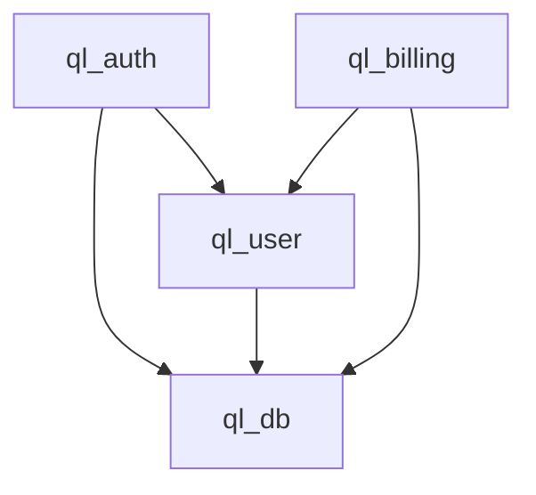

# ULTRA REVIEW REPORT

**Review ID:** UR-<YYYY-MM-DD>-<SEQ>
**Project:** <Project Name>
**Repository:** <URL or path>
**Date:** <ISO Date>
**Reviewer:** <Agent identifier>
**Mode:** <SCAN | DEEP | COSMIC | SPECIALIZED: <mode>>

---

## 1. Executive Summary

**Overall Condition:** <HEALTHY | CONCERNING | CRITICAL>

**Primary Engineering Risks:**
1. <Risk 1>
2. <Risk 2>
3. <Risk 3>

**Key Metrics:**
- Files reviewed: <count>
- Lines of code in scope: <count>
- Passes executed: <list>
- Coverage: <percentage of relevant codebase>
- Critical findings: <count>
- High findings: <count>
- Medium findings: <count>
- Verified defects: <count>
- Strategic recommendations: <count>

**Bottom Line:** <2-3 sentence honest assessment>

---

## 2. Project Understanding

### Product
- **Purpose:** <What problem does this solve?>
- **Target Users:** <Who uses this?>
- **Key Workflows:** <Primary user journeys>
- **Business Context:** <Revenue model, stage, constraints>

### Domain
- **Core Entities:** <Domain models>
- **Business Rules:** <Critical invariants>
- **External Dependencies:** <Third-party services, APIs>

### Architecture
- **Style:** <Monolith, modular monolith, microservices, serverless>
- **Language/Framework:** <Primary stack>
- **Data Layer:** <Database, ORM, patterns>
- **Communication:** <REST, GraphQL, gRPC, events>
- **Deployment:** <Container, VM, serverless, edge>

---

## 3. Review Scope

### Included
- <Package/module/path 1>
- <Package/module/path 2>
- ...

### Excluded
- <Area> — <Reason: out of scope, not accessible, low priority, etc.>

### Scope Rationale
<Why this scope for this mode>

---

## 4. Investigation Coverage

| Area | Method | Coverage | Limitations |
|------|--------|----------|-------------|
| Repository structure | glob, tree | 100% | |
| Architecture docs | Read | 80% | Some outdated |
| Source code (target) | Read, grep, static analysis | 90% | Generated files skipped |
| Tests | Read, execute | 70% | E2E not run |
| Database | Schema inspection | 100% | No production data |
| CI/CD | Workflow review | 100% | No execution |
| Infrastructure | Config review | 60% | No cluster access |

**Total Effective Coverage:** <percentage with explanation>

---

## 5. Architecture Overview

### Module Responsibility Map

| Module | Responsibility | Domain | Key Dependencies | Consumers |
|--------|---------------|--------|------------------|-----------|
| ql_auth | Authentication | Security | ql_user, crypto | All |
| ql_user | User management | Identity | ql_db | ql_auth, ql_billing |

### Dependency Graph



### Critical Data Flows

1. **User Registration:** UI → API → ql_auth → ql_user → DB → Email
2. **Payment Processing:** UI → API → ql_billing → Payment Gateway → DB → Webhook

### Failure Boundaries

| Boundary | Isolation | Blast Radius |
|----------|-----------|--------------|
| Auth service | Circuit breaker, timeout | Auth only |
| Billing | Queue, retry, DLQ | Billing delayed |

---

## 6. Engineering Scorecard

| Dimension | Score (0-100) | Confidence | Summary |
|-----------|---------------|------------|---------|
| Product Alignment | | | |
| Architecture | | | |
| Code Quality | | | |
| Security | | | |
| Database & Data Integrity | | | |
| API Quality | | | |
| Performance | | | |
| Reliability | | | |
| Testing | | | |
| UI/UX | | | |
| DevEx | | | |
| Documentation | | | |
| Maintainability | | | |
| Scalability | | | |
| Operational Readiness | | | |

**Overall Score:** <weighted average> / 100

**Score Explanation:** <How calculated, any dimension dragging down>

---

## 7. Critical Findings

| ID | Title | Severity | Confidence | Priority | Module |
|----|-------|----------|------------|----------|--------|
| UR-XXX-001 | <Title> | CRITICAL | CONFIRMED | P0 | <module> |
| UR-XXX-002 | <Title> | HIGH | HIGH | P1 | <module> |

---

## 8. Detailed Findings

### Finding UR-XXX-001

**Title:** <Descriptive title>
**Category:** <Security | Architecture | Code Quality | Performance | etc.>
**Severity:** <CRITICAL | HIGH | MEDIUM | LOW | INFO>
**Confidence:** <CONFIRMED | HIGH | MEDIUM | LOW | UNKNOWN>
**Priority:** <P0 | P1 | P2 | P3>
**Module:** <Package/module>
**File:** <path/to/file.ts:123>

**Evidence:**
```
<Code snippet, tool output, test result, or reproduction steps>
```

**Technical Explanation:**
<Detailed explanation of the issue>

**Root Cause:**
<Why this exists - architectural decision, oversight, missing pattern, etc.>

**Impact:**
<What happens if exploited/triggered - data loss, security breach, downtime, etc.>

**Reproduction:**
<Steps to reproduce, or "Not reproduced - inferred from code">

**Recommended Solution:**
<Specific, actionable fix>

**Alternative Solutions:**
1. <Alternative 1> — <Trade-off>
2. <Alternative 2> — <Trade-off>

**Validation Criteria:**
<How to verify the fix works>

**Dependencies:**
<Other findings or tasks that must complete first>

**Related Findings:**
<UR-XXX-005, UR-XXX-012>

---

## 9. Security Assessment

### Threat Model Summary
<STRIDE analysis highlights>

### Vulnerabilities Found
<Cross-reference to detailed findings>

### Security Posture
| Control | Status | Notes |
|---------|--------|-------|
| Authentication | | |
| Authorization | | |
| Input Validation | | |
| Secrets Management | | |
| Cryptography | | |
| Logging/Audit | | |
| Supply Chain | | |
| Infrastructure | | |

---

## 10. Reliability & Performance

### Failure Scenarios Analyzed
| Scenario | Likelihood | Impact | Mitigation |
|----------|------------|--------|------------|

### Bottlenecks Identified
| Component | Metric | Current | Target | Gap |

### Scaling Limits
| Component | Current Limit | Projected Limit | Trigger |

---

## 11. Architectural Assessment

### Strengths
- <Strength 1>
- <Strength 2>

### Weaknesses
- <Weakness 1>
- <Weakness 2>

### Structural Risks
| Risk | Likelihood | Impact | Mitigation |
|------|------------|--------|------------|

### Technical Debt Hotspots
| Area | Debt Type | Estimated Remediation |
|------|-----------|----------------------|

---

## 12. Existing Strengths

*What is already good and should be preserved*

1. <Strength 1> — <Evidence>
2. <Strength 2> — <Evidence>
3. <Strength 3> — <Evidence>

---

## 13. Improvement Opportunities

| # | Opportunity | Type | Effort | Impact | Priority |
|---|-------------|------|--------|--------|----------|
| 1 | <Description> | <Quick win | Refactor | Migration> | <S/M/L> | <High/Med/Low> | <P1/P2/P3> |

---

## 14. Prioritized Engineering Roadmap

### Immediate (P0) — This Week
- [ ] <Task from critical findings>

### Short-term (P1) — Next Sprint
- [ ] <Task from high findings>

### Medium-term (P2) — Next 1-2 Months
- [ ] <Task from medium findings>

### Long-term (P3) — Next Quarter+
- [ ] <Strategic improvements>

### Parallelizable Tracks
- Track A: <Independent work>
- Track B: <Independent work>

---

## 15. Validation Results

| Check | Command | Result | Evidence |
|-------|---------|--------|----------|
| TypeScript compile | `tsc --noEmit` | PASS/FAIL | <Output summary> |
| ESLint | `eslint .` | PASS/FAIL | <Error count> |
| Unit tests | `pnpm test` | PASS/FAIL | <Pass/fail counts> |
| Build | `pnpm build` | PASS/FAIL | <Artifacts> |
| Security audit | `npm audit` | PASS/FAIL | <Vuln count> |
| Dependency check | `pnpm outdated` | INFO | <Count> |

---

## 16. Limitations & Unknowns

| Area | Unknown | Blocker | Risk if Wrong |
|------|---------|---------|---------------|
| <Area> | <What we don't know> | <Why blocked> | <Impact> |

---

## 17. Final Engineering Verdict

**Readiness Assessment:** <PRODUCTION_READY | NEEDS_WORK | NOT_READY>

**Condition Summary:**
<Honest 3-5 paragraph assessment covering: what works, what doesn't, biggest risks, whether the system can sustain its current trajectory, and what must change>

**Recommendation:**
<Clear, actionable recommendation for leadership>

---

## Appendix: Finding Index

| ID | Severity | Confidence | Priority | Title | Module |
|----|----------|------------|----------|-------|--------|
| UR-XXX-001 | CRITICAL | CONFIRMED | P0 | ... | ... |
| UR-XXX-002 | HIGH | HIGH | P1 | ... | ... |
...