# Grand Strategic Tracks Technical Specifications: Groups C & D (Tracks 11 – 20)

**Domain Focus**:
- **Group C: Spatial HUD, Visual World & Atmosphere** (Tracks 11 – 15)
- **Group D: Harbor Community, Ethics & Governance** (Tracks 16 – 20)

**Architectural Governance & Compliance**:
- All data persistence, schemas, ACL, and view declarations strictly follow `packages/ql_*` using TypeScript and the QlOrm runtime engine. **Strictly NO Drizzle ORM, NO Drizzle schema definitions, and NO SQL migration files**.
- All browser/web client network communications strictly use `@moonwitness/moonclient` via the singleton `moonClient`. **Raw `fetch`, `axios`, or direct DB/ORM access in web code is strictly prohibited**.
- All UI components are authored as reusable composites under `@moonwitness/ui`, utilizing CSS tokens from `tokens.css`, state classes (`.is-*`), and prop-driven copy linked to `ql_i18n` catalogs (`id.po` / `en.po`).
- Anti-Slop rules (Purpose Gate, Hard Gate, Quality Locks) and WCAG 2.2 AA accessibility standards are enforced across all visual interfaces.

---

## Group C: Spatial HUD, Visual World & Atmosphere

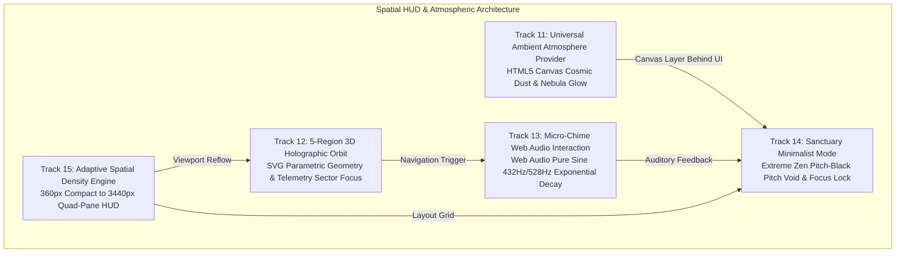

---

### 🔹 Track 11: Universal Ambient Atmosphere Provider

#### 1. System Architecture & Interaction Flow
The Universal Ambient Atmosphere Provider renders a lightweight, serene cosmic stardust canvas behind application surfaces. The engine uses double-buffered HTML5 Canvas with an optimized `requestAnimationFrame` loop maintaining 60 FPS while keeping sustained CPU utilization below 1.0%.

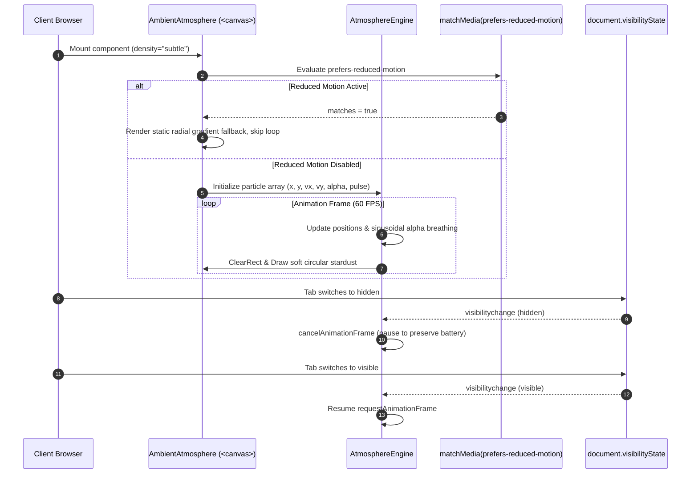

- **Particle Physics**: Stardust particles drift along slow linear trajectories with wrapped toroidal boundary conditions (`x = (x + vx) % width`). Opacity is modulated via sinusoidal breathing: `alpha = baseAlpha + amplitude * Math.sin(timestamp * frequency)`.
- **Memory & Resource Discipline**: Particles are allocated in a fixed-size TypedArray or pre-allocated object pool to prevent garbage collection spikes. Particle counts are clamped: Zen = 25 particles, Subtle = 50 particles, Stellar = 90 particles.
- **Accessibility & Battery Conservation**: Automatically suspends whenever `document.hidden === true` or when the user enables `prefers-reduced-motion`.

#### 2. Concrete TypeScript Component Interfaces / Signatures
```typescript
import type { CSSProperties, ReactElement, Ref } from "react";

export type AtmosphereDensity = "zen" | "subtle" | "stellar" | "disabled";

export interface AtmosphereParticle {
  x: number;
  y: number;
  vx: number;
  vy: number;
  radius: number;
  baseAlpha: number;
  alpha: number;
  pulseSpeed: number;
  pulsePhase: number;
}

export interface AmbientAtmosphereProps {
  /** Visual particle density preset. Defaults to "subtle". */
  density?: AtmosphereDensity;
  /** Custom particle count override (clamped between 10 and 120). */
  particleCount?: number;
  /** Whether mouse movements introduce gentle particle drift deflection. Default: false. */
  interactive?: boolean;
  /** Speed multiplier for particle motion (0.1 to 2.0). Default: 1.0. */
  speedMultiplier?: number;
  /** Optional class name merged via `cn(...)`. */
  className?: string;
  /** Optional inline styles. Must strictly conform to token references. */
  style?: CSSProperties;
  /** Ref to underlying HTMLCanvasElement. */
  canvasRef?: Ref<HTMLCanvasElement>;
}

export interface AtmosphereEngineConfig {
  canvas: HTMLCanvasElement;
  density: AtmosphereDensity;
  particleCount: number;
  interactive: boolean;
  speedMultiplier: number;
  prefersReducedMotion: boolean;
}

export declare function AmbientAtmosphere(props: AmbientAtmosphereProps): ReactElement;
```

#### 3. QlOrm Model Declarations & Field Constraints
User preferences for atmospheric intensity are stored in the user profile/preference model in `packages/ql_auth` or `packages/ql_base`:

```typescript
import type { QlModelDefinition } from "ql_orm";

export const ATMOSPHERE_DENSITIES = ["zen", "subtle", "stellar", "disabled"] as const;

export const userAtmospherePreference: QlModelDefinition = {
  name: "auth.atmosphere_preference",
  labelKey: "web.models.entities.auth_atmosphere_preference",
  description: "User ambient canvas atmosphere and visual particle density settings.",
  tableName: "auth_atmosphere_preference",
  ownerField: "owner_id",
  fields: {
    density: {
      type: "char",
      required: true,
      default: "subtle",
      maxLength: 16,
      options: ATMOSPHERE_DENSITIES,
      validator(value) {
        return ATMOSPHERE_DENSITIES.includes(value as (typeof ATMOSPHERE_DENSITIES)[number])
          ? undefined
          : `density must be one of: ${ATMOSPHERE_DENSITIES.join(", ")}`;
      },
    },
    interactive_drift: {
      type: "boolean",
      required: true,
      default: false,
    },
    speed_factor: {
      type: "integer",
      required: true,
      default: 100, // Stored as percentage integer (100 = 1.0x)
      minValue: 10,
      maxValue: 200,
    },
    owner_id: {
      type: "char",
      required: true,
      maxLength: 64,
      private: true,
    },
    created_at: {
      type: "datetime",
      required: true,
    },
    updated_at: {
      type: "datetime",
      required: true,
    },
  },
};
```

ACL Rules (`packages/ql_auth/__manifest__.ts`):
```typescript
{
  model: "auth.atmosphere_preference",
  group: "user",
  read: true,
  write: true,
  create: true,
  unlink: false,
}
```

#### 4. API Contracts & DTOs
```typescript
// packages/moonclient/src/index.ts

export interface UserAtmospherePreferenceDto {
  density: "zen" | "subtle" | "stellar" | "disabled";
  interactiveDrift: boolean;
  speedFactor: number;
}

export interface UpdateAtmospherePreferenceRequestDto {
  density?: "zen" | "subtle" | "stellar" | "disabled";
  interactiveDrift?: boolean;
  speedFactor?: number;
}

export interface AtmospherePreferenceResponseDto {
  preference: UserAtmospherePreferenceDto;
  updatedAt: string;
}

// Route extension in apiRoutes
export const apiRoutes = {
  // ...
  auth: {
    // ...
    atmospherePreference: "/auth/me/preferences/atmosphere",
  },
} as const;

// Typed MoonClient method extension
export class MoonClient {
  public async getAtmospherePreference(): Promise<AtmospherePreferenceResponseDto> {
    return this.request<AtmospherePreferenceResponseDto>(apiRoutes.auth.atmospherePreference);
  }

  public async updateAtmospherePreference(
    payload: UpdateAtmospherePreferenceRequestDto
  ): Promise<AtmospherePreferenceResponseDto> {
    return this.request<AtmospherePreferenceResponseDto>(apiRoutes.auth.atmospherePreference, {
      method: "PATCH",
      body: JSON.stringify(payload),
    });
  }
}
```

#### 5. UI / UX & Anti-Slop Specifications
- **Anti-Slop Dials**:
  - `ENERGY`: 1 (Subdued, serene, zero neon flicker or flash).
  - `RHYTHM`: 1 (Gentle continuous sinusoidal breathing, no abrupt leaps).
  - `MOTION`: 1 (Gliding velocity < 12px/sec, immediately halted on reduced motion).
- **Design Tokens**:
  - Canvas background: `--color-panel-deeper` (`#070918`).
  - Stardust glow: `--color-acid-shadow` (`#8a6a22`) with alpha 0.03 to 0.08.
  - Rare distant stars: `--color-ink-soft` (`#d3cbb8`) with radius 0.8px and alpha 0.05.
- **Purpose Gate (R-07, R-13, R-19)**:
  - *Why this canvas technique?* To establish sacred cosmic space and spatial depth without competing with scripture text legibility.
  - *Hard limits*: Opacity capped at 0.08 max. Canvas is strictly `pointer-events-none` and `aria-hidden="true"`.
- **Dual-Theme Parity**:
  - Dark Mode: Deep indigo/void canvas with warm gold stardust.
  - Light Mode: Rich parchment canvas (`#f3ecda`) with subtle warm bronze dust motes (alpha 0.02 - 0.04).
- **WCAG 2.2 AA Compliance**:
  - Contrast between foreground typography (`--color-ink`) and canvas background remains ≥ 18:1.
  - Mandatory `@media (prefers-reduced-motion: reduce)` handler disables the canvas render loop completely.

#### 6. Phased Implementation Roadmap
- **Phase 1: Foundation (Canvas Core & Lifecycle)**
  - Implement canvas lifecycle hook `useAtmosphereCanvas` with resize debouncing and `requestAnimationFrame` cleanup.
  - Implement `prefers-reduced-motion` and `document.hidden` auto-pause listeners.
- **Phase 2: Addon & Preferences Integration**
  - Add `auth.atmosphere_preference` QlOrm model and seed default records.
  - Add API endpoint and `@moonwitness/moonclient` methods.
- **Phase 3: Visual Polish & Performance Hardening**
  - Benchmark frame pacing on low-power devices; enforce <1% CPU utilization ceiling.
  - Integrate with `SanctuaryMinimalistMode` (Track 14) for seamless fade-to-black.

#### 7. Verification Rubrics & Acceptance Criteria
- **Automated Test Commands**:
  ```bash
  pnpm --filter @moonwitness/ui test -- tests/ambient-atmosphere.test.tsx
  pnpm --filter @moonwitness/moonclient test -- src/index.test.ts
  ```
- **Integrity Invariants**:
  1. If `window.matchMedia('(prefers-reduced-motion: reduce)').matches` is true, `requestAnimationFrame` is called 0 times.
  2. Memory footprint stays constant: 0 new object allocations inside the 60 FPS animation loop.
  3. Sustained CPU utilization stays below 1.0% in Chrome DevTools performance traces.

---

### 🔹 Track 12: 5-Region 3D Holographic Orbit

#### 1. System Architecture & Interaction Flow
The 5-Region 3D Holographic Orbit renders an interactive SVG orbital ring visualizing the 5 strategic regions of the MoonWitness Command Center:
1. `revelation`: Revelation Archive (Mushaf & Classical Readings)
2. `hermeneutics`: Hermeneutic Core (Cross-Surah Graph & Tafsir Engine)
3. `sanad`: Epistemic Sanad (Review Pipeline & Scholar Accreditation)
4. `harbor`: Harbor Concourse (Collaborative Study Circles & Deeds Ledger)
5. `telemetry`: Fleet Operability (Orbit Health, Cloudflare Connectors & API Gateways)

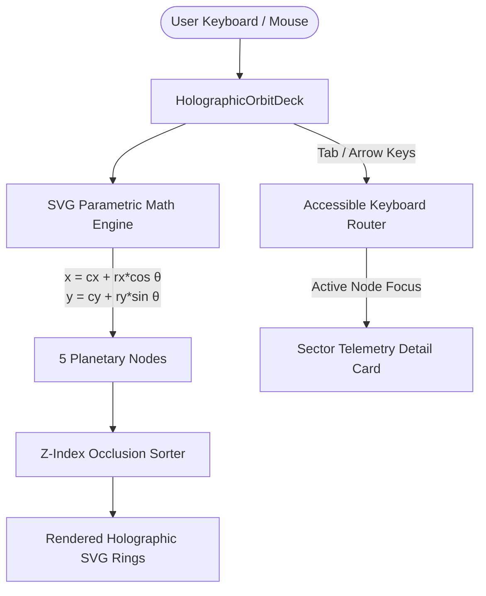

- **Geometry & Math**: Uses an inclined orbital projection:
  $$\begin{aligned}
  x(\theta) &= c_x + r_x \cos(\theta + \phi) \\
  y(\theta) &= c_y + r_y \sin(\theta + \phi) \sin(\text{inclination}) \\
  \text{scale}(\theta) &= 0.75 + 0.25 \frac{\sin(\theta + \phi) + 1}{2}
  \end{aligned}$$
  where $\phi$ is the active rotation angle and inclination is fixed at $28^\circ$.
- **Interaction & Selection**: Clicking a planetary node or pressing `ArrowLeft`/`ArrowRight` smoothly rotates the orbit to place the selected region at the prominent front focus ($y_{\max}$).

#### 2. Concrete TypeScript Component Interfaces / Signatures
```typescript
import type { KeyboardEvent, ReactElement } from "react";

export type CommandRegionId =
  | "revelation"
  | "hermeneutics"
  | "sanad"
  | "harbor"
  | "telemetry";

export interface OrbitRegionNode {
  id: CommandRegionId;
  label: string;
  tagline: string;
  href: string;
  thetaRad: number; // Angle on orbital plane (0 to 2*PI)
  status: "nominal" | "active" | "alert";
  metricLabel: string;
  metricValue: string;
}

export interface HolographicOrbitDeckProps {
  /** The 5 active region nodes with current telemetry. */
  regions: OrbitRegionNode[];
  /** Currently selected/focused region ID. */
  activeRegionId: CommandRegionId;
  /** Selection callback invoked when user clicks or selects a region. */
  onSelectRegion: (regionId: CommandRegionId) => void;
  /** Whether the orbit slowly auto-rotates when idle. Default: false. */
  autoRotate?: boolean;
  /** Optional class override. */
  className?: string;
}

export interface OrbitNodePosition {
  x: number;
  y: number;
  scale: number;
  opacity: number;
  zIndex: number;
}

export declare function HolographicOrbitDeck(props: HolographicOrbitDeckProps): ReactElement;
```

#### 3. QlOrm Model Declarations & Field Constraints
The 5 strategic regions and their system operational metadata are defined in `ql_base` (or `ql_dashboard`):

```typescript
import type { QlModelDefinition } from "ql_orm";

export const REGION_STATUSES = ["nominal", "active", "alert"] as const;

export const telemetryRegionNode: QlModelDefinition = {
  name: "telemetry.region_node",
  labelKey: "web.models.entities.telemetry_region_node",
  description: "Platform strategic command center regions and live telemetry anchor.",
  tableName: "telemetry_region_node",
  fields: {
    region_id: {
      type: "char",
      required: true,
      unique: true,
      maxLength: 32,
    },
    name: {
      type: "char",
      required: true,
      maxLength: 100,
    },
    route_path: {
      type: "char",
      required: true,
      maxLength: 120,
    },
    display_order: {
      type: "integer",
      required: true,
      minValue: 1,
      maxValue: 10,
    },
    status: {
      type: "char",
      required: true,
      default: "nominal",
      maxLength: 16,
      options: REGION_STATUSES,
    },
    health_score: {
      type: "integer",
      required: true,
      default: 100,
      minValue: 0,
      maxValue: 100,
    },
    is_active: {
      type: "boolean",
      required: true,
      default: true,
    },
    created_at: {
      type: "datetime",
      required: true,
    },
    updated_at: {
      type: "datetime",
      required: true,
    },
  },
};
```

ACL Rules (`packages/ql_base/__manifest__.ts`):
```typescript
{
  model: "telemetry.region_node",
  group: "user",
  read: true,
  write: false,
  create: false,
  unlink: false,
},
{
  model: "telemetry.region_node",
  group: "admin",
  read: true,
  write: true,
  create: true,
  unlink: false,
}
```

Seed Data (`packages/ql_base/data/region_nodes.ts`):
```typescript
import type { QlSeedDataRecord } from "ql_orm";

export const regionNodesSeedData: readonly QlSeedDataRecord[] = [
  {
    id: "region_revelation",
    model: "telemetry.region_node",
    key: { field: "region_id", value: "revelation" },
    updatePolicy: "reconcile",
    values: {
      region_id: "revelation",
      name: "Revelation Archive",
      route_path: "/corpus/reader",
      display_order: 1,
      status: "nominal",
      health_score: 100,
      is_active: true,
      created_at: Date.now(),
      updated_at: Date.now(),
    },
  },
  {
    id: "region_hermeneutics",
    model: "telemetry.region_node",
    key: { field: "region_id", value: "hermeneutics" },
    updatePolicy: "reconcile",
    values: {
      region_id: "hermeneutics",
      name: "Hermeneutic Core",
      route_path: "/research/graph",
      display_order: 2,
      status: "nominal",
      health_score: 100,
      is_active: true,
      created_at: Date.now(),
      updated_at: Date.now(),
    },
  },
  {
    id: "region_sanad",
    model: "telemetry.region_node",
    key: { field: "region_id", value: "sanad" },
    updatePolicy: "reconcile",
    values: {
      region_id: "sanad",
      name: "Epistemic Sanad",
      route_path: "/workflow/review",
      display_order: 3,
      status: "nominal",
      health_score: 100,
      is_active: true,
      created_at: Date.now(),
      updated_at: Date.now(),
    },
  },
  {
    id: "region_harbor",
    model: "telemetry.region_node",
    key: { field: "region_id", value: "harbor" },
    updatePolicy: "reconcile",
    values: {
      region_id: "harbor",
      name: "Harbor Concourse",
      route_path: "/community/circles",
      display_order: 4,
      status: "nominal",
      health_score: 100,
      is_active: true,
      created_at: Date.now(),
      updated_at: Date.now(),
    },
  },
  {
    id: "region_telemetry",
    model: "telemetry.region_node",
    key: { field: "region_id", value: "telemetry" },
    updatePolicy: "reconcile",
    values: {
      region_id: "telemetry",
      name: "Fleet Operability",
      route_path: "/command-center/telemetry",
      display_order: 5,
      status: "nominal",
      health_score: 100,
      is_active: true,
      created_at: Date.now(),
      updated_at: Date.now(),
    },
  },
];
```

#### 4. API Contracts & DTOs
```typescript
// packages/moonclient/src/index.ts

export interface RegionTelemetryDto {
  regionId: string;
  name: string;
  routePath: string;
  status: "nominal" | "active" | "alert";
  healthScore: number;
  activeSessions: number;
  lastUpdated: string;
}

export interface RegionalTelemetryResponseDto {
  regions: RegionTelemetryDto[];
  systemStatus: "healthy" | "degraded";
  timestamp: string;
}

export const apiRoutes = {
  // ...
  dashboard: {
    regionalTelemetry: "/dashboard/regions/telemetry",
  },
} as const;

export class MoonClient {
  public async getRegionalTelemetry(): Promise<RegionalTelemetryResponseDto> {
    return this.request<RegionalTelemetryResponseDto>(apiRoutes.dashboard.regionalTelemetry);
  }
}
```

#### 5. UI / UX & Anti-Slop Specifications
- **Anti-Slop Dials**:
  - `ENERGY`: 2 (Polished HUD glow, clear spatial differentiation).
  - `RHYTHM`: 3 (Varied orbital spacing with interactive depth occlusion).
  - `MOTION`: 2 (Smooth CSS transform transitions on rotation, 350ms ease-out).
- **Design Tokens**:
  - Orbit SVG ellipse stroke: `--color-hairline-soft` (`#2a2750`).
  - Active node border: `--color-acid` (`#f2c15e`).
  - Active node halo: `--color-acid-shadow` (`#8a6a22`) with capped blur (R-13).
  - Planetary card fill: `--color-panel-raised` (`#171a3d`).
- **Accessible Dual-Mode Presentation**:
  - Includes a prominent switch button allowing users to toggle between **Orbital Hologram** and **Accessible List Table** views.
  - Screen readers receive structured semantic `<ul>` / `<li>` markup with `role="region"` and `aria-current="true"` on the active node.
- **Purpose Gate (R-01, R-10, R-12)**:
  - Vector SVG rendering guarantees zero blur at 4K resolutions and zero multi-megabyte 3D asset downloads.

#### 6. Phased Implementation Roadmap
- **Phase 1: SVG Parametric Mathematics & Node Placement**
  - Implement ellipse geometry helper and depth-sorting logic.
  - Build static 5-node orbital presentation.
- **Phase 2: Interaction & Accessibility Engine**
  - Add keyboard arrow navigation and click-to-focus rotation.
  - Implement Accessible 2D Table mode toggle.
- **Phase 3: Realtime Telemetry Hookup**
  - Connect with `moonClient.getRegionalTelemetry()` and auto-refresh telemetry status pills.

#### 7. Verification Rubrics & Acceptance Criteria
- **Automated Test Commands**:
  ```bash
  pnpm --filter apps/web test -- src/features/dashboard/holographic-orbit-deck.test.tsx
  ```
- **Integrity Invariants**:
  1. Nodes with higher $y$ coordinates strictly receive higher SVG rendering z-index.
  2. Tab navigation cycles through all 5 regions with visible focus ring (`ring-2 ring-acid`).
  3. No raw HTML `<button>` or `<input>` used; strictly `@moonwitness/ui` controls.

---

### 🔹 Track 13: Micro-Chime Web Audio Interaction System

#### 1. System Architecture & Interaction Flow
The Micro-Chime interaction system provides gentle, sub-perceptual harmonic feedback upon meaningful user accomplishments (e.g., surah transition, covenant signature, review approval).

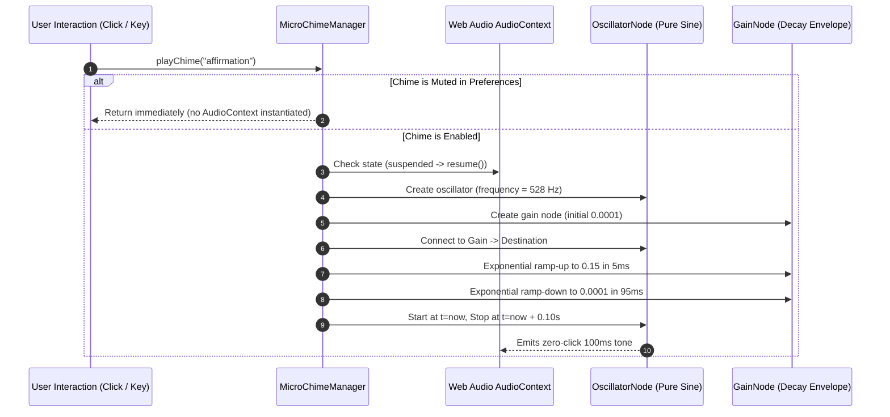

- **Sacred Harmonic Frequencies**:
  - `contemplation` (432 Hz): Used when entering Zen Mode or navigating between Surahs.
  - `affirmation` (528 Hz): Used upon successful peer review approval or covenant signing.
  - `transition` (648 Hz): Used for subtle command palette navigation.
- **Click-Free Gain Envelope**: Attack ramp of 5ms and exponential decay of 95ms completely prevents auditory speaker clicks/pops.
- **Strict User Consent (Default Muted)**: By default, audio is strictly **MUTED**. Audio will only sound after the user explicitly enables the Chime toggle.

#### 2. Concrete TypeScript Component Interfaces / Signatures
```typescript
import type { ReactElement } from "react";

export type MicroChimeTone = "contemplation" | "affirmation" | "transition";

export interface MicroChimeConfig {
  frequencyHz: number;
  durationMs: number;
  peakGain: number;
}

export interface MicroChimeController {
  play(tone: MicroChimeTone): void;
  isEnabled(): boolean;
  setEnabled(enabled: boolean): void;
  getVolume(): number;
  setVolume(volumePct: number): void;
}

export interface ChimeToggleProps {
  /** Whether the chime audio is currently enabled. */
  enabled: boolean;
  /** Callback fired when user toggles chime status. */
  onToggle: (nextState: boolean) => void;
  /** Optional class override. */
  className?: string;
  /** Visible label or tooltip text from i18n catalog. */
  label: string;
}

export declare function ChimeToggle(props: ChimeToggleProps): ReactElement;
export declare function useMicroChime(): MicroChimeController;
```

#### 3. QlOrm Model Declarations & Field Constraints
User chime state is recorded in `auth.user_preference` under `packages/ql_auth`:

```typescript
import type { QlModelDefinition } from "ql_orm";

export const userChimePreference: QlModelDefinition = {
  name: "auth.chime_preference",
  labelKey: "web.models.entities.auth_chime_preference",
  description: "User micro-chime auditory feedback preferences.",
  tableName: "auth_chime_preference",
  ownerField: "owner_id",
  fields: {
    enabled: {
      type: "boolean",
      required: true,
      default: false, // Strictly muted by default
    },
    volume_percent: {
      type: "integer",
      required: true,
      default: 50,
      minValue: 0,
      maxValue: 100,
    },
    preferred_tone: {
      type: "char",
      required: true,
      default: "contemplation",
      maxLength: 32,
      options: ["contemplation", "affirmation", "transition"],
    },
    owner_id: {
      type: "char",
      required: true,
      maxLength: 64,
      private: true,
    },
    created_at: {
      type: "datetime",
      required: true,
    },
    updated_at: {
      type: "datetime",
      required: true,
    },
  },
};
```

ACL Rules (`packages/ql_auth/__manifest__.ts`):
```typescript
{
  model: "auth.chime_preference",
  group: "user",
  read: true,
  write: true,
  create: true,
  unlink: false,
}
```

#### 4. API Contracts & DTOs
```typescript
// packages/moonclient/src/index.ts

export interface UserChimePreferenceDto {
  enabled: boolean;
  volumePercent: number;
  preferredTone: "contemplation" | "affirmation" | "transition";
}

export interface UpdateChimePreferenceRequestDto {
  enabled?: boolean;
  volumePercent?: number;
  preferredTone?: "contemplation" | "affirmation" | "transition";
}

export const apiRoutes = {
  // ...
  auth: {
    // ...
    chimePreference: "/auth/me/preferences/chime",
  },
} as const;

export class MoonClient {
  public async getChimePreference(): Promise<UserChimePreferenceDto> {
    return this.request<UserChimePreferenceDto>(apiRoutes.auth.chimePreference);
  }

  public async updateChimePreference(
    payload: UpdateChimePreferenceRequestDto
  ): Promise<UserChimePreferenceDto> {
    return this.request<UserChimePreferenceDto>(apiRoutes.auth.chimePreference, {
      method: "PATCH",
      body: JSON.stringify(payload),
    });
  }
}
```

#### 5. UI / UX & Anti-Slop Specifications
- **Anti-Slop Dials**:
  - `ENERGY`: 1 (Pristine, soft, zero looping audio or background drone).
  - `RHYTHM`: 1 (Single isolated 100ms tone only on intentional user milestone).
  - `MOTION`: 1 (Audio toggle icon transitions smoothly between `VolumeX` and `Volume2`).
- **Design Tokens**:
  - Button styling: `.ql-button--ghost` with `text-muted hover:text-acid`.
  - Active audio status indicator: `.text-acid bg-panel-well border-hairline`.
- **Purpose Gate (R-26, R-38)**:
  - *Why synthesized sine waves?* Avoids downloading MP3/WAV audio assets (zero network overhead, instant playback under 5ms latency).
  - *No Autoplay Violation*: AudioContext is initialized strictly upon user click or key gesture.

#### 6. Phased Implementation Roadmap
- **Phase 1: Web Audio Synthesis Engine**
  - Implement pure oscillator factory with exponential gain decay in `@moonwitness/ui/src/lib/micro-chime-engine.ts`.
- **Phase 2: UI Toggle & localStorage Cache**
  - Build `ChimeToggle` composite component and embed in `SanctuaryHeader`.
  - Store offline state in `localStorage` with server fallback via `moonClient`.
- **Phase 3: Integration Across Sacred Journeys**
  - Trigger chime upon Surah completion, Covenant signing, and CAB review approvals.

#### 7. Verification Rubrics & Acceptance Criteria
- **Automated Test Commands**:
  ```bash
  pnpm --filter @moonwitness/ui test -- tests/micro-chime.test.ts
  ```
- **Integrity Invariants**:
  1. Default audio state is strictly muted (`enabled === false`).
  2. If muted, `AudioContext.createOscillator()` is never invoked.
  3. Total tone duration does not exceed 120ms; audio pops are mathematically eliminated via exponential gain curve.

---

### 🔹 Track 14: Sanctuary Minimalist Mode (Extreme Zen Mode)

#### 1. System Architecture & Interaction Flow
Sanctuary Minimalist Mode (Extreme Zen) strips away all HUD chrome, navigation bars, sidebars, telemetry widgets, and secondary metadata to center the sacred Quranic text on an unblemished, pitch-black void canvas.

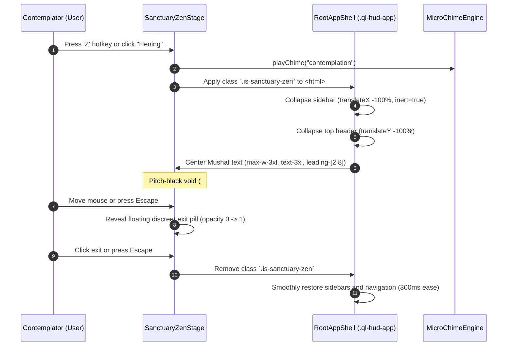

- **Layout State Invariant**: When `.is-sanctuary-zen` is active:
  - Header and sidebars are marked with `inert` and `aria-hidden="true"` to prevent background focus trapping.
  - The reading viewport is locked to standard flow without horizontal shifts.
  - Font scaling is elevated by +20% with generous line spacing (`leading-[2.8]`).

#### 2. Concrete TypeScript Component Interfaces / Signatures
```typescript
import type { ReactElement, ReactNode } from "react";

export interface SanctuaryZenStageProps {
  /** Revelation Arabic text (Madinah typography). */
  arabicText: string;
  /** Standard Quranic citation locator (e.g., "Surah Al-Kahf 18:10"). */
  citation: string;
  /** Optional translation text displayed in soft ink beneath the verse. */
  translationText?: string;
  /** Surah number for chapter context. */
  surahNumber: number;
  /** Ayah number for verse index. */
  ayahNumber: number;
  /** Callback invoked when the user exits Zen Mode. */
  onExit: () => void;
  /** Optional custom action slot (e.g. audio tilawah whisper player). */
  floatingActions?: ReactNode;
  /** Class override. */
  className?: string;
}

export interface UseSanctuaryZenResult {
  isZenActive: boolean;
  enterZen: () => void;
  exitZen: () => void;
  toggleZen: () => void;
}

export declare function SanctuaryZenStage(props: SanctuaryZenStageProps): ReactElement;
export declare function useSanctuaryZen(): UseSanctuaryZenResult;
```

#### 3. QlOrm Model Declarations & Field Constraints
Reading session preferences for Zen mode typography and font size are stored in `auth.user_preference`:

```typescript
import type { QlModelDefinition } from "ql_orm";

export const ZEN_FONT_SIZES = ["lg", "xl", "2xl", "3xl", "4xl"] as const;

export const userSanctuaryPreference: QlModelDefinition = {
  name: "auth.sanctuary_preference",
  labelKey: "web.models.entities.auth_sanctuary_preference",
  description: "User Zen Mode sanctuary reading preferences.",
  tableName: "auth_sanctuary_preference",
  ownerField: "owner_id",
  fields: {
    font_size: {
      type: "char",
      required: true,
      default: "3xl",
      maxLength: 16,
      options: ZEN_FONT_SIZES,
    },
    show_translation: {
      type: "boolean",
      required: true,
      default: true,
    },
    dim_atmosphere: {
      type: "boolean",
      required: true,
      default: true,
    },
    owner_id: {
      type: "char",
      required: true,
      maxLength: 64,
      private: true,
    },
    created_at: {
      type: "datetime",
      required: true,
    },
    updated_at: {
      type: "datetime",
      required: true,
    },
  },
};
```

ACL Rules (`packages/ql_auth/__manifest__.ts`):
```typescript
{
  model: "auth.sanctuary_preference",
  group: "user",
  read: true,
  write: true,
  create: true,
  unlink: false,
}
```

#### 4. API Contracts & DTOs
```typescript
// packages/moonclient/src/index.ts

export interface SanctuaryPreferenceDto {
  fontSize: "lg" | "xl" | "2xl" | "3xl" | "4xl";
  showTranslation: boolean;
  dimAtmosphere: boolean;
}

export interface UpdateSanctuaryPreferenceRequestDto {
  fontSize?: "lg" | "xl" | "2xl" | "3xl" | "4xl";
  showTranslation?: boolean;
  dimAtmosphere?: boolean;
}

export const apiRoutes = {
  // ...
  auth: {
    // ...
    sanctuaryPreference: "/auth/me/preferences/sanctuary",
  },
} as const;

export class MoonClient {
  public async getSanctuaryPreference(): Promise<SanctuaryPreferenceDto> {
    return this.request<SanctuaryPreferenceDto>(apiRoutes.auth.sanctuaryPreference);
  }

  public async updateSanctuaryPreference(
    payload: UpdateSanctuaryPreferenceRequestDto
  ): Promise<SanctuaryPreferenceDto> {
    return this.request<SanctuaryPreferenceDto>(apiRoutes.auth.sanctuaryPreference, {
      method: "PATCH",
      body: JSON.stringify(payload),
    });
  }
}
```

#### 5. UI / UX & Anti-Slop Specifications
- **Anti-Slop Dials**:
  - `ENERGY`: 1 (Complete visual stillness, pitch void, total focus).
  - `RHYTHM`: 1 (Centered single typographic measure, 65ch maximum width).
  - `MOTION`: 1 (Smooth 300ms fade on entry/exit).
- **Design Tokens**:
  - Full-screen canvas: `--color-panel-deeper` (`#070918`).
  - Quranic typography: `--color-ink` (`#f1ead9`), `font-serif text-3xl md:text-4xl leading-[2.8]`.
  - Citation locator: `--color-acid-muted` (`#d9bf86`), `text-xs uppercase tracking-[0.25em]`.
- **Contrast & Accessibility (WCAG 2.2 AA)**:
  - Contrast ratio between text ink (`#f1ead9`) and void (`#070918`) is 18.5:1.
  - Floating exit pill: High-contrast button with visible focus indicator (`ring-2 ring-acid`).
  - Keyboard Shortcut: `Z` toggles entry; `Escape` immediately exits.
  - `aria-live="polite"` announces state change to assistive technology.

#### 6. Phased Implementation Roadmap
- **Phase 1: Global Sanctuary CSS & State Hook**
  - Implement `useSanctuaryZen` and CSS transitions for `.is-sanctuary-zen`.
- **Phase 2: Minimalist Centered Stage & Floating Exit Pill**
  - Create `SanctuaryZenStage` component with mouse-move reveal exit pill.
- **Phase 3: Hotkey Integration & Persistence**
  - Bind global keyboard shortcuts (`Z` / `Escape`) and synchronize preferences with `moonClient`.

#### 7. Verification Rubrics & Acceptance Criteria
- **Automated Test Commands**:
  ```bash
  pnpm --filter apps/web test -- src/features/sanctuary/sanctuary-zen-stage.test.tsx
  ```
- **Integrity Invariants**:
  1. Entering Zen mode places `aria-hidden="true"` and `inert` on all background navigation elements.
  2. Pressing `Escape` reliably exits Zen mode and returns keyboard focus to the originating trigger element.
  3. No horizontal scrollbars appear under any viewport width (360px to 3840px).

---

### 🔹 Track 15: Adaptive Spatial Density Engine (Phone to Ultra-wide 4K)

#### 1. System Architecture & Interaction Flow
The Adaptive Spatial Density Engine provides fluid layout reflow across screen sizes from 360px mobile compact to 3440px+ quad-pane panoramic HUDs. It dynamically clamps typographic line lengths to a readable 45–75 characters per line while maximizing spatial utilization on ultrawide displays.

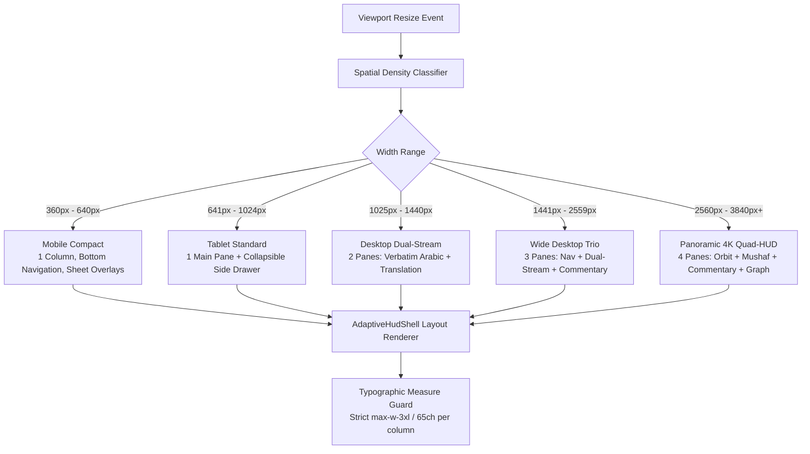

- **The 5 Density Tiers**:
  1. `compact` (< 640px): Single-column vertical stream, bottom bar navigation, touch targets ≥ 44×44px.
  2. `tablet` (640px – 1023px): Primary reading column with sliding off-canvas panels for notes.
  3. `dual` (1024px – 1439px): Synchronized twin panes (Verbatim Revelation + Hermeneutic Translation).
  4. `trio` (1440px – 2559px): 3 panes (Sidebar navigation, Twin reader, Scholarly Tafsir).
  5. `panoramic` (≥ 2560px): 4 panes (Spatial Command Orbit, Mushaf, Tafsir, Cross-Surah Graph).
- **Line Length Preservation**: Even in 4-pane 3840px mode, individual column text measures are strictly clamped (`max-w-3xl` / `65ch`) to eliminate horizontal eye strain.

#### 2. Concrete TypeScript Component Interfaces / Signatures
```typescript
import type { ReactElement, ReactNode } from "react";

export type SpatialDensityTier =
  | "compact"
  | "tablet"
  | "dual"
  | "trio"
  | "panoramic";

export interface HudPaneDefinition {
  id: string;
  title: string;
  minWidthPx: number;
  priority: 1 | 2 | 3 | 4; // 1 = highest priority (never hidden)
  content: ReactNode;
}

export interface AdaptiveHudShellProps {
  /** Array of available HUD panes ordered by spatial hierarchy. */
  panes: HudPaneDefinition[];
  /** Override density mode. If "auto", determined by viewport measurement. */
  densityMode?: "auto" | SpatialDensityTier;
  /** Active pane IDs for mobile/tablet collapsed views. */
  activePaneId?: string;
  /** Callback fired when the active spatial density tier transitions. */
  onDensityChange?: (nextTier: SpatialDensityTier) => void;
  /** Class override. */
  className?: string;
}

export interface UseSpatialDensityResult {
  currentTier: SpatialDensityTier;
  viewportWidth: number;
  isTouchDevice: boolean;
  visiblePaneCount: number;
}

export declare function AdaptiveHudShell(props: AdaptiveHudShellProps): ReactElement;
export declare function useSpatialDensity(): UseSpatialDensityResult;
```

#### 3. QlOrm Model Declarations & Field Constraints
User layout density preferences are stored in `auth.user_preference`:

```typescript
import type { QlModelDefinition } from "ql_orm";

export const SPATIAL_DENSITY_OPTIONS = [
  "auto",
  "compact",
  "tablet",
  "dual",
  "trio",
  "panoramic",
] as const;

export const userDensityPreference: QlModelDefinition = {
  name: "auth.density_preference",
  labelKey: "web.models.entities.auth_density_preference",
  description: "User adaptive layout density and multi-pane HUD preferences.",
  tableName: "auth_density_preference",
  ownerField: "owner_id",
  fields: {
    preferred_density: {
      type: "char",
      required: true,
      default: "auto",
      maxLength: 24,
      options: SPATIAL_DENSITY_OPTIONS,
    },
    max_text_measure_ch: {
      type: "integer",
      required: true,
      default: 65,
      minValue: 45,
      maxValue: 85,
    },
    preserve_scroll_on_resize: {
      type: "boolean",
      required: true,
      default: true,
    },
    owner_id: {
      type: "char",
      required: true,
      maxLength: 64,
      private: true,
    },
    created_at: {
      type: "datetime",
      required: true,
    },
    updated_at: {
      type: "datetime",
      required: true,
    },
  },
};
```

ACL Rules (`packages/ql_auth/__manifest__.ts`):
```typescript
{
  model: "auth.density_preference",
  group: "user",
  read: true,
  write: true,
  create: true,
  unlink: false,
}
```

#### 4. API Contracts & DTOs
```typescript
// packages/moonclient/src/index.ts

export interface DensityPreferenceDto {
  preferredDensity: "auto" | "compact" | "tablet" | "dual" | "trio" | "panoramic";
  maxTextMeasureCh: number;
  preserveScrollOnResize: boolean;
}

export interface UpdateDensityPreferenceRequestDto {
  preferredDensity?: "auto" | "compact" | "tablet" | "dual" | "trio" | "panoramic";
  maxTextMeasureCh?: number;
  preserveScrollOnResize?: boolean;
}

export const apiRoutes = {
  // ...
  auth: {
    // ...
    densityPreference: "/auth/me/preferences/density",
  },
} as const;

export class MoonClient {
  public async getDensityPreference(): Promise<DensityPreferenceDto> {
    return this.request<DensityPreferenceDto>(apiRoutes.auth.densityPreference);
  }

  public async updateDensityPreference(
    payload: UpdateDensityPreferenceRequestDto
  ): Promise<DensityPreferenceDto> {
    return this.request<DensityPreferenceDto>(apiRoutes.auth.densityPreference, {
      method: "PATCH",
      body: JSON.stringify(payload),
    });
  }
}
```

#### 5. UI / UX & Anti-Slop Specifications
- **Anti-Slop Dials**:
  - `ENERGY`: 2 (Balanced spatial distribution, structured dividers).
  - `RHYTHM`: 3 (Dynamic column layout reflowing responsively from 1 to 4 columns).
  - `MOTION`: 1 (Smooth width changes without jarring element displacement).
- **Compliance with `antislop-layoutmobile`**:
  - Zero horizontal scroll leaks (`overflow-x: hidden` on root, individual panes manage internal `overflow-y: auto`).
  - Mobile touch targets strictly ≥ 44×44px.
  - No layout jumps: CSS Grid uses explicit `fr` ratios and `minmax()` boundaries.
- **Design Tokens**:
  - Pane divider borders: `--color-hairline` (`#3a3560`).
  - Pane surface: `--color-panel` (`#0f1230`) and `--color-panel-raised` (`#171a3d`).
  - Column line width clamp: `max-w-3xl` / `max-w-[65ch]`.

#### 6. Phased Implementation Roadmap
- **Phase 1: Responsive Grid Tokens & Media Query Hook**
  - Implement `useSpatialDensity` hook with resize observer.
  - Define grid template token classes in `packages/ui/styles/components.css`.
- **Phase 2: Adaptive Multi-Pane Shell Composite**
  - Build `AdaptiveHudShell` in `@moonwitness/ui/src/composites/adaptive-hud-shell.tsx`.
- **Phase 3: Scroll Position Synchronization & E2E Testing**
  - Implement active verse scroll anchor lock during breakpoint transitions.
  - Write multi-resolution Playwright tests (360px, 768px, 1440px, 3440px).

#### 7. Verification Rubrics & Acceptance Criteria
- **Automated Test Commands**:
  ```bash
  pnpm --filter @moonwitness/ui test -- tests/adaptive-hud-shell.test.tsx
  pnpm --filter apps/web test:e2e -- e2e/spatial-density.spec.ts
  ```
- **Integrity Invariants**:
  1. Under 360px viewport width, exactly 1 pane is active in DOM; horizontal page scroll is 0px.
  2. Under 3440px viewport width, all 4 panes render simultaneously side-by-side with text measure ≤ 65ch per pane.
  3. Active reading verse remains visible in viewport across breakpoint transitions.

---

## Group D: Harbor Community, Ethics & Governance

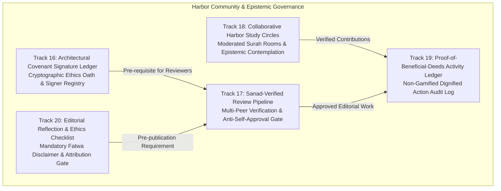

---

### 🔹 Track 16: Architectural Covenant Signature Ledger

#### 1. System Architecture & Interaction Flow
The Architectural Covenant Signature Ledger provides a public, cryptographic registry where contributors commit to the 7 sacred research principles of MoonWitness before authoring or reviewing content.

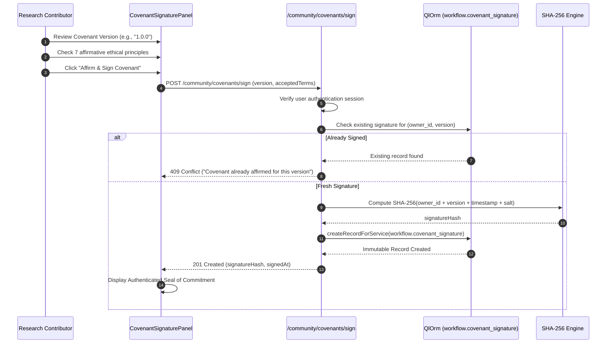

- **The 7 Covenant Principles**:
  1. *Epistemic Humility*: Refraining from personal doctrinal invention or speculative dogma.
  2. *Verbatim Revelation*: Upholding the zero-alteration sanctity of the Arabic Quranic text.
  3. *Scholarly Attribution*: Explicitly citing classical chains of transmission and accredited sources.
  4. *Anti-Commercialization*: Never monetizing, exploiting, or paywalling divine revelation.
  5. *Consensus Seeking*: Resolving scholarly disputes through collaborative peer discourse.
  6. *Civic Dignity*: Upholding respectful, honorable conduct toward all researchers.
  7. *Rectification Obligation*: Immediately correcting any proven factual error.
- **Cryptographic Immutability**: Each signature generates a SHA-256 digest sealing the user ID, covenant version, timestamp, and terms digest. Signatures cannot be edited or deleted through generic CRUD.

#### 2. Concrete TypeScript Component Interfaces / Signatures
```typescript
import type { ReactElement } from "react";

export interface CovenantTermItem {
  id: string;
  number: number;
  title: string;
  description: string;
}

export interface CovenantSignatureRecord {
  id: string;
  contributorName: string;
  contributorCallsign: string;
  covenantVersion: string;
  signatureHash: string;
  signedAt: string;
}

export interface CovenantSignaturePanelProps {
  /** Covenant version string (e.g. "1.0.0"). */
  version: string;
  /** The 7 core covenant commitments. */
  terms: CovenantTermItem[];
  /** Whether current logged-in user has already signed this version. */
  hasSigned: boolean;
  /** Existing signature record if already signed. */
  userSignature?: CovenantSignatureRecord;
  /** Callback fired upon successful signature creation. */
  onSignSuccess: (signature: CovenantSignatureRecord) => void;
  /** Class override. */
  className?: string;
}

export interface CovenantLedgerTableProps {
  signatures: CovenantSignatureRecord[];
  totalSignatures: number;
  isLoading: boolean;
  className?: string;
}

export declare function CovenantSignaturePanel(props: CovenantSignaturePanelProps): ReactElement;
export declare function CovenantLedgerTable(props: CovenantLedgerTableProps): ReactElement;
```

#### 3. QlOrm Model Declarations & Field Constraints
The covenant signature model is defined under `packages/ql_workflow` (or `ql_base`):

```typescript
import type { QlModelDefinition } from "ql_orm";

export const workflowCovenantSignature: QlModelDefinition = {
  name: "workflow.covenant_signature",
  labelKey: "web.models.entities.workflow_covenant_signature",
  description: "Cryptographic contributor covenant signature and research ethics oath.",
  tableName: "workflow_covenant_signature",
  ownerField: "owner_id",
  fields: {
    covenant_version: {
      type: "char",
      required: true,
      maxLength: 32,
    },
    terms_digest: {
      type: "char",
      required: true,
      maxLength: 64, // SHA-256 hash of the exact terms text
    },
    signature_hash: {
      type: "char",
      required: true,
      unique: true,
      maxLength: 64, // Cryptographic signature proof
    },
    contributor_callsign: {
      type: "char",
      required: true,
      maxLength: 100,
    },
    statement_accepted: {
      type: "boolean",
      required: true,
      validator(value) {
        return value === true ? undefined : "statement_accepted must be true to sign.";
      },
    },
    owner_id: {
      type: "char",
      required: true,
      maxLength: 64,
      private: true,
    },
    created_at: {
      type: "datetime",
      required: true,
    },
    updated_at: {
      type: "datetime",
      required: true,
    },
  },
};
```

ACL Rules (`packages/ql_workflow/__manifest__.ts`):
```typescript
// Bypass lockdown on write/unlink: Covenant signatures are append-only and immutable.
{
  model: "workflow.covenant_signature",
  group: "user",
  read: true,
  write: false,
  create: true,
  unlink: false,
},
{
  model: "workflow.covenant_signature",
  group: "admin",
  read: true,
  write: false,
  create: false,
  unlink: false,
}
```

#### 4. API Contracts & DTOs
```typescript
// packages/moonclient/src/index.ts

export interface SignCovenantRequestDto {
  covenantVersion: string;
  termsDigest: string;
  statementAccepted: boolean;
  contributorCallsign: string;
}

export interface SignCovenantResponseDto {
  signatureId: string;
  signatureHash: string;
  signedAt: string;
  covenantVersion: string;
}

export interface CovenantSignatureItemDto {
  id: string;
  contributorCallsign: string;
  covenantVersion: string;
  signatureHash: string;
  signedAt: string;
}

export interface CovenantLedgerResponseDto {
  signatures: CovenantSignatureItemDto[];
  totalCount: number;
}

export const apiRoutes = {
  // ...
  community: {
    covenants: "/community/covenants",
    signCovenant: "/community/covenants/sign",
  },
} as const;

export class MoonClient {
  public async getCovenantLedger(version?: string): Promise<CovenantLedgerResponseDto> {
    const query = version ? `?version=${encodeURIComponent(version)}` : "";
    return this.request<CovenantLedgerResponseDto>(`${apiRoutes.community.covenants}${query}`);
  }

  public async signCovenant(payload: SignCovenantRequestDto): Promise<SignCovenantResponseDto> {
    return this.request<SignCovenantResponseDto>(apiRoutes.community.signCovenant, {
      method: "POST",
      body: JSON.stringify(payload),
    });
  }
}
```

#### 5. UI / UX & Anti-Slop Specifications
- **Anti-Slop Dials**:
  - `ENERGY`: 1 (Solemn, ceremonial, dignified research register).
  - `RHYTHM`: 1 (Clean editorial reading flow with numbered principles).
  - `MOTION`: 1 (Quiet fade-in of verification seal upon signing).
- **Design Tokens**:
  - Panel background: `--color-panel-raised` (`#171a3d`).
  - Gold signature accent: `--color-acid` (`#f2c15e`).
  - Cryptographic hash display: `font-mono text-xs text-acid-muted bg-panel-well p-2 border border-hairline`.
- **Purpose Gate (R-17, R-26, R-38)**:
  - Real database records and SHA-256 hashes (never fake simulated numbers).
  - Checkboxes use semantic HTML labeled controls via `@moonwitness/ui`.
  - Confirmation button is disabled until all 7 terms are checked.

#### 6. Phased Implementation Roadmap
- **Phase 1: QlOrm Model & Immutability Security Rules**
  - Add `workflow.covenant_signature` model and seed external ID definitions.
  - Implement unique index constraint preventing duplicate user signatures per version.
- **Phase 2: API Endpoints & MoonClient Integration**
  - Implement `/community/covenants` and `/community/covenants/sign` in `apps/api`.
  - Add typed methods to `MoonClient`.
- **Phase 3: Public Ledger View & Profile Seal**
  - Build `CovenantSignaturePanel` and `CovenantLedgerTable` in `apps/web/src/features/community`.
  - Display verified covenant badge on research author cards.

#### 7. Verification Rubrics & Acceptance Criteria
- **Automated Test Commands**:
  ```bash
  pnpm --filter packages/ql_workflow test -- tests/covenant-signature.test.ts
  pnpm --filter @moonwitness/moonclient test -- src/index.test.ts
  ```
- **Integrity Invariants**:
  1. A user cannot sign the same covenant version twice; second attempt returns HTTP 409 Conflict.
  2. Direct user PATCH or DELETE requests on `workflow.covenant_signature` fail with `QlAccessError`.
  3. The `signature_hash` matches canonical SHA-256 of `owner_id:version:terms_digest:created_at`.

---

### 🔹 Track 17: Sanad-Verified Review Pipeline

#### 1. System Architecture & Interaction Flow
The Sanad-Verified Review Pipeline enforces multi-peer scholarly validation before research submissions, annotations, or translations can be published. It introduces a strict, automated 2-person rule and absolute anti-self-approval enforcement.

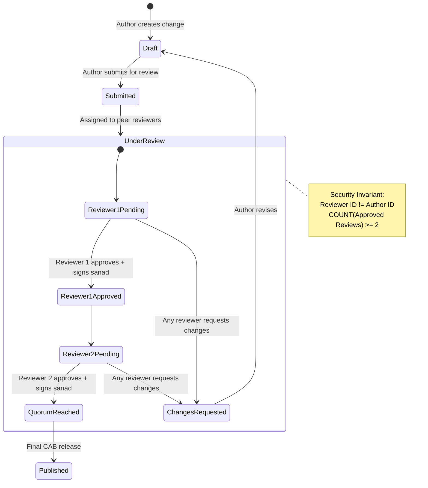

- **Anti-Self-Approval Enforcement**: An author cannot review or approve their own change request (`reviewer_id !== change.owner_id`). Any such attempt throws `403 Forbidden ("Self-approval is strictly prohibited")`.
- **Quorum Requirement**: Transitioning to `published` requires at least 2 independent positive evaluations (`COUNT(*) >= 2 WHERE decision = 'approved'`).
- **Sanad Chain Accreditation**: Reviewers must provide their verified scholar reference (`sanad_chain_ref`) affirming their qualification to review the specific domain.

#### 2. Concrete TypeScript Component Interfaces / Signatures
```typescript
import type { ReactElement } from "react";

export type PeerReviewDecision = "approved" | "changes_requested";

export interface SanadReviewerItem {
  reviewerId: string;
  reviewerName: string;
  sanadChainRef: string;
  decision: PeerReviewDecision;
  notes: string;
  signedAt: string;
}

export interface SanadVerificationStepperProps {
  /** Change request ID being reviewed. */
  changeId: string;
  /** Current workflow state (e.g. "under_review", "published"). */
  currentState: string;
  /** Author ID of the change request (for self-approval guard). */
  authorId: string;
  /** Current logged-in user ID. */
  currentUserId: string;
  /** List of recorded peer reviews. */
  reviews: SanadReviewerItem[];
  /** Minimum number of required peer approvals (default: 2). */
  requiredReviews?: number;
  /** Callback fired when a peer review is submitted. */
  onSubmitReview: (decision: PeerReviewDecision, notes: string, sanadRef: string) => Promise<void>;
  /** Class override. */
  className?: string;
}

export declare function SanadVerificationStepper(
  props: SanadVerificationStepperProps
): ReactElement;
```

#### 3. QlOrm Model Declarations & Field Constraints
The peer review model is declared in `packages/ql_workflow`:

```typescript
import type { QlModelDefinition } from "ql_orm";

export const PEER_REVIEW_DECISIONS = ["approved", "changes_requested"] as const;

export const workflowPeerReview: QlModelDefinition = {
  name: "workflow.peer_review",
  labelKey: "web.models.entities.workflow_peer_review",
  description: "Scholarly peer review record in the Sanad verification pipeline.",
  tableName: "workflow_peer_review",
  ownerField: "reviewer_id",
  fields: {
    change_id: {
      type: "char",
      required: true,
      maxLength: 64,
    },
    decision: {
      type: "char",
      required: true,
      maxLength: 32,
      options: PEER_REVIEW_DECISIONS,
      validator(value) {
        return PEER_REVIEW_DECISIONS.includes(value as (typeof PEER_REVIEW_DECISIONS)[number])
          ? undefined
          : `decision must be one of: ${PEER_REVIEW_DECISIONS.join(", ")}`;
      },
    },
    notes: {
      type: "text",
      required: true,
      maxLength: 8000,
    },
    sanad_chain_ref: {
      type: "char",
      required: true,
      maxLength: 160,
    },
    reviewer_id: {
      type: "char",
      required: true,
      maxLength: 64,
      private: true,
    },
    created_at: {
      type: "datetime",
      required: true,
    },
    updated_at: {
      type: "datetime",
      required: true,
    },
  },
};
```

ACL Rules (`packages/ql_workflow/__manifest__.ts`):
```typescript
{
  model: "workflow.peer_review",
  group: "user",
  read: true,
  write: false,
  create: true, // Only reviewer can create their review
  unlink: false, // Reviews are immutable audit records
}
```

Service Guard Invariants (`packages/ql_workflow/services/workflow-service.ts`):
```typescript
export async function submitPeerReviewForService(
  orm: QlOrm,
  changeId: string,
  reviewerId: string,
  payload: { decision: "approved" | "changes_requested"; notes: string; sanadChainRef: string }
): Promise<void> {
  const [change] = await orm.findManyByService("workflow.change", {
    filter: { id: changeId },
    limit: 1,
  });

  if (!change) throw new Error("Change request not found.");
  if (change.owner_id === reviewerId) {
    throw new Error("Self-approval is strictly prohibited: author cannot review own change.");
  }

  await orm.createRecordForService("workflow.peer_review", {
    change_id: changeId,
    decision: payload.decision,
    notes: payload.notes,
    sanad_chain_ref: payload.sanadChainRef,
    reviewer_id: reviewerId,
    created_at: Date.now(),
    updated_at: Date.now(),
  });

  // Evaluate quorum
  const reviews = await orm.findManyByService("workflow.peer_review", {
    filter: { change_id: changeId, decision: "approved" },
  });

  if (reviews.length >= 2 && change.state === "under_review") {
    await orm.updateRecordsForService("workflow.change", { id: changeId }, { state: "approved" });
  }
}
```

#### 4. API Contracts & DTOs
```typescript
// packages/moonclient/src/index.ts

export interface PeerReviewItemDto {
  id: string;
  reviewerId: string;
  reviewerName: string;
  decision: "approved" | "changes_requested";
  notes: string;
  sanadChainRef: string;
  createdAt: string;
}

export interface SanadPipelineStatusDto {
  changeId: string;
  currentState: string;
  requiredReviews: number;
  approvedCount: number;
  canPublish: boolean;
  reviews: PeerReviewItemDto[];
}

export interface SubmitPeerReviewRequestDto {
  decision: "approved" | "changes_requested";
  notes: string;
  sanadChainRef: string;
}

export const apiRoutes = {
  // ...
  workflow: {
    // ...
    sanadVerification: (changeId: string) =>
      `/workflow/changes/${encodeURIComponent(changeId)}/sanad`,
  },
} as const;

export class MoonClient {
  public async getSanadPipelineStatus(changeId: string): Promise<SanadPipelineStatusDto> {
    return this.request<SanadPipelineStatusDto>(apiRoutes.workflow.sanadVerification(changeId));
  }

  public async submitPeerReview(
    changeId: string,
    payload: SubmitPeerReviewRequestDto
  ): Promise<SanadPipelineStatusDto> {
    return this.request<SanadPipelineStatusDto>(apiRoutes.workflow.sanadVerification(changeId), {
      method: "POST",
      body: JSON.stringify(payload),
    });
  }
}
```

#### 5. UI / UX & Anti-Slop Specifications
- **Anti-Slop Dials**:
  - `ENERGY`: 1 (Clear, sober scholarly review workflow).
  - `RHYTHM`: 2 (Structured 2-slot verification stepper with reviewer cards).
  - `MOTION`: 1 (Subtle checkmark state transitions).
- **Design Tokens**:
  - Approved status badge: `--color-success` (`#6ee7b7`) with `border-success/30 bg-panel-well`.
  - Pending slot card: `border-hairline-soft bg-panel text-muted`.
  - Changes-requested callout: `--color-warning` (`#fbbf24`) with `border-warning/30 bg-panel-well`.
- **Purpose Gate (R-27, R-32, R-38)**:
  - If current user is the author, review submission form is completely replaced with an informative banner: *"You are the author of this work. Independent scholarly peer review is required."*
  - Comprehensive accessible review history: screen readers hear review count and verdict summaries.

#### 6. Phased Implementation Roadmap
- **Phase 1: QlOrm Model & Workflow Service Guard Rules**
  - Implement `workflow.peer_review` model and `submitPeerReviewForService` in `ql_workflow`.
  - Enforce anti-self-approval and quorum transition rules.
- **Phase 2: MoonClient API Endpoints & Verification Stepper UI**
  - Implement `/workflow/changes/:id/sanad` endpoints.
  - Build `SanadVerificationStepper` in `apps/web/src/features/workflow`.
- **Phase 3: Integration with Research & Corpus Addons**
  - Connect Sanad gate to all `story.narrative` and `corpus.translation` publication routes.

#### 7. Verification Rubrics & Acceptance Criteria
- **Automated Test Commands**:
  ```bash
  pnpm --filter packages/ql_workflow test -- tests/sanad-review-pipeline.test.ts
  ```
- **Integrity Invariants**:
  1. Author submitting review for their own change request produces 403 Forbidden.
  2. Change request does not transition to `approved` or `published` with only 1 approval.
  3. Change request transitions to `approved` immediately when the 2nd distinct qualified approval is saved.

---

### 🔹 Track 18: Collaborative Harbor Study Circles

#### 1. System Architecture & Interaction Flow
Collaborative Harbor Study Circles provide moderated virtual study rooms where researchers and readers contemplate specific Surahs, sharing curated reflections that are vetted by designated facilitators before entering the public discussion stream.

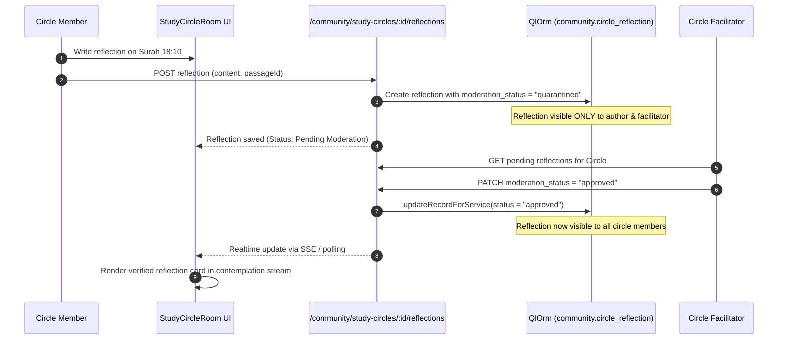

- **Epistemic Quarantine Invariant**: Unmoderated reflections are never broadcast to other circle members until approved by a facilitator.
- **Distinction of Tiers**: Community reflections are explicitly badged as *Personal Contemplation (Tadabbur)*, preventing confusion with authoritative exegesis (*Tafsir*).

#### 2. Concrete TypeScript Component Interfaces / Signatures
```typescript
import type { ReactElement } from "react";

export type ReflectionModerationStatus = "quarantined" | "approved" | "rejected";

export interface StudyCircleItem {
  id: string;
  title: string;
  surahNumber: number;
  surahNameArabic: string;
  facilitatorName: string;
  memberCount: number;
  status: "active" | "concluded";
  approvedReflectionCount: number;
}

export interface CircleReflectionItem {
  id: string;
  circleId: string;
  authorCallsign: string;
  passageLocator: string; // e.g. "18:10"
  content: string;
  moderationStatus: ReflectionModerationStatus;
  createdAt: string;
}

export interface StudyCircleDirectoryProps {
  circles: StudyCircleItem[];
  onSelectCircle: (circleId: string) => void;
  className?: string;
}

export interface StudyCircleRoomProps {
  circle: StudyCircleItem;
  reflections: CircleReflectionItem[];
  isFacilitator: boolean;
  onSubmitReflection: (content: string, passageLocator: string) => Promise<void>;
  onModerateReflection?: (reflectionId: string, decision: "approved" | "rejected") => Promise<void>;
  className?: string;
}

export declare function StudyCircleDirectory(props: StudyCircleDirectoryProps): ReactElement;
export declare function StudyCircleRoom(props: StudyCircleRoomProps): ReactElement;
```

#### 3. QlOrm Model Declarations & Field Constraints
The study circle models are defined in `packages/ql_chat` (or `ql_workflow`):

```typescript
import type { QlModelDefinition } from "ql_orm";

export const CIRCLE_STATUSES = ["active", "concluded", "archived"] as const;
export const MODERATION_STATUSES = ["quarantined", "approved", "rejected"] as const;

export const communityStudyCircle: QlModelDefinition = {
  name: "community.study_circle",
  labelKey: "web.models.entities.community_study_circle",
  description: "Virtual study circle for collaborative Surah contemplation.",
  tableName: "community_study_circle",
  ownerField: "facilitator_id",
  fields: {
    title: {
      type: "char",
      required: true,
      maxLength: 160,
    },
    surah_number: {
      type: "integer",
      required: true,
      minValue: 1,
      maxValue: 114,
    },
    status: {
      type: "char",
      required: true,
      default: "active",
      maxLength: 24,
      options: CIRCLE_STATUSES,
    },
    max_members: {
      type: "integer",
      required: true,
      default: 50,
      minValue: 2,
      maxValue: 500,
    },
    facilitator_id: {
      type: "char",
      required: true,
      maxLength: 64,
      private: true,
    },
    created_at: {
      type: "datetime",
      required: true,
    },
    updated_at: {
      type: "datetime",
      required: true,
    },
  },
};

export const communityCircleReflection: QlModelDefinition = {
  name: "community.circle_reflection",
  labelKey: "web.models.entities.community_circle_reflection",
  description: "Moderated personal contemplation shared within a study circle.",
  tableName: "community_circle_reflection",
  ownerField: "author_id",
  fields: {
    circle_id: {
      type: "char",
      required: true,
      maxLength: 64,
    },
    passage_locator: {
      type: "char",
      required: true,
      maxLength: 32, // e.g. "18:10"
    },
    content: {
      type: "text",
      required: true,
      maxLength: 4000,
    },
    moderation_status: {
      type: "char",
      required: true,
      default: "quarantined",
      maxLength: 24,
      options: MODERATION_STATUSES,
    },
    author_id: {
      type: "char",
      required: true,
      maxLength: 64,
      private: true,
    },
    created_at: {
      type: "datetime",
      required: true,
    },
    updated_at: {
      type: "datetime",
      required: true,
    },
  },
};
```

ACL Rules (`packages/ql_chat/__manifest__.ts`):
```typescript
{
  model: "community.study_circle",
  group: "user",
  read: true,
  write: false,
  create: true,
  unlink: false,
},
{
  model: "community.circle_reflection",
  group: "user",
  read: true, // QlOrm query filter automatically enforces status='approved' for non-authors
  write: true,
  create: true,
  unlink: false,
}
```

#### 4. API Contracts & DTOs
```typescript
// packages/moonclient/src/index.ts

export interface StudyCircleDto {
  id: string;
  title: string;
  surahNumber: number;
  facilitatorName: string;
  memberCount: number;
  status: "active" | "concluded";
}

export interface CircleReflectionDto {
  id: string;
  circleId: string;
  authorCallsign: string;
  passageLocator: string;
  content: string;
  moderationStatus: "quarantined" | "approved" | "rejected";
  createdAt: string;
}

export interface SubmitReflectionRequestDto {
  passageLocator: string;
  content: string;
}

export const apiRoutes = {
  // ...
  community: {
    // ...
    studyCircles: "/community/study-circles",
    circleDetail: (id: string) => `/community/study-circles/${encodeURIComponent(id)}`,
    reflections: (circleId: string) =>
      `/community/study-circles/${encodeURIComponent(circleId)}/reflections`,
  },
} as const;

export class MoonClient {
  public async listStudyCircles(): Promise<{ circles: StudyCircleDto[] }> {
    return this.request<{ circles: StudyCircleDto[] }>(apiRoutes.community.studyCircles);
  }

  public async getCircleReflections(circleId: string): Promise<{ reflections: CircleReflectionDto[] }> {
    return this.request<{ reflections: CircleReflectionDto[] }>(
      apiRoutes.community.reflections(circleId)
    );
  }

  public async submitCircleReflection(
    circleId: string,
    payload: SubmitReflectionRequestDto
  ): Promise<CircleReflectionDto> {
    return this.request<CircleReflectionDto>(apiRoutes.community.reflections(circleId), {
      method: "POST",
      body: JSON.stringify(payload),
    });
  }
}
```

#### 5. UI / UX & Anti-Slop Specifications
- **Anti-Slop Dials**:
  - `ENERGY`: 2 (Engaged study community, clean cards).
  - `RHYTHM`: 2 (Linear conversation flow paired with sticky Surah reference sidebar).
  - `MOTION`: 1 (Smooth card entrance without bounce).
- **Design Tokens**:
  - Reflection card: `--color-panel-raised` (`#171a3d`) with border `--color-hairline`.
  - Contemplation badge: `bg-panel-well text-acid-muted text-[11px] font-mono border-hairline`.
  - Quarantined banner: `bg-panel-well text-warning border-warning/30`.
- **Purpose Gate (R-17, R-27)**:
  - Empty state provided if a circle has zero reflections: *"No reflections shared yet for this Surah. Be the first to share your contemplation."*

#### 6. Phased Implementation Roadmap
- **Phase 1: QlOrm Models & Moderation Isolation Rules**
  - Implement `community.study_circle` and `community.circle_reflection`.
- **Phase 2: Room Interface & Reflection Feed**
  - Build `StudyCircleDirectory` and `StudyCircleRoom` in `apps/web/src/features/community`.
- **Phase 3: Facilitator Moderation Portal**
  - Implement moderation approval workflow and status notification pills.

#### 7. Verification Rubrics & Acceptance Criteria
- **Automated Test Commands**:
  ```bash
  pnpm --filter packages/ql_chat test -- tests/study-circle-moderation.test.ts
  ```
- **Integrity Invariants**:
  1. A `quarantined` reflection is never returned in query results for other users.
  2. Non-facilitators attempting to approve a reflection receive HTTP 403 Forbidden.

---

### 🔹 Track 19: Proof-of-Beneficial-Deeds Activity Ledger

#### 1. System Architecture & Interaction Flow
The Proof-of-Beneficial-Deeds Activity Ledger is a dignified, non-gamified public ledger recording verified beneficial deeds across the MoonWitness platform (e.g. proofreading verse translations, fixing typographical errors, verifying classical citations).

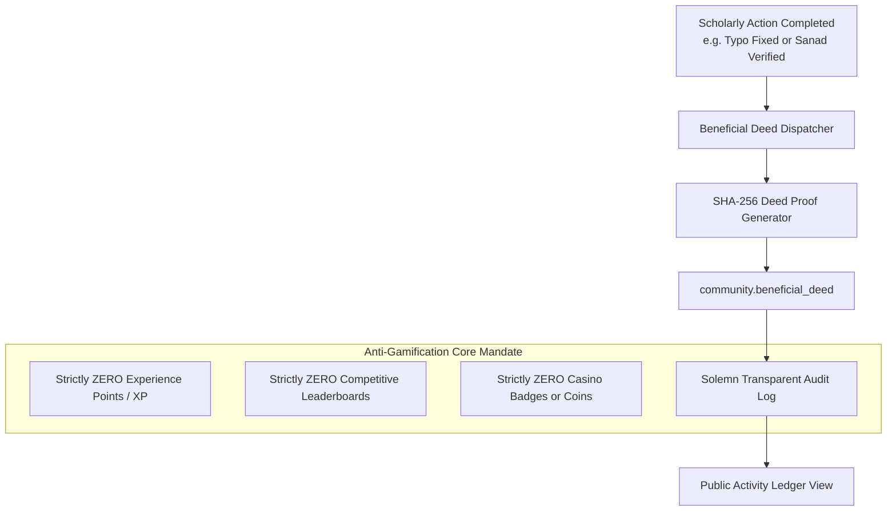

- **Strict Anti-Gamification Mandate**: In compliance with sacred ethics, the ledger bans all casino-style engagement hooks:
  - ❌ ZERO XP (experience points).
  - ❌ ZERO competitive leaderboards or rank tiers.
  - ❌ ZERO celebratory confetti animations or sound effects.
  - ❌ ZERO artificial daily streaks.
- **Anonymity Protection**: Contributor can toggle complete anonymity (`is_anonymous: true`), replacing their public identity with a cryptographically randomized pseudonym.

#### 2. Concrete TypeScript Component Interfaces / Signatures
```typescript
import type { ReactElement } from "react";

export type BeneficialDeedKind =
  | "typo_correction"
  | "translation_review"
  | "reference_verification"
  | "annotation_audit";

export interface BeneficialDeedRecord {
  id: string;
  contributorCallsign: string;
  isAnonymous: boolean;
  deedKind: BeneficialDeedKind;
  summary: string;
  targetLocator: string;
  proofHash: string;
  createdAt: string;
}

export interface DeedsActivityLedgerProps {
  /** Array of recorded verified beneficial deed entries. */
  deeds: BeneficialDeedRecord[];
  /** Total count of recorded deeds across platform history. */
  totalCount: number;
  /** Active filter by deed kind. */
  activeKindFilter?: BeneficialDeedKind;
  /** Filter selection callback. */
  onFilterChange: (kind?: BeneficialDeedKind) => void;
  /** Class override. */
  className?: string;
}

export declare function DeedsActivityLedger(props: DeedsActivityLedgerProps): ReactElement;
```

#### 3. QlOrm Model Declarations & Field Constraints
The beneficial deed model is defined in `packages/ql_base`:

```typescript
import type { QlModelDefinition } from "ql_orm";

export const DEED_KINDS = [
  "typo_correction",
  "translation_review",
  "reference_verification",
  "annotation_audit",
] as const;

export const communityBeneficialDeed: QlModelDefinition = {
  name: "community.beneficial_deed",
  labelKey: "web.models.entities.community_beneficial_deed",
  description: "Non-gamified transparent ledger of verified beneficial deeds.",
  tableName: "community_beneficial_deed",
  ownerField: "actor_id",
  fields: {
    deed_kind: {
      type: "char",
      required: true,
      maxLength: 32,
      options: DEED_KINDS,
    },
    target_model: {
      type: "char",
      required: true,
      maxLength: 64,
    },
    target_id: {
      type: "char",
      required: true,
      maxLength: 64,
    },
    summary: {
      type: "char",
      required: true,
      maxLength: 255,
    },
    proof_hash: {
      type: "char",
      required: true,
      maxLength: 64,
    },
    is_anonymous: {
      type: "boolean",
      required: true,
      default: false,
    },
    actor_id: {
      type: "char",
      required: true,
      maxLength: 64,
      private: true,
    },
    created_at: {
      type: "datetime",
      required: true,
    },
    updated_at: {
      type: "datetime",
      required: true,
    },
  },
};
```

ACL Rules (`packages/ql_base/__manifest__.ts`):
```typescript
// Users cannot write directly to the deeds ledger; records are created via server services only.
{
  model: "community.beneficial_deed",
  group: "user",
  read: true,
  write: false,
  create: false,
  unlink: false,
}
```

#### 4. API Contracts & DTOs
```typescript
// packages/moonclient/src/index.ts

export interface BeneficialDeedItemDto {
  id: string;
  contributorCallsign: string;
  isAnonymous: boolean;
  deedKind: "typo_correction" | "translation_review" | "reference_verification" | "annotation_audit";
  summary: string;
  proofHash: string;
  createdAt: string;
}

export interface DeedsLedgerResponseDto {
  deeds: BeneficialDeedItemDto[];
  totalCount: number;
}

export const apiRoutes = {
  // ...
  community: {
    // ...
    deedsLedger: "/community/deeds-ledger",
  },
} as const;

export class MoonClient {
  public async getDeedsLedger(kind?: string): Promise<DeedsLedgerResponseDto> {
    const query = kind ? `?kind=${encodeURIComponent(kind)}` : "";
    return this.request<DeedsLedgerResponseDto>(`${apiRoutes.community.deedsLedger}${query}`);
  }
}
```

#### 5. UI / UX & Anti-Slop Specifications
- **Anti-Slop Dials**:
  - `ENERGY`: 1 (Sober, dignified historical ledger).
  - `RHYTHM`: 1 (Clean table rows, uniform row heights).
  - `MOTION`: 1 (Static display, zero distracting animations).
- **Design Tokens**:
  - Table surface: `--color-panel` (`#0f1230`) with rows divided by `--color-hairline`.
  - Deed type pill: `text-ink-soft bg-panel-well border-hairline font-mono text-[10px]`.
  - Pseudonym styling: `text-muted font-mono`.
- **Purpose Gate (R-16, R-17, R-38)**:
  - Complete elimination of marketing jargon and gamified badges.

#### 6. Phased Implementation Roadmap
- **Phase 1: QlOrm Model & Event Emitter Service**
  - Implement `community.beneficial_deed` model.
  - Hook event emitters into `ql_workflow` and `ql_corpus` to record deeds upon approval.
- **Phase 2: MoonClient API & Ledger View Component**
  - Add `/community/deeds-ledger` endpoint.
  - Implement `DeedsActivityLedger` table composite in `@moonwitness/ui`.
- **Phase 3: Privacy & Anonymity Controls**
  - Allow users to toggle public attribution vs. randomized pseudonym in their profile.

#### 7. Verification Rubrics & Acceptance Criteria
- **Automated Test Commands**:
  ```bash
  pnpm --filter packages/ql_base test -- tests/beneficial-deeds.test.ts
  ```
- **Integrity Invariants**:
  1. Ledger contains zero references to "XP", "points", "rank", or "coins".
  2. When `is_anonymous` is true, the user's real name is replaced with a cryptographic pseudonymous hash.
  3. Direct user attempts to INSERT/UPDATE/DELETE records via API return HTTP 403 Forbidden.

---

### 🔹 Track 20: Editorial Reflection & Ethics Checklist

#### 1. System Architecture & Interaction Flow
The Editorial Reflection & Ethics Checklist is an indispensable pre-publication validation gate. It prevents unauthorized religious fatwa decrees, personal polemics, and unverified classical attributions from entering the public research library.

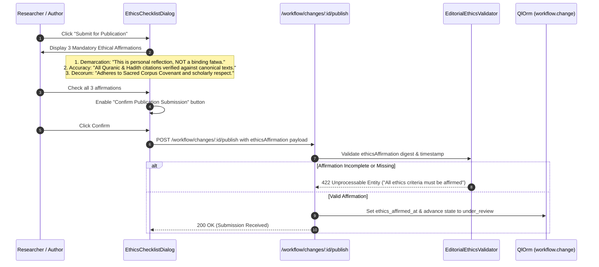

- **The 3 Mandatory Affirmations**:
  1. *Epistemic Demarcation*: Affirming that the submission is personal research commentary, not a binding religious decree (*Fatwa*).
  2. *Citation Accuracy*: Affirming that all verses and traditions cited exist verbatim in canonical collections.
  3. *Adherence to Decorum*: Affirming that the writing preserves dignity, avoiding polemical sectarian attacks.
- **Server-Side Validation Barrier**: The API refuses publication if the client fails to submit the validated affirmations digest.

#### 2. Concrete TypeScript Component Interfaces / Signatures
```typescript
import type { ReactElement } from "react";

export interface EthicsAffirmationPayload {
  changeId: string;
  isNotFatwaAffirmed: boolean;
  citationsVerifiedAffirmed: boolean;
  decorumAffirmed: boolean;
  affirmedAt: string;
  ethicsDigest: string; // SHA-256 digest of checked items + timestamp
}

export interface EthicsChecklistDialogProps {
  /** Whether the ethics verification modal is visible. */
  open: boolean;
  /** Title of the article or research work being published. */
  articleTitle: string;
  /** Change request ID being submitted. */
  changeId: string;
  /** Callback fired when author affirms all ethics criteria. */
  onConfirm: (payload: EthicsAffirmationPayload) => Promise<void>;
  /** Callback fired when author dismisses or cancels the dialog. */
  onCancel: () => void;
  /** Class override. */
  className?: string;
}

export declare function EthicsChecklistDialog(
  props: EthicsChecklistDialogProps
): ReactElement;
```

#### 3. QlOrm Model Declarations & Field Constraints
Ethics affirmation fields are attached to `workflow.change` in `packages/ql_workflow` and `story.narrative` in `packages/ql_research`:

```typescript
// Field additions to workflow.change in packages/ql_workflow/models/workflow_change.ts:
export const workflowChangeEthicsFields = {
  ethics_affirmed_at: {
    type: "datetime" as const,
    required: false,
  },
  ethics_digest: {
    type: "char" as const,
    required: false,
    maxLength: 64,
  },
  is_not_fatwa_affirmed: {
    type: "boolean" as const,
    required: true,
    default: false,
  },
};
```

ACL Rules (`packages/ql_workflow/__manifest__.ts`):
```typescript
// Ethics fields can only be stamped during transition to under_review or approved.
{
  model: "workflow.change",
  group: "user",
  read: true,
  write: false, // State and ethics fields protected behind workflow service
  create: true,
  unlink: false,
}
```

#### 4. API Contracts & DTOs
```typescript
// packages/moonclient/src/index.ts

export interface PublishChangeRequestDto {
  ethicsAffirmation: {
    isNotFatwaAffirmed: boolean;
    citationsVerifiedAffirmed: boolean;
    decorumAffirmed: boolean;
    affirmedAt: string;
    ethicsDigest: string;
  };
}

export interface PublishChangeResponseDto {
  changeId: string;
  newState: string;
  ethicsAffirmedAt: string;
}

export const apiRoutes = {
  // ...
  workflow: {
    // ...
    publishChange: (id: string) => `/workflow/changes/${encodeURIComponent(id)}/publish`,
  },
} as const;

export class MoonClient {
  public async publishWorkflowChange(
    changeId: string,
    payload: PublishChangeRequestDto
  ): Promise<PublishChangeResponseDto> {
    return this.request<PublishChangeResponseDto>(apiRoutes.workflow.publishChange(changeId), {
      method: "POST",
      body: JSON.stringify(payload),
    });
  }
}
```

#### 5. UI / UX & Anti-Slop Specifications
- **Anti-Slop Dials**:
  - `ENERGY`: 1 (Formal, solemn, high-gravity pre-flight checklist).
  - `RHYTHM`: 1 (Clear 3-item checklist with full descriptive subtitles).
  - `MOTION`: 1 (Standard modal dialog fade-in).
- **Design Tokens**:
  - Modal surface: `--color-panel-raised` (`#171a3d`) with border `--color-hairline-strong`.
  - Checkbox labels: `--color-ink` (`#f1ead9`) with subtitle `--color-ink-soft`.
  - Confirm button: `.ql-button--default` (warm gold accent).
- **Accessibility & Focus Trap (WCAG 2.2 AA)**:
  - Modal implements strict focus trap (`role="dialog"`, `aria-modal="true"`, `aria-labelledby="ethics-dialog-title"`).
  - Confirm button is strictly disabled (`aria-disabled="true"`) until all 3 checkboxes are ticked.
  - Dialog closes gracefully on `Escape`.

#### 6. Phased Implementation Roadmap
- **Phase 1: Workflow Schema Stamping & Validation Rules**
  - Add ethics verification columns to `workflow.change`.
  - Add backend validator in `workflow-service.ts` rejecting publish requests without full affirmations.
- **Phase 2: Ethics Modal Component & MoonClient Integration**
  - Build `EthicsChecklistDialog` composite in `@moonwitness/ui/src/composites/ethics-dialog.tsx`.
  - Wire publication submission flow in `apps/web/src/features/workflow`.
- **Phase 3: Automated Negative Testing & E2E Auditing**
  - Write test asserting API returns 422 if any checkbox is missing.

#### 7. Verification Rubrics & Acceptance Criteria
- **Automated Test Commands**:
  ```bash
  pnpm --filter packages/ql_workflow test -- tests/ethics-checklist.test.ts
  pnpm --filter @moonwitness/ui test -- tests/ethics-dialog.test.tsx
  ```
- **Integrity Invariants**:
  1. API returns HTTP 422 Unprocessable Entity if `isNotFatwaAffirmed === false`.
  2. Dialog cannot be confirmed via keyboard Enter until all 3 checkboxes evaluate to `true`.
  3. `ethics_digest` correctly matches SHA-256 of the affirmation payload.
