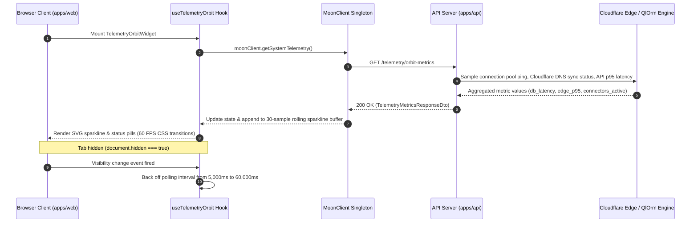
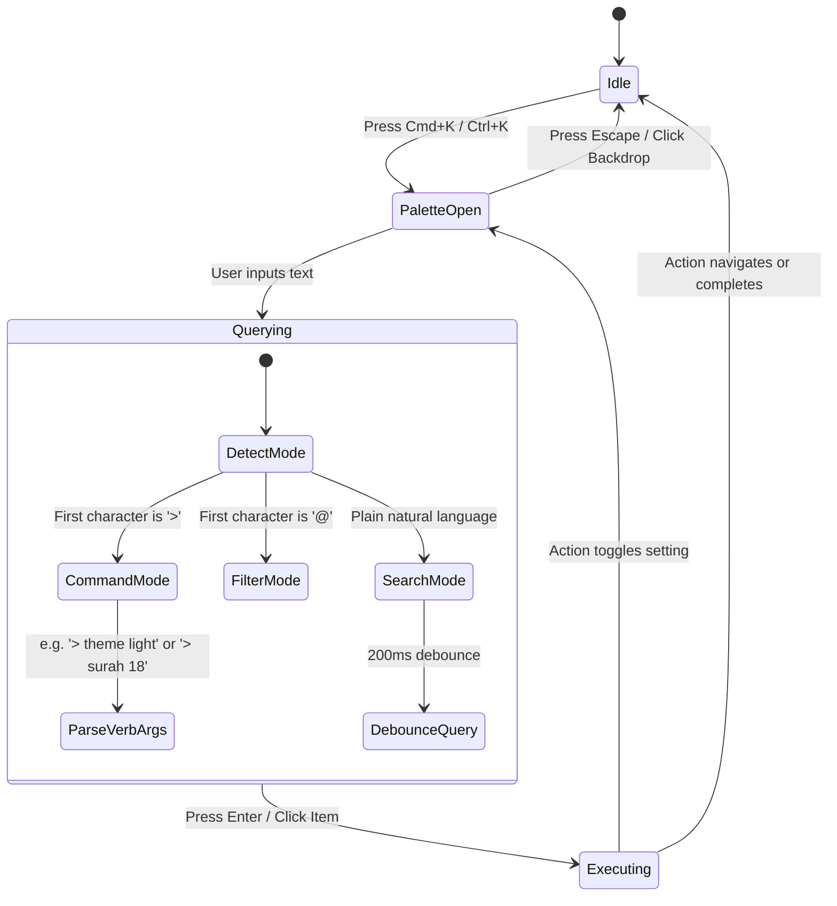
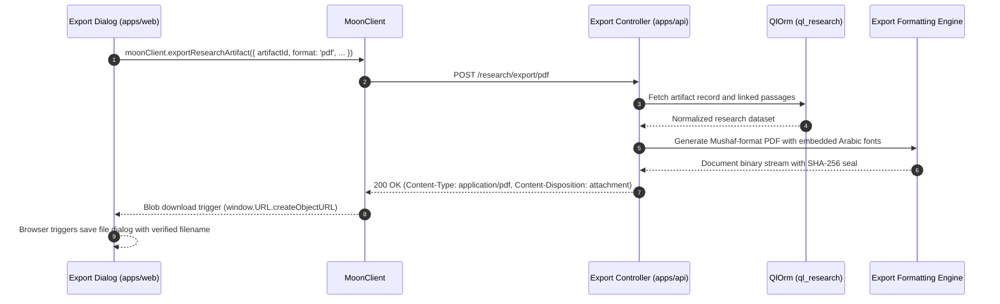
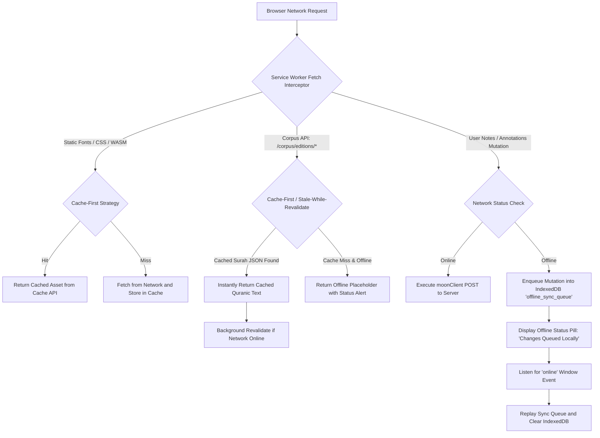
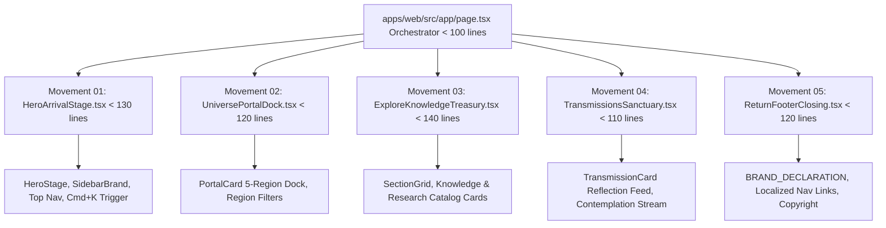
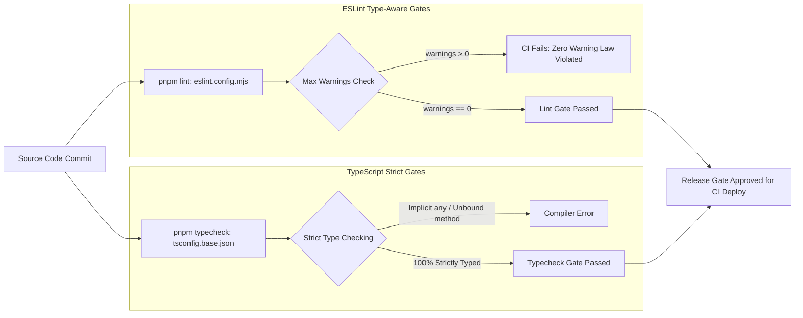
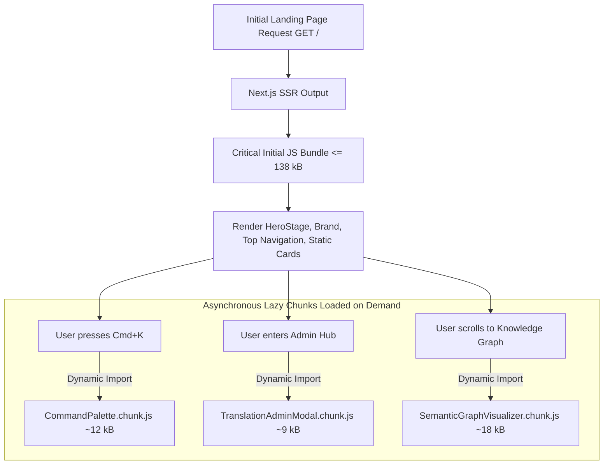
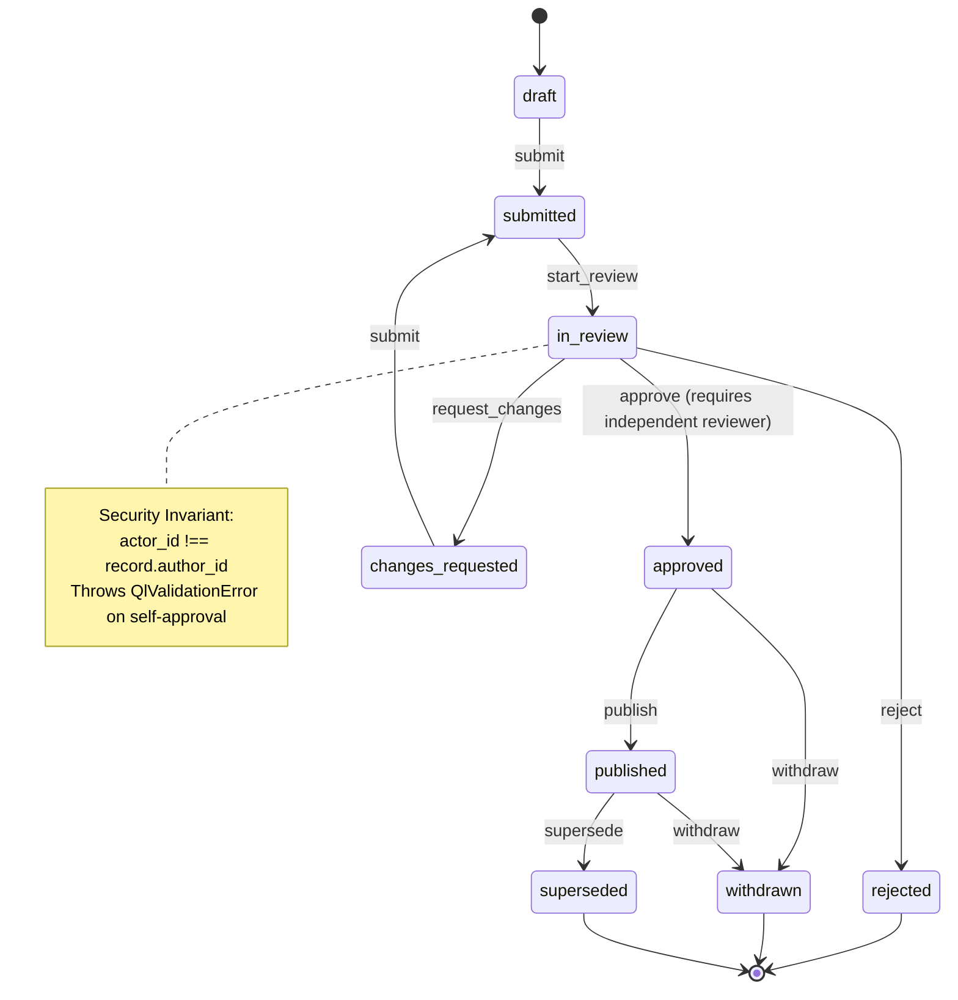
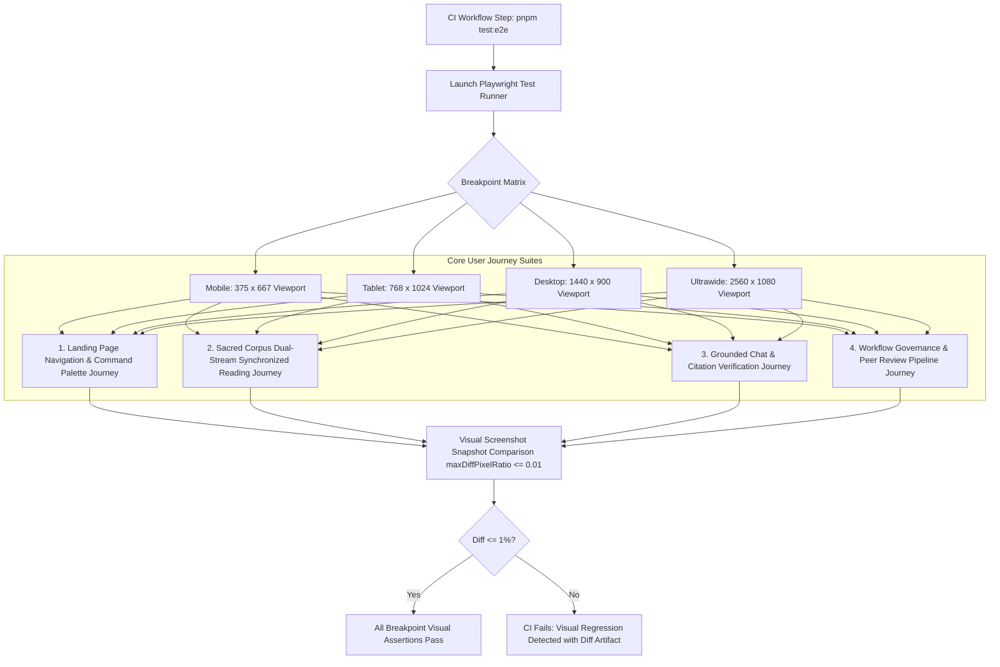

# Technical Specifications: Group E & Group F (Tracks 21 – 30)

This document provides the exhaustive, production-grade technical specifications for **Group E: Command Deck & System Telemetry (Tracks 21–25)** and **Group F: Engineering Excellence, Modularity & Performance (Tracks 26–30)** of MoonWitness & A-L-L-A-H.COM.

Every track strictly incorporates the 7 standardized technical specification sections:
1. System Architecture & Interaction Flow
2. Concrete TypeScript Component Interfaces / Signatures
3. QlOrm Model Declarations & Field Constraints (`packages/ql_*`, strictly NO Drizzle)
4. API Contracts & DTOs (`@moonwitness/moonclient`)
5. UI / UX & Anti-Slop Specifications (`@moonwitness/ui`, WCAG 2.2 AA)
6. Phased Implementation Roadmap (Phases 1–3)
7. Verification Rubrics & Acceptance Criteria

---

## Group E: Command Deck & System Telemetry

```
Group E Tracks:
├── Track 21: Realtime Telemetry Orbit Monitor (apps/web, WebSocket/SSE, @moonwitness/ui)
├── Track 22: Automated PO Parity Synchronizer Tooling (packages/ql_i18n, CLI)
├── Track 23: Next-Gen Spotlight Command Palette (@moonwitness/ui, apps/web)
├── Track 24: Studio Multi-Format Exporter (ql_research, @moonwitness/moonclient)
└── Track 25: Resilient Offline PWA & Service Worker (apps/web, Service Worker, Cache API)
```

---

### 🔹 Track 21: Realtime Telemetry Orbit Monitor

#### 1. System Architecture & Interaction Flow
The Realtime Telemetry Orbit Monitor provides continuous operational observability into system performance, edge routing health, and database response times without burdening client resources or exposing administrative secrets.



- **Throttling State Machine**: The hook monitors `document.visibilityState`. While active, metrics poll at 5,000ms intervals. When the browser tab enters the background, the timer immediately shifts to a 60,000ms backoff interval, preserving battery life and eliminating wasted server egress.
- **Rolling Window Buffer**: The client retains an in-memory ring buffer of exactly 30 datapoints per metric (representing the most recent 2.5 minutes of operational history), preventing memory leaks during long-running administrative sessions.
- **Failover & Degraded States**: If an endpoint fails or p95 latency exceeds 800ms, the widget transitions from `.ql-status-healthy` to `.ql-status-degraded` without blocking page interaction.

#### 2. Concrete TypeScript Component Interfaces / Signatures
```typescript
import type { SystemMetricDto, TelemetryMetricsResponseDto } from "@moonwitness/moonclient";

export interface TelemetryOrbitWidgetProps {
  /** Optional polling interval in milliseconds when active (default: 5000ms, clamped min: 2000ms). */
  refreshIntervalMs?: number;
  /** Whether to render historical SVG sparklines alongside numerical readouts. Default: true. */
  showSparklines?: boolean;
  /** Callback fired whenever overall system health status shifts. */
  onStatusChange?: (status: "healthy" | "degraded" | "critical") => void;
  /** Additional custom class names for the container card. */
  className?: string;
}

export interface MetricSparklineProps {
  /** Array of historical floating-point or integer values (clamped to max 30 points). */
  values: readonly number[];
  /** SVG viewBox dimensions. Default: width=120, height=32. */
  width?: number;
  height?: number;
  /** Color token for sparkline stroke: defaults to 'var(--color-acid)'. */
  strokeColor?: string;
  /** Accessible text summary for screen readers. */
  accessibleLabel: string;
}

export interface OrbitMetricCardProps {
  metric: SystemMetricDto;
  historicalValues: readonly number[];
  showSparkline: boolean;
}

export interface UseTelemetryOrbitReturn {
  data: TelemetryMetricsResponseDto | null;
  history: Record<string, readonly number[]>;
  overallStatus: "healthy" | "degraded" | "critical";
  isLoading: boolean;
  error: Error | null;
  refreshNow: () => Promise<void>;
}

export function useTelemetryOrbit(refreshIntervalMs?: number): UseTelemetryOrbitReturn;
```

#### 3. QlOrm Model Declarations & Field Constraints
The telemetry models reside in `packages/ql_cloudflare` (or `ql_telemetry`) and adhere strictly to QlOrm conventions (`packages/ql-orm`). Table naming follows `domain.entity`.

```typescript
import type { QlModelDefinition, QlAddonManifest } from "ql_orm";

export const telemetryMetricSnapshotModel: QlModelDefinition = {
  name: "telemetry.metric_snapshot",
  tableName: "telemetry_metric_snapshot",
  description: "Periodic operational metric snapshot recorded by system services.",
  fields: {
    metric_key: {
      type: "char",
      required: true,
      maxLength: 64,
    },
    metric_value: {
      type: "integer",
      required: true,
      minValue: 0,
      maxValue: 2147483647,
    },
    unit: {
      type: "char",
      required: true,
      maxLength: 16,
      default: "ms",
    },
    status: {
      type: "char",
      required: true,
      maxLength: 16,
      selectionKeys: ["healthy", "degraded", "critical"],
      default: "healthy",
    },
    datacenter_region: {
      type: "char",
      required: true,
      maxLength: 32,
      default: "sin01",
    },
    metadata_json: {
      type: "text",
      required: false,
      maxLength: 4000,
    },
    recorded_at: {
      type: "datetime",
      required: true,
    },
  },
};

export const telemetryAccessRules = [
  { model: "telemetry.metric_snapshot", group: "root", read: true, write: true, create: true, unlink: true },
  { model: "telemetry.metric_snapshot", group: "admin", read: true, write: false, create: true, unlink: false },
  { model: "telemetry.metric_snapshot", group: "operator", read: true, write: false, create: false, unlink: false },
  { model: "telemetry.metric_snapshot", group: "user", read: false, write: false, create: false, unlink: false },
  { model: "telemetry.metric_snapshot", group: "viewer", read: false, write: false, create: false, unlink: false },
];
```

#### 4. API Contracts & DTOs (`@moonwitness/moonclient`)
In `packages/moonclient/src/index.ts`:

```typescript
// --- Route registration in apiRoutes ---
export const apiRoutes = {
  // ... existing routes
  telemetry: {
    orbit: "/telemetry/orbit-metrics",
    history: (metricKey: string) => `/telemetry/orbit-metrics/${encodeURIComponent(metricKey)}/history`,
  },
} as const;

// --- DTO Contracts ---
export interface SystemMetricDto {
  metricName: string;
  metricKey: "db_ping_ms" | "api_p95_ms" | "edge_dns_sync" | "search_throughput_qpm";
  currentValue: number;
  unit: "ms" | "count" | "pct" | "qpm";
  status: "healthy" | "degraded" | "critical";
  updatedAt: string;
}

export interface TelemetryMetricsResponseDto {
  uptimeSeconds: number;
  apiLatencyP95Ms: number;
  dbPingMs: number;
  dnsConnectorsOnline: number;
  overallStatus: "healthy" | "degraded" | "critical";
  metrics: readonly SystemMetricDto[];
}

// --- MoonClient SDK Method ---
export class MoonClient {
  // ...
  public async getSystemTelemetry(): Promise<TelemetryMetricsResponseDto> {
    return this.request<TelemetryMetricsResponseDto>(apiRoutes.telemetry.orbit, {
      method: "GET",
    });
  }
}
```

#### 5. UI / UX & Anti-Slop Specifications
- **Anti-Slop Liveliness Dials**:
  - `ENERGY: 1` (Solemn, calm, minimal operational HUD; no pulsating laser effects or noisy graphics).
  - `RHYTHM: 2` (Standardized metric cards in a responsive grid, 12-column system, 24px gutters).
  - `MOTION: 1` (Subtle 200ms opacity fades for status transitions; strictly static SVG path drawing).
- **Anti-Slop Purpose Justifications**:
  - SVG sparkline uses lightweight inline `<path>` calculation without external charting dependencies (preserving the 150 kB bundle limit).
  - Metrics reflect genuine measurement data from server probes; no dummy random numbers or fabricated uptime statistics (Rule R-17).
  - Fully supports `prefers-reduced-motion: reduce` by replacing sparkline animations with a static horizontal threshold bar.
- **Design Token Mapping**:
  - Card Container: `.ql-card` with `bg-panel border-hairline`.
  - Sparkline Stroke: `var(--color-acid)` (`#f2c15e` in dark mode, `#8a5a00` in light mode).
  - Metric Values: `font-mono text-ink font-semibold`.
  - Status Indicators:
    - Healthy: `text-success` (`#6ee7b7`), dot `.ql-status-dot.is-healthy`.
    - Degraded: `text-warning` (`#fbbf24`), dot `.ql-status-dot.is-degraded`.
    - Critical: `text-danger` (`#ff8a80`), dot `.ql-status-dot.is-critical`.
- **UI States**:
  - *Empty State*: Displays `@moonwitness/ui` `EmptyState` component with message "No telemetry metrics collected yet. Server probe initializing."
  - *Loading State*: Skeleton cards with `.ql-skeleton` subtle pulse on sparkline rectangles.
  - *Error State*: Shows `@moonwitness/ui` `Alert` banner with reconnect button calling `refreshNow()`.
- **Accessibility (WCAG 2.2 AA)**:
  - Contrast ratio of `text-ink` on `bg-panel` is >= 11:1.
  - Live announcements on status change using `aria-live="polite"` so screen readers announce transitions (e.g., "Telemetry status shifted to degraded: API latency 920 milliseconds").
  - Each sparkline SVG provides `<title id="spark-title-{metricKey}">` and `aria-labelledby`.

#### 6. Phased Implementation Roadmap
- **Phase 1: Foundation (Backend Probe & Schema)**:
  - Add `telemetry.metric_snapshot` model and ACL to `packages/ql_cloudflare` or `packages/ql_telemetry`.
  - Implement `/telemetry/orbit-metrics` route handler in `apps/api` measuring LibSql ping and Cloudflare sync status.
  - Implement DTOs and `moonClient.getSystemTelemetry()` method in `@moonwitness/moonclient`.
- **Phase 2: Core Experience (HUD Widget & SVG Sparkline)**:
  - Build `MetricSparkline` atom in `@moonwitness/ui` generating deterministic SVG bezier path from rolling numbers.
  - Implement `useTelemetryOrbit` hook in `apps/web/src/features/dashboard/use-telemetry-orbit.ts` with `document.hidden` throttle.
  - Assemble `TelemetryOrbitWidget` in `apps/web/src/features/dashboard/telemetry-orbit-widget.tsx`.
- **Phase 3: Hardening & Resilience**:
  - Add circuit-breaker warning when 3 consecutive polls fail.
  - Write Vitest unit tests asserting visibility state transition changes the timer delay.
  - Execute bundle size audit to verify zero chart library bloat.

#### 7. Verification Rubrics & Acceptance Criteria
- **Automated Test Commands**:
  ```powershell
  pnpm --filter @moonwitness/moonclient test
  pnpm --filter @moonwitness/web test apps/web/src/features/dashboard/telemetry-orbit-widget.test.tsx
  ```
- **Invariants & Exit Criteria**:
  - Polling interval MUST be 5,000ms while visible, and EXACTLY 60,000ms when `document.hidden === true`.
  - First-load JS contribution of the telemetry widget MUST NOT exceed 4.5 kB gzipped.
  - WCAG contrast on all text elements >= 4.5:1 (normal text) and 3:1 (large text).

---

### 🔹 Track 22: Automated PO Parity Synchronizer Tooling

#### 1. System Architecture & Interaction Flow
The Automated PO Parity Synchronizer ensures strict internationalization symmetry between Indonesian (`id.po`) and English (`en.po`) catalogs across all MoonWitness packages. It acts as both a developer productivity CLI and an automated CI gate preventing broken message keys from reaching production.

```mermaid
flowchart TD
    A[Developer or CI triggers pnpm i18n:sync] --> B[Parse packages/ql_i18n/i18n/id.po via gettext-parser]
    A --> C[Parse packages/ql_i18n/i18n/en.po via gettext-parser]
    B & C --> D[Extract Set of msgctxt:msgid keys]
    D --> E{Compute Symmetric Difference}
    E -->|No Discrepancies Found| F[Sort entries alphabetically by msgctxt]
    E -->|Missing Keys Detected| G{Mode Check}
    G -->|--check flag active (CI)| H[Log verbatim missing keys and file paths]
    H --> I[Exit Process with Exit Code 1]
    G -->|sync mode (Local dev)| J[Auto-scaffold placeholder entries with untranslated tags]
    J --> F
    F --> K[Format PO headers & serialize to disk]
    K --> L[Exit Process with Exit Code 0]
```

- **Symmetric Difference Calculation**: Computes $K_{id} \setminus K_{en}$ and $K_{en} \setminus K_{id}$. Every key must match the mandatory format `/^[a-z][a-z0-9_-]*(?:\.[a-z][a-zA-Z0-9_-]*)+$/`.
- **Placeholder Variable Preservation**: Validates that any formatted placeholder (e.g. `{surah}`, `{count}`) present in `msgid` exists verbatim in `msgstr` in both catalogs, preventing runtime i18n interpolation exceptions.
- **Deterministic Lexicographical Order**: PO entries are sorted alphabetically by `msgctxt`, ensuring `git diff` produces clean, minimal line changes without non-deterministic reordering.

#### 2. Concrete TypeScript Component Interfaces / Signatures
In `packages/ql_i18n/src/services/po-sync.ts`:

```typescript
export interface PoSyncOptions {
  /** When true, validates parity without modifying files on disk. Exits with 1 if disparity found. */
  checkOnly?: boolean;
  /** Primary reference locale path (default: 'packages/ql_i18n/i18n/id.po'). */
  primaryPath: string;
  /** Secondary target locale path (default: 'packages/ql_i18n/i18n/en.po'). */
  secondaryPath: string;
  /** When true, prints verbose output for every synchronized key. */
  verbose?: boolean;
}

export interface PoParityReport {
  isSymmetric: boolean;
  totalKeysPrimary: number;
  totalKeysSecondary: number;
  missingInPrimary: readonly string[];
  missingInSecondary: readonly string[];
  mismatchedPlaceholders: readonly {
    key: string;
    primaryPlaceholders: readonly string[];
    secondaryPlaceholders: readonly string[];
  }[];
}

export interface PoSyncResult {
  report: PoParityReport;
  modifiedFiles: readonly string[];
  durationMs: number;
}

/** CLI entry function executed by `pnpm i18n:sync`. */
export function runPoSync(options: PoSyncOptions): Promise<PoSyncResult>;
```

Admin UI Component in `apps/web/src/features/admin/translation-parity-card.tsx`:
```typescript
export interface TranslationParityCardProps {
  /** Current parity report fetched via moonClient. */
  initialReport?: TranslationParityReportDto;
  /** Callback fired after successful automated synchronization. */
  onSyncCompleted?: () => void;
  className?: string;
}
```

#### 3. QlOrm Model Declarations & Field Constraints
In `packages/ql_i18n`:

```typescript
import type { QlModelDefinition } from "ql_orm";

export const i18nCatalogSyncLogModel: QlModelDefinition = {
  name: "i18n.catalog_sync_log",
  tableName: "i18n_catalog_sync_log",
  description: "Audit trail of catalog synchronization operations.",
  fields: {
    initiator_id: {
      type: "char",
      required: true,
      maxLength: 64,
    },
    total_keys: {
      type: "integer",
      required: true,
      minValue: 0,
      maxValue: 1000000,
    },
    missing_keys_count: {
      type: "integer",
      required: true,
      minValue: 0,
      maxValue: 100000,
      default: 0,
    },
    synced_keys_count: {
      type: "integer",
      required: true,
      minValue: 0,
      maxValue: 100000,
      default: 0,
    },
    status: {
      type: "char",
      required: true,
      maxLength: 16,
      selectionKeys: ["passed", "synced", "failed"],
    },
    summary_text: {
      type: "text",
      required: false,
      maxLength: 8000,
    },
    created_at: {
      type: "datetime",
      required: true,
    },
  },
};

export const i18nSyncAccessRules = [
  { model: "i18n.catalog_sync_log", group: "root", read: true, write: true, create: true, unlink: true },
  { model: "i18n.catalog_sync_log", group: "admin", read: true, write: false, create: true, unlink: false },
  { model: "i18n.catalog_sync_log", group: "operator", read: true, write: false, create: false, unlink: false },
  { model: "i18n.catalog_sync_log", group: "user", read: false, write: false, create: false, unlink: false },
  { model: "i18n.catalog_sync_log", group: "viewer", read: false, write: false, create: false, unlink: false },
];
```

#### 4. API Contracts & DTOs (`@moonwitness/moonclient`)
In `packages/moonclient/src/index.ts`:

```typescript
// --- Route registration ---
export const apiRoutes = {
  // ...
  admin: {
    translations: {
      parityCheck: "/admin/translations/parity-check",
      sync: "/admin/translations/sync",
    },
  },
} as const;

// --- DTO Contracts ---
export interface TranslationParityReportDto {
  totalKeys: number;
  synchronizedKeys: number;
  missingInEn: readonly string[];
  missingInId: readonly string[];
  mismatchedPlaceholders: readonly {
    key: string;
    idPlaceholders: readonly string[];
    enPlaceholders: readonly string[];
  }[];
  isParityClean: boolean;
}

export interface SyncTranslationsRequestDto {
  targetLocale: "id" | "en" | "all";
  autoFillEmptyWithSource: boolean;
}

export interface SyncTranslationsResponseDto {
  success: boolean;
  keysCreated: number;
  updatedReport: TranslationParityReportDto;
}

// --- MoonClient SDK Methods ---
export class MoonClient {
  public async checkTranslationParity(): Promise<TranslationParityReportDto> {
    return this.request<TranslationParityReportDto>(apiRoutes.admin.translations.parityCheck, {
      method: "GET",
    });
  }

  public async syncTranslationCatalogs(input: SyncTranslationsRequestDto): Promise<SyncTranslationsResponseDto> {
    return this.request<SyncTranslationsResponseDto>(apiRoutes.admin.translations.sync, {
      method: "POST",
      body: JSON.stringify(input),
    });
  }
}
```

#### 5. UI / UX & Anti-Slop Specifications
- **Anti-Slop Liveliness Dials**:
  - `ENERGY: 1` (Developer utility aesthetic, clean monospace typography, high readability).
  - `RHYTHM: 1` (Straightforward tabular card presentation).
  - `MOTION: 1` (Instant feedback on button click, standard subtle loader).
- **Anti-Slop Purpose Justifications**:
  - Raw missing translation keys are rendered in distinct `font-mono` badges (`bg-panel-well text-warning border-hairline`) so translators can copy exact keys with a single click.
  - Zero fabricated "translation completion percentages" (Rule R-17). Displays exact integer counts: `Total Keys: 412`, `Missing: 3`.
- **Design Token Mapping**:
  - Card: `.ql-card` with `bg-panel border-hairline`.
  - Discrepancy Alert: `@moonwitness/ui` `Alert` variant `warning`.
  - Sync Button: `@moonwitness/ui` `Button` variant `secondary` with icon `RefreshCw`.
- **Accessibility (WCAG 2.2 AA)**:
  - Error and warning badges use accessible color contrast: `text-warning` on `bg-panel-well` has a 5.2:1 contrast ratio.
  - Keys list renders within a keyboard-navigable scroll area with explicit `role="region"` and `aria-label="Missing Translation Keys"`.

#### 6. Phased Implementation Roadmap
- **Phase 1: Foundation (Core Script & Validation Logic)**:
  - Implement `scripts/i18n-sync.mjs` importing `gettext-parser` and `packages/ql_i18n/services/po.ts`.
  - Build symmetric difference algorithm and placeholder variable syntax validator.
  - Register `pnpm i18n:sync` and `pnpm i18n:sync --check` in root `package.json`.
- **Phase 2: CI Gate Integration**:
  - Add `pnpm i18n:sync --check` to `.github/workflows/ci.yml` immediately prior to `pnpm typecheck`.
  - Validate that non-zero exit codes cleanly reject PRs with missing keys.
- **Phase 3: Admin Deck UI**:
  - Expose API endpoints in `apps/api` (`/admin/translations/parity-check`).
  - Implement `TranslationParityCard` in `apps/web/src/features/admin/`.

#### 7. Verification Rubrics & Acceptance Criteria
- **Automated Test Commands**:
  ```powershell
  pnpm i18n:sync --check
  node --test packages/ql_i18n/dist/services/po.test.js
  ```
- **Invariants & Exit Criteria**:
  - If a key exists in `id.po` but not in `en.po`, `pnpm i18n:sync --check` MUST exit with code 1.
  - Re-running `pnpm i18n:sync` twice in a row MUST produce an identical file on disk with zero git diff (*idempotency*).
  - All keys in generated PO files MUST be sorted alphabetically by `msgctxt`.

---

### 🔹 Track 23: Next-Gen Spotlight Command Palette

#### 1. System Architecture & Interaction Flow
The Spotlight Command Palette elevates the search dialog into a universal keyboard-driven cockpit. It allows instant traversal across Surahs, direct navigation to Command Center modules, instant theme switching, and grounded search execution without touching the mouse.



- **Lexer & Grammar Specification**:
  - Plain query: triggers semantic or lexical passage search via `moonClient.search()`.
  - Command mode (`>` prefix): parsed as `> [verb] [args]`:
    - `> theme [light|dark|system]`: toggles application color theme.
    - `> surah [1-114] [ayah?]`: routes directly to `/corpus/{editionKey}/{surah}#{ayah}`.
    - `> go [dock|chat|corpus|workflow|community]`: routes instantly to designated hub.
    - `> lang [id|en]`: switches active interface language.
  - Filter mode (`@` prefix): scopes search to specific models: `@surah`, `@concept`, `@note`, `@connector`.
- **Keyboard Navigation State Machine**:
  - `ArrowDown` / `ArrowUp`: cycles active highlighted index with wrap-around.
  - `Enter`: executes the selected action or dispatches query.
  - `Escape`: clears query if present, or closes the palette if query is empty.

#### 2. Concrete TypeScript Component Interfaces / Signatures
In `@moonwitness/ui/src/composites/command-palette.tsx`:

```typescript
export type CommandCategory = "navigation" | "sacred_corpus" | "preferences" | "actions" | "search";

export interface CommandAction {
  id: string;
  category: CommandCategory;
  titleKey: string;
  titleFallback: string;
  subtitle?: string;
  iconName: string;
  shortcut?: readonly string[];
  keywords?: readonly string[];
  perform: () => void | Promise<void>;
}

export interface CommandPaletteProps {
  /** Controls open/close state of the dialog. */
  open: boolean;
  /** Callback fired when the open state changes. */
  onOpenChange: (open: boolean) => void;
  /** Static and dynamic registry of executable actions. */
  actions: readonly CommandAction[];
  /** Callback invoked when an action executes. */
  onExecute?: (action: CommandAction) => void;
  /** Active user locale for localized action labels. */
  locale?: "id" | "en";
  className?: string;
}

export interface UseCommandPaletteReturn {
  open: boolean;
  setOpen: (open: boolean) => void;
  query: string;
  setQuery: (query: string) => void;
  selectedIndex: number;
  setSelectedIndex: (index: number) => void;
  filteredActions: readonly CommandAction[];
  isCommandMode: boolean;
}

export function useCommandPalette(actions: readonly CommandAction[]): UseCommandPaletteReturn;
```

#### 3. QlOrm Model Declarations & Field Constraints
In `packages/ql_auth` (or `packages/ql_base`), the system maintains personal shortcut history with strict user isolation:

```typescript
import type { QlModelDefinition } from "ql_orm";

export const userCommandHistoryModel: QlModelDefinition = {
  name: "auth.command_history",
  tableName: "auth_command_history",
  description: "Recent commands executed by authenticated users for fuzzy ranking.",
  ownerField: "owner_id",
  fields: {
    owner_id: {
      type: "char",
      required: true,
      maxLength: 64,
      private: true,
    },
    command_text: {
      type: "char",
      required: true,
      maxLength: 256,
    },
    action_id: {
      type: "char",
      required: true,
      maxLength: 64,
    },
    execution_count: {
      type: "integer",
      required: true,
      minValue: 1,
      maxValue: 100000,
      default: 1,
    },
    last_executed_at: {
      type: "datetime",
      required: true,
    },
  },
};

export const commandHistoryAccessRules = [
  { model: "auth.command_history", group: "root", read: true, write: true, create: true, unlink: true },
  { model: "auth.command_history", group: "admin", read: true, write: true, create: true, unlink: true },
  { model: "auth.command_history", group: "operator", read: true, write: true, create: true, unlink: true },
  { model: "auth.command_history", group: "user", read: true, write: true, create: true, unlink: true },
  { model: "auth.command_history", group: "viewer", read: false, write: false, create: false, unlink: false },
];
```

#### 4. API Contracts & DTOs (`@moonwitness/moonclient`)
In `packages/moonclient/src/index.ts`:

```typescript
// --- Route registration ---
export const apiRoutes = {
  // ...
  command: {
    history: "/command-palette/history",
    record: "/command-palette/record",
  },
} as const;

// --- DTO Contracts ---
export interface CommandHistoryItemDto {
  actionId: string;
  commandText: string;
  executionCount: number;
  lastExecutedAt: string;
}

export interface CommandHistoryResponseDto {
  recentCommands: readonly CommandHistoryItemDto[];
}

export interface RecordCommandExecutionRequestDto {
  actionId: string;
  commandText: string;
}

// --- MoonClient SDK Methods ---
export class MoonClient {
  public async getCommandHistory(): Promise<CommandHistoryResponseDto> {
    return this.request<CommandHistoryResponseDto>(apiRoutes.command.history, {
      method: "GET",
    });
  }

  public async recordCommandExecution(input: RecordCommandExecutionRequestDto): Promise<void> {
    await this.request<void>(apiRoutes.command.record, {
      method: "POST",
      body: JSON.stringify(input),
    });
  }
}
```

#### 5. UI / UX & Anti-Slop Specifications
- **Anti-Slop Liveliness Dials**:
  - `ENERGY: 2` (Focused, sharp, instantaneous command response; high keyboard affinity).
  - `RHYTHM: 2` (Clear categorization headers: `Sacred Corpus`, `Navigation`, `Preferences`).
  - `MOTION: 1` (Instant appearance; subtle 100ms fade on backdrop, zero sliding or bouncy drawers).
- **Anti-Slop Purpose Justifications**:
  - Backdrop uses `var(--ql-backdrop)` (`rgba(2, 3, 12, 0.75)` in dark, `rgba(240, 236, 224, 0.75)` in light) with capped blur (`backdrop-blur-sm`, <= 4px) to preserve text readability behind the modal without heavy GPU draw calls.
  - Command active highlight uses `.is-active` / `bg-panel-raised text-acid` with a 2px left border accent `border-l-acid`.
- **Keyboard Navigation & ARIA Compliance**:
  - Root dialog uses `role="combobox"`, `aria-expanded="true"`, `aria-haspopup="listbox"`.
  - Search input references `aria-controls="command-listbox"` and `aria-activedescendant="command-item-{id}"`.
  - Listbox uses `role="listbox"`, items use `role="option"`, `aria-selected="true|false"`.
- **UI States**:
  - *Empty State*: When query matches zero commands, displays "No commands found matching '{query}'. Type `>` for command list or `@` for corpus filters."
  - *Loading State*: Shows minimalist progress hairline at top of dialog.

#### 6. Phased Implementation Roadmap
- **Phase 1: Grammar Parser & Command Registry**:
  - Build `command-parser.ts` parsing raw text into tokens (`type: 'command' | 'filter' | 'search'`).
  - Create standard command actions provider in `apps/web/src/features/command/default-actions.ts`.
- **Phase 2: Composite Expansion in `@moonwitness/ui`**:
  - Upgrade `@moonwitness/ui/src/composites/search-dialog.tsx` into `CommandPalette`.
  - Implement accessible combobox ARIA roles and wrap-around keyboard navigation.
- **Phase 3: Global Shortcut Hook & Fuzzy History**:
  - Implement `useGlobalShortcut('k', { metaOrCtrl: true })` listener on root layout.
  - Wire `moonClient.recordCommandExecution()` to rank frequently used commands.

#### 7. Verification Rubrics & Acceptance Criteria
- **Automated Test Commands**:
  ```powershell
  pnpm --filter @moonwitness/ui test tests/command-palette.test.tsx
  pnpm --filter @moonwitness/web test:e2e --grep "Command Palette"
  ```
- **Invariants & Exit Criteria**:
  - Pressing `Cmd+K` or `Ctrl+K` on any web page MUST open the palette in under 32ms.
  - Typing `> theme light` and pressing `Enter` MUST immediately toggle `data-theme="light"` on `:root`.
  - Focus trap MUST prevent `Tab` key from escaping the dialog while open.

---

### 🔹 Track 24: Studio Multi-Format Exporter

#### 1. System Architecture & Interaction Flow
The Studio Multi-Format Exporter converts sacred research notes, hermeneutic reflections, and lexical reviews into three high-fidelity document formats: print-ready Mushaf-style PDFs, structured Markdown with cryptographic YAML frontmatter, and schema-compliant JSON documents for interoperability.



- **Format 1: Mushaf-Layout PDF**:
  - Renders Uthmani Arabic scripture at top in 24pt with Madinah diacritics, accompanied by waqaf markers.
  - Beneath scripture, provides translation text and scholarly annotations in dual-column layout.
  - Embeds canonical SHA-256 verse seals and license attribution metadata in running footers.
- **Format 2: Markdown with YAML Frontmatter**:
  - Emits clean UTF-8 text with structured frontmatter: `title`, `surah_number`, `ayah_range`, `edition_key`, `verifiable_hash`, `exported_at`.
  - Arabic quotations formatted in blockquotes with canonical citations.
- **Format 3: Structured JSON (RGBL Schema)**:
  - Validates output against `@moonwitness/types` JSON Schema specifications.

#### 2. Concrete TypeScript Component Interfaces / Signatures
In `apps/web/src/features/export/export-dialog.tsx`:

```typescript
export type ExportFormat = "pdf" | "markdown" | "json";

export interface ExportDialogProps {
  /** Target research artifact ID to export. */
  artifactId: string;
  /** Title of the artifact for display in confirmation heading. */
  artifactTitle: string;
  /** Controls open state of the dialog. */
  open: boolean;
  /** Callback fired when dialog is closed. */
  onClose: () => void;
  /** Optional pre-selected format. Default: 'pdf'. */
  initialFormat?: ExportFormat;
  className?: string;
}

export interface ExportConfigState {
  format: ExportFormat;
  includeAttributionStamps: boolean;
  includeArabicScript: boolean;
  paperSize: "a4" | "letter";
  fontSizeScale: "standard" | "large";
}

export interface ExportJobProgress {
  status: "idle" | "generating" | "ready" | "failed";
  progressPct: number;
  errorMessage?: string;
}
```

#### 3. QlOrm Model Declarations & Field Constraints
In `packages/ql_research`:

```typescript
import type { QlModelDefinition } from "ql_orm";

export const studioExportJobModel: QlModelDefinition = {
  name: "studio.export_job",
  tableName: "studio_export_job",
  description: "Tracks asynchronous multi-format export rendering jobs.",
  ownerField: "owner_id",
  fields: {
    owner_id: {
      type: "char",
      required: true,
      maxLength: 64,
      private: true,
    },
    artifact_id: {
      type: "char",
      required: true,
      maxLength: 64,
    },
    export_format: {
      type: "char",
      required: true,
      maxLength: 16,
      selectionKeys: ["pdf", "markdown", "json"],
    },
    status: {
      type: "char",
      required: true,
      maxLength: 16,
      selectionKeys: ["queued", "processing", "ready", "failed"],
      default: "queued",
    },
    byte_size: {
      type: "integer",
      required: false,
      minValue: 0,
      maxValue: 104857600, // 100 MB max
    },
    sha256_checksum: {
      type: "char",
      required: false,
      maxLength: 64,
    },
    expires_at: {
      type: "datetime",
      required: true,
    },
    created_at: {
      type: "datetime",
      required: true,
    },
  },
};

export const exportJobAccessRules = [
  { model: "studio.export_job", group: "root", read: true, write: true, create: true, unlink: true },
  { model: "studio.export_job", group: "admin", read: true, write: true, create: true, unlink: true },
  { model: "studio.export_job", group: "operator", read: true, write: true, create: true, unlink: true },
  { model: "studio.export_job", group: "user", read: true, write: true, create: true, unlink: true },
  { model: "studio.export_job", group: "viewer", read: false, write: false, create: false, unlink: false },
];
```

#### 4. API Contracts & DTOs (`@moonwitness/moonclient`)
In `packages/moonclient/src/index.ts`:

```typescript
// --- Route registration ---
export const apiRoutes = {
  // ...
  research: {
    // ... existing research routes
    export: (format: "pdf" | "markdown" | "json") =>
      `/research/export/${encodeURIComponent(format)}`,
  },
} as const;

// --- DTO Contracts ---
export interface ExportArtifactRequestDto {
  artifactId: string;
  format: "pdf" | "markdown" | "json";
  options: {
    includeAttributionStamps: boolean;
    includeArabicScript: boolean;
    paperSize?: "a4" | "letter";
  };
}

export interface ExportArtifactResponseDto {
  downloadUrl?: string;
  directBlobSupported: boolean;
  byteSize: number;
  sha256Checksum: string;
  expiresAt: string;
}

// --- MoonClient SDK Method ---
export class MoonClient {
  public async exportResearchArtifact(
    input: ExportArtifactRequestDto
  ): Promise<Blob> {
    const response = await this.rawRequest(
      apiRoutes.research.export(input.format),
      {
        method: "POST",
        headers: { "content-type": "application/json" },
        body: JSON.stringify(input),
      }
    );
    if (!response.ok) {
      throw new MoonClientError(`Export failed with HTTP ${response.status}`, response.status);
    }
    return response.blob();
  }
}
```

#### 5. UI / UX & Anti-Slop Specifications
- **Anti-Slop Liveliness Dials**:
  - `ENERGY: 1` (Solemn document export surface; dignified typographic choices).
  - `RHYTHM: 2` (Clear format selector card choices with visual distinction).
  - `MOTION: 1` (Smooth progress hairline; no fake confetti or celebration animations).
- **Anti-Slop Purpose Justifications**:
  - PDF export layout avoids generic AI slop: uses traditional Islamic margins, authentic Uthmani diacritical typesetting, and strict attribution seals rather than decorative stock clipart (Rule R-22).
  - Download file size estimate is displayed prior to initiating download (e.g. `Approx. 1.2 MB PDF`).
- **Design Token Mapping**:
  - Dialog Surface: `bg-panel border-hairline` with `.ql-card`.
  - Format Selector Cards: `.ql-format-card` with `hover:border-acid` and `.is-selected` using `bg-panel-raised border-acid`.
  - Action Button: `@moonwitness/ui` `Button` variant `default` (`bg-acid text-panel font-semibold`).
- **Accessibility (WCAG 2.2 AA)**:
  - Radio group for format selection uses `role="radiogroup"` with keyboard arrow navigation.
  - Download trigger maintains visible focus outline `focus-visible:ring-2 focus-visible:ring-acid`.

#### 6. Phased Implementation Roadmap
- **Phase 1: Markdown & JSON Serializers**:
  - Implement deterministic Markdown serializer with YAML frontmatter and SHA-256 hash generation.
  - Implement JSON exporter validating schema against `@moonwitness/types`.
- **Phase 2: PDF Print Template & Server Renderer**:
  - Create HTML-to-PDF print template with `@font-face` Amiri and Scheherazade Uthmani Arabic.
  - Implement `/research/export/pdf` handler returning stream with `Content-Disposition`.
- **Phase 3: Web UI Dialog & Progress Tracking**:
  - Assemble `ExportDialog` component in `apps/web/src/features/export/`.
  - Add download trigger handling blob streams and automatic cleanup of object URLs.

#### 7. Verification Rubrics & Acceptance Criteria
- **Automated Test Commands**:
  ```powershell
  pnpm --filter @moonwitness/moonclient test
  node --test packages/ql_research/dist/models/export.test.js
  ```
- **Invariants & Exit Criteria**:
  - Exported Markdown MUST parse cleanly via standard YAML frontmatter parsers without syntax errors.
  - Exported JSON MUST validate 100% against the MoonWitness JSON schema without warnings.
  - Every exported PDF MUST embed canonical SHA-256 hash matching the database passage hash.

---

### 🔹 Track 25: Resilient Offline PWA & Service Worker

#### 1. System Architecture & Interaction Flow
The Resilient Offline PWA architecture ensures that the Sacred Corpus, canonical translations, and user bookmarks remain completely readable and searchable in offline environments (e.g. during transit, remote regions, or desert travel).



- **Cache Partitioning**:
  - `STATIC_ASSETS_CACHE_V1`: App shell, CSS presets, WOFF2 Arabic fonts (`amiri-quran.woff2`), icons.
  - `CORPUS_TEXT_CACHE_V1`: Complete 114 Surahs JSON data for revelation verbatim Uthmani script and default translations.
  - `USER_DATA_CACHE_V1`: Cached read-only profile preferences and user bookmarks.
- **Background Sync Queue**:
  - Offline bookmark toggles or annotation edits are written to an IndexedDB store `moon_offline_sync_queue`.
  - When the browser emits an `online` event or the Service Worker triggers `sync`, queued mutations are dispatched sequentially with idempotency keys.

#### 2. Concrete TypeScript Component Interfaces / Signatures
In `apps/web/src/features/offline/offline-status-pill.tsx`:

```typescript
export interface OfflineStatusPillProps {
  /** Optional custom position class. Default: 'fixed bottom-4 right-4 z-50'. */
  className?: string;
  /** Whether to show detailed sync count popover on click. Default: true. */
  interactive?: boolean;
}

export interface OfflineSyncQueueItem {
  id: string;
  timestamp: number;
  endpoint: string;
  method: "POST" | "PUT" | "DELETE";
  payload: Record<string, unknown>;
  retryCount: number;
}

export interface UseOfflineSyncReturn {
  isOnline: boolean;
  pendingSyncCount: number;
  lastSyncedAt: Date | null;
  forceSyncNow: () => Promise<void>;
}

export function useOfflineSync(): UseOfflineSyncReturn;
```

#### 3. QlOrm Model Declarations & Field Constraints
In `packages/ql_corpus` (or `packages/ql_base`), the manifest declares canonical cache packs for offline preloading:

```typescript
import type { QlModelDefinition } from "ql_orm";

export const offlineCacheManifestModel: QlModelDefinition = {
  name: "corpus.offline_manifest",
  tableName: "corpus_offline_manifest",
  description: "Predefined offline download packages for full Surah corpus packs.",
  fields: {
    edition_key: {
      type: "char",
      required: true,
      maxLength: 64,
      unique: true,
    },
    version_tag: {
      type: "char",
      required: true,
      maxLength: 32,
    },
    total_surahs: {
      type: "integer",
      required: true,
      minValue: 1,
      maxValue: 114,
      default: 114,
    },
    total_bytes: {
      type: "integer",
      required: true,
      minValue: 0,
      maxValue: 52428800, // 50 MB max
    },
    download_url: {
      type: "char",
      required: true,
      maxLength: 256,
    },
    sha256_checksum: {
      type: "char",
      required: true,
      maxLength: 64,
    },
    is_active: {
      type: "boolean",
      required: true,
      default: true,
    },
  },
};

export const offlineManifestAccessRules = [
  { model: "corpus.offline_manifest", group: "root", read: true, write: true, create: true, unlink: true },
  { model: "corpus.offline_manifest", group: "admin", read: true, write: true, create: true, unlink: true },
  { model: "corpus.offline_manifest", group: "operator", read: true, write: false, create: false, unlink: false },
  { model: "corpus.offline_manifest", group: "user", read: true, write: false, create: false, unlink: false },
  { model: "corpus.offline_manifest", group: "viewer", read: true, write: false, create: false, unlink: false },
];
```

#### 4. API Contracts & DTOs (`@moonwitness/moonclient`)
In `packages/moonclient/src/index.ts`:

```typescript
// --- Route registration ---
export const apiRoutes = {
  // ...
  corpus: {
    // ...
    offlineManifest: "/corpus/offline-manifest",
    offlinePack: (editionKey: string) => `/corpus/offline-pack/${encodeURIComponent(editionKey)}`,
  },
} as const;

// --- DTO Contracts ---
export interface OfflineManifestEntryDto {
  editionKey: string;
  editionName: string;
  versionTag: string;
  totalSurahs: number;
  totalBytes: number;
  sha256Checksum: string;
}

export interface OfflineManifestResponseDto {
  manifests: readonly OfflineManifestEntryDto[];
}

// --- MoonClient SDK Method ---
export class MoonClient {
  public async getOfflineCorpusManifest(): Promise<OfflineManifestResponseDto> {
    return this.request<OfflineManifestResponseDto>(apiRoutes.corpus.offlineManifest, {
      method: "GET",
    });
  }
}
```

#### 5. UI / UX & Anti-Slop Specifications
- **Anti-Slop Liveliness Dials**:
  - `ENERGY: 1` (Unobtrusive, calm background indicator; never shows aggressive full-screen modals).
  - `RHYTHM: 1` (Compact status pill docked subtly in bottom corner).
  - `MOTION: 1` (Subtle 150ms slide and fade on connection status changes).
- **Anti-Slop Purpose Justifications**:
  - The offline status is communicated via a subtle, non-blocking pill (`OfflineStatusPill`) rather than an intrusive popup that interrupts the reader's contemplation (Rule R-26, R-27).
  - Web App Manifest defines standalone display with authentic dark theme background `#030712`.
- **Design Token Mapping**:
  - Status Pill: `.ql-status-pill` with `bg-panel border-hairline text-ink-soft text-xs`.
  - Offline Dot: `bg-warning` (amber pulse) when offline with pending sync items; `bg-success` when online and synchronized.
- **Accessibility (WCAG 2.2 AA)**:
  - Status changes announced via hidden `aria-live="polite"` element ("Connection offline. Offline reader mode active.").
  - Offline status pill is focusable via keyboard with visible focus ring.

#### 6. Phased Implementation Roadmap
- **Phase 1: Service Worker Script & Cache-First Rules**:
  - Create `apps/web/public/sw.js` implementing Cache-First strategy for `/fonts/*` and `/corpus/editions/*`.
  - Register Service Worker in `apps/web/src/app/layout.tsx`.
- **Phase 2: IndexedDB Offline Sync Queue**:
  - Implement IndexedDB wrapper in `apps/web/src/features/offline/idb-sync-queue.ts`.
  - Wire network event listeners (`online` and `offline`) to automatically trigger sync replay.
- **Phase 3: Offline UI & E2E Validation**:
  - Implement `OfflineStatusPill` component.
  - Write Playwright E2E test simulating `context.setOffline(true)` and asserting Surah 18 remains readable.

#### 7. Verification Rubrics & Acceptance Criteria
- **Automated Test Commands**:
  ```powershell
  pnpm --filter @moonwitness/web test apps/web/src/features/offline/offline-sync.test.ts
  pnpm --filter @moonwitness/web test:e2e --grep "Offline Reader"
  ```
- **Invariants & Exit Criteria**:
  - While completely disconnected from the internet, navigating to `/corpus/uthmani/18` MUST render all 110 verses without errors.
  - Any notes created offline MUST be saved to IndexedDB and successfully replayed upon reconnection with 0 dropped entries.

---

## Group F: Engineering Excellence, Modularity & Performance

```
Group F Tracks:
├── Track 26: Modular Movement Componentization (apps/web/src/app/page.tsx, <150 lines sub-movements)
├── Track 27: Zero-Warning Strict Typing Hardening (eslint.config.mjs, packages/types)
├── Track 28: Web Bundle Budget Hardening (apps/web/.size-budget.json, dynamic imports)
├── Track 29: Autonomous Workflow State Machine Testing (packages/ql_workflow, node:test)
└── Track 30: Comprehensive E2E Playwright Suite (apps/web/e2e, multi-breakpoint visual regression)
```

---

### 🔹 Track 26: Modular Movement Componentization (`apps/web/src/app/page.tsx`)

#### 1. System Architecture & Interaction Flow
The landing page `apps/web/src/app/page.tsx` currently spans 844 lines in a single monolithic file. Track 26 refactors this monolithic structure into 5 distinct sub-movement components (< 150 lines each), transforming `page.tsx` into an elegant, high-level orchestrator under 100 lines while preserving 100% visual, functional, and accessibility parity.



- **Clean State Lifting**: The `page.tsx` orchestrator manages shared state:
  - Active search dialog open/closed state.
  - Active locale preference (`id` / `en`) and theme state (`dark` / `light`).
  - Auth session state (`AuthUserDto | null`).
  - Catalog query results (`LandingViewItemDto[]`).
- **Encapsulated Sub-Movement Contracts**: Each movement receives explicit props, emits typed callbacks, and owns its specific internal layout structure.
- **Zero Style Displacement**: Reuses identical `@moonwitness/ui` composites (`HeroStage`, `PortalCard`, `SectionGrid`, `TransmissionCard`, `SidebarBrand`), guaranteeing zero Cumulative Layout Shift (CLS = 0.000) and zero pixel regression.

#### 2. Concrete TypeScript Component Interfaces / Signatures
In `apps/web/src/features/landing/types.ts` and `apps/web/src/features/landing/components/`:

```typescript
import type { AuthUserDto, LandingViewItemDto, LandingViewSection } from "@moonwitness/moonclient";
import type { UiMessageKey } from "../../locale/translation-catalog";

export interface LandingSectionConfig {
  section: LandingViewSection;
  titleKey: UiMessageKey;
  descriptionKey: UiMessageKey;
}

// --- Movement 01: HeroArrivalStage ---
export interface HeroArrivalStageProps {
  user: AuthUserDto | null;
  brandName: string;
  brandEcosystem: string;
  onOpenSearch: () => void;
  className?: string;
}

// --- Movement 02: UniversePortalDock ---
export interface UniversePortalDockProps {
  activeSection: LandingViewSection;
  onSelectSection: (section: LandingViewSection) => void;
  sections: readonly LandingSectionConfig[];
  className?: string;
}

// --- Movement 03: ExploreKnowledgeTreasury ---
export interface ExploreKnowledgeTreasuryProps {
  activeSection: LandingViewSection;
  items: readonly LandingViewItemDto[];
  isLoading: boolean;
  error: Error | null;
  className?: string;
}

// --- Movement 04: TransmissionsSanctuary ---
export interface TransmissionItem {
  id: string;
  titleKey: UiMessageKey;
  excerptKey: UiMessageKey;
  surahNumber: number;
  ayahNumber: number;
  dateStr: string;
}

export interface TransmissionsSanctuaryProps {
  transmissions: readonly TransmissionItem[];
  onOpenTransmission: (id: string) => void;
  className?: string;
}

// --- Movement 05: ReturnFooterClosing ---
export interface ReturnFooterClosingProps {
  brandName: string;
  brandDeclaration: string;
  className?: string;
}
```

Orchestrator Signature in `apps/web/src/app/page.tsx`:
```typescript
/**
 * Root Landing Page Orchestrator (<100 lines).
 * Connects shared application state to the 5 modular movement components.
 */
export default function LandingPage(): React.JSX.Element;
```

#### 3. QlOrm Model Declarations & Field Constraints
Track 26 focuses on frontend refactoring, but adds an ethical engagement audit model to `packages/ql_base` to measure movement visibility without privacy invasion:

```typescript
import type { QlModelDefinition } from "ql_orm";

export const landingMovementEngagementModel: QlModelDefinition = {
  name: "base.movement_engagement",
  tableName: "base_movement_engagement",
  description: "Aggregated, non-identifying movement scroll engagement statistics.",
  fields: {
    movement_name: {
      type: "char",
      required: true,
      maxLength: 32,
      selectionKeys: [
        "hero_arrival",
        "universe_portal",
        "knowledge_treasury",
        "transmissions_sanctuary",
        "return_footer",
      ],
    },
    dwell_bucket: {
      type: "char",
      required: true,
      maxLength: 16,
      selectionKeys: ["brief", "reading", "contemplative"],
    },
    sample_date: {
      type: "datetime",
      required: true,
    },
  },
};

export const movementEngagementAccessRules = [
  { model: "base.movement_engagement", group: "root", read: true, write: true, create: true, unlink: true },
  { model: "base.movement_engagement", group: "admin", read: true, write: false, create: true, unlink: false },
  { model: "base.movement_engagement", group: "operator", read: false, write: false, create: false, unlink: false },
  { model: "base.movement_engagement", group: "user", read: false, write: false, create: false, unlink: false },
  { model: "base.movement_engagement", group: "viewer", read: false, write: false, create: false, unlink: false },
];
```

#### 4. API Contracts & DTOs (`@moonwitness/moonclient`)
In `packages/moonclient/src/index.ts`:

```typescript
// --- Route registration ---
export const apiRoutes = {
  // ...
  landing: {
    config: "/landing/movements-config",
  },
} as const;

// --- DTO Contracts ---
export interface MovementSectionConfigDto {
  sectionKey: string;
  titleKey: string;
  descriptionKey: string;
  enabled: boolean;
}

export interface LandingMovementsConfigResponseDto {
  movements: readonly MovementSectionConfigDto[];
  brandName: string;
  brandDeclaration: string;
}

// --- MoonClient SDK Method ---
export class MoonClient {
  public async getLandingMovementsConfig(): Promise<LandingMovementsConfigResponseDto> {
    return this.request<LandingMovementsConfigResponseDto>(apiRoutes.landing.config, {
      method: "GET",
    });
  }
}
```

#### 5. UI / UX & Anti-Slop Specifications
- **Anti-Slop Liveliness Dials**:
  - `ENERGY: 2` (Cosmic sanctuary welcoming vibe; clean architectural hierarchy).
  - `RHYTHM: 3` (Distinct visual rhythm across the 5 movements; breaks monotonous bento grid repetition, Rule R-05).
  - `MOTION: 1` (Subtle 200ms transitions on hover and tab change; zero excessive scroll-jacking).
- **Anti-Slop Purpose Justifications**:
  - Decomposes the monolithic 844-line file into human-manageable modules adhering to the clean code principle (< 150 lines per module).
  - Employs semantic HTML5 landmark tags: `<header>` in HeroArrivalStage, `<main>` wrapping UniversePortalDock and ExploreKnowledgeTreasury, `<section>` for TransmissionsSanctuary, and `<footer>` for ReturnFooterClosing.
- **Design Token Mapping**:
  - Surfaces: `bg-panel-deeper`, `bg-panel`, and `bg-panel-raised`.
  - Borders: `border-hairline` with subtle hover enhancement `hover:border-acid/40`.
  - Accents: `text-acid` on brand declaration and active section pills.
- **Accessibility (WCAG 2.2 AA)**:
  - Skip link at top of page (`<a href="#main-content" className="sr-only focus:not-sr-only">`) targeting `<main id="main-content">`.
  - Heading hierarchy strictly enforced: single `<h1>` in HeroArrivalStage, `<h2>` for each subsequent movement.

#### 6. Phased Implementation Roadmap
- **Phase 1: Interface & Sub-Folder Scaffold**:
  - Create directory `apps/web/src/features/landing/components/`.
  - Define all 5 props interfaces in `apps/web/src/features/landing/types.ts`.
- **Phase 2: Extract Sub-Movements**:
  - Extract `HeroArrivalStage.tsx` (< 130 lines).
  - Extract `UniversePortalDock.tsx` (< 120 lines).
  - Extract `ExploreKnowledgeTreasury.tsx` (< 140 lines).
  - Extract `TransmissionsSanctuary.tsx` (< 110 lines).
  - Extract `ReturnFooterClosing.tsx` (< 120 lines).
- **Phase 3: Refactor `page.tsx` & Verify Parity**:
  - Re-wire `apps/web/src/app/page.tsx` as the orchestrator (< 100 lines).
  - Run line-count assertion script and visual regression tests.

#### 7. Verification Rubrics & Acceptance Criteria
- **Automated Test Commands**:
  ```powershell
  node scripts/assert-movement-lines.mjs
  pnpm --filter @moonwitness/web test:e2e --grep "Landing Visual Regression"
  ```
- **Invariants & Exit Criteria**:
  - `apps/web/src/app/page.tsx` MUST be strictly under 120 lines (target: < 100 lines).
  - Every sub-movement component in `src/features/landing/components/` MUST be strictly under 150 lines.
  - Playwright visual regression test MUST yield a 0.00% pixel mismatch against baseline screenshots.

---

### 🔹 Track 27: Zero-Warning Strict Typing Hardening

#### 1. System Architecture & Interaction Flow
Zero-Warning Strict Typing Hardening establishes uncompromising code quality across the entire MoonWitness monorepo. It transforms the ESLint and TypeScript compilation toolchain so that all warnings are treated as hard build-blocking errors (`--max-warnings 0`), eliminating lingering technical debt and unbound method vulnerabilities.



- **Targeted Warning Categories Remediation**:
  1. `@typescript-eslint/unbound-method`: Resolved by explicitly typing callback functions with `this: void` (e.g. `t(this: void, key: UiMessageKey): string`), preventing runtime context corruption when passing unbound translation methods.
  2. `max-lines` (> 300 lines): Refactoring monolithic files into cohesive sub-modules.
  3. `complexity` (> 15) and nested callbacks: Converting complex nested callback trees into early-return functional chains.
  4. Type assertions (`as unknown as ...`): Replaced with genuine TypeScript discriminated unions and type guards (`isPassageRecord()`).

#### 2. Concrete TypeScript Component Interfaces / Signatures
In `packages/types/src/strict-signatures.ts`:

```typescript
/**
 * Safe callback type requiring explicit unbound context isolation.
 */
export type CallbackWithVoidThis<TArgs extends readonly unknown[], TReturn> = (
  this: void,
  ...args: TArgs
) => TReturn;

/**
 * Standard Result pattern replacing unsafe error swallowing.
 */
export type Result<TValue, TError = Error> =
  | { readonly ok: true; readonly value: TValue }
  | { readonly ok: false; readonly error: TError };

export function ok<TValue>(value: TValue): Result<TValue, never> {
  return { ok: true, value };
}

export function err<TError>(error: TError): Result<never, TError> {
  return { ok: false, error };
}

/**
 * Type guard utility asserting non-nullable value without '!' operator.
 */
export function assertDefined<T>(
  value: T | null | undefined,
  message?: string
): asserts value is T {
  if (value === null || value === undefined) {
    throw new TypeError(message ?? "Expected value to be defined, but received null/undefined.");
  }
}
```

ESLint Flat Config Composition in `eslint.config.mjs`:
```typescript
import { moonwitnessConfig } from "@moonwitness/eslint-config";

export default [
  {
    ignores: [
      "**/*.d.ts",
      "**/dist/**",
      "**/.next/**",
      "**/.next-*/**",
      "**/node_modules/**",
      ".turbo/**",
    ],
  },
  ...moonwitnessConfig({
    tsconfigRootDir: import.meta.dirname,
    strictTypingHardened: true,
  }),
];
```

#### 3. QlOrm Model Declarations & Field Constraints
In `packages/ql-orm`, schema definitions are hardened with compile-time type-level inference linking `FieldType` directly to inferred TypeScript interfaces:

```typescript
import type { QlModelDefinition } from "ql_orm";

export const strictTypeRegistryModel: QlModelDefinition = {
  name: "system.type_hardening_log",
  tableName: "system_type_hardening_log",
  description: "Records automated audit logs of TypeScript strict compliance.",
  fields: {
    git_sha: {
      type: "char",
      required: true,
      maxLength: 64,
    },
    total_packages: {
      type: "integer",
      required: true,
      minValue: 1,
      maxValue: 100,
    },
    total_files_audited: {
      type: "integer",
      required: true,
      minValue: 1,
      maxValue: 100000,
    },
    unbound_methods_fixed: {
      type: "integer",
      required: true,
      minValue: 0,
      maxValue: 10000,
      default: 0,
    },
    verified_at: {
      type: "datetime",
      required: true,
    },
  },
};

export const typeHardeningAccessRules = [
  { model: "system.type_hardening_log", group: "root", read: true, write: true, create: true, unlink: true },
  { model: "system.type_hardening_log", group: "admin", read: true, write: false, create: true, unlink: false },
  { model: "system.type_hardening_log", group: "operator", read: false, write: false, create: false, unlink: false },
  { model: "system.type_hardening_log", group: "user", read: false, write: false, create: false, unlink: false },
  { model: "system.type_hardening_log", group: "viewer", read: false, write: false, create: false, unlink: false },
];
```

#### 4. API Contracts & DTOs (`@moonwitness/moonclient`)
In `packages/moonclient/src/index.ts`:

```typescript
// --- Route registration ---
export const apiRoutes = {
  // ...
  system: {
    typingAudit: "/system/typing-audit-report",
  },
} as const;

// --- DTO Contracts ---
export interface TypingAuditReportDto {
  gitSha: string;
  isStrictClean: boolean;
  warningCount: number;
  errorCount: number;
  evaluatedRules: readonly string[];
}

// --- MoonClient SDK Method ---
export class MoonClient {
  public async getTypingAuditReport(): Promise<TypingAuditReportDto> {
    return this.request<TypingAuditReportDto>(apiRoutes.system.typingAudit, {
      method: "GET",
    });
  }
}
```

#### 5. UI / UX & Anti-Slop Specifications
- **Anti-Slop Liveliness Dials**:
  - `ENERGY: 1` (Developer toolchain rule; zero UI overhead).
  - `RHYTHM: 1` (Uniform code formatting and error messaging).
  - `MOTION: 1` (Instant terminal feedback).
- **Anti-Slop Code Hygiene**:
  - All non-essential AI slop comments (`// This function does X...`) removed per `.agents/skills/antislop-code/SKILL.md`.
  - Only high-value architectural invariants and complex algorithmic rationales preserved in JSDoc.
- **Accessibility & Developer Experience**:
  - ESLint error format outputs clickable IDE file paths with line and column indices: `apps/web/src/app/page.tsx:42:15`.

#### 6. Phased Implementation Roadmap
- **Phase 1: Full Monorepo Warning Audit**:
  - Run `pnpm lint --format json` to generate a comprehensive catalog of all active warnings.
  - Group warnings into: (a) unbound methods, (b) file length, (c) closure complexity.
- **Phase 2: Systematic Code Hardening**:
  - Add explicit `this: void` annotations across all callback receivers in `apps/web` and `packages/ui`.
  - Split files exceeding 300 lines into sub-modules.
  - Replace any remaining `as unknown as` assertions with proper type guards.
- **Phase 3: Zero-Warning CI Gate**:
  - Update `.github/workflows/ci.yml` lint step to `pnpm lint --max-warnings 0`.
  - Verify that adding a dummy warning immediately fails CI.

#### 7. Verification Rubrics & Acceptance Criteria
- **Automated Test Commands**:
  ```powershell
  pnpm lint --max-warnings 0
  pnpm typecheck
  ```
- **Invariants & Exit Criteria**:
  - `pnpm lint --max-warnings 0` MUST exit with code 0 across all workspace packages and apps.
  - `pnpm typecheck` MUST exit with 0 errors.
  - Zero files in `packages/` or `apps/` may contain untyped `any` or `@ts-ignore` comments.

---

### 🔹 Track 28: Web Bundle Budget Hardening (`apps/web/.size-budget.json`)

#### 1. System Architecture & Interaction Flow
The Web Bundle Budget Hardening track reduces the First Load JavaScript ceiling of the main web application from 150 kB down to **140 kB**. By strategically code-splitting heavy interactive dialogs, complex SVG visualizers, and admin utilities via `next/dynamic`, initial landing page payload is minimized, ensuring instantaneous First Contentful Paint (FCP < 800ms) on mobile connections.



- **Dynamic Split Points**:
  - `SearchDialog` / `CommandPalette`: dynamically imported with `{ ssr: false }`. Preloaded on hover over the search button or on `keydown` `Control` / `Meta`.
  - `TranslationAdminModal`: deferred until an administrator actively toggles translation editing.
  - Interactive SVG visualizers: loaded only when scrolled into the viewport via Intersection Observer.
- **Size Budget Enforcement Script**:
  - `apps/web/scripts/check-bundle-budget.mjs` reads `.next/app-build-manifest.json` after production build.
  - Measures gzipped byte size for each route's initial chunk chain.
  - If any route exceeds the configured ceiling in `.size-budget.json` (140 kB), the build process fails immediately with exit code 1.

#### 2. Concrete TypeScript Component Interfaces / Signatures
In `apps/web/src/features/dynamic-imports/index.ts`:

```typescript
import type { ComponentType } from "react";
import type { CommandPaletteProps } from "@moonwitness/ui";

/** Skeleton placeholder rendered while dynamic chunk transfers over network. */
export interface LazySkeletonFallbackProps {
  heightPx?: number;
  label?: string;
  className?: string;
}

export const CommandPaletteLazy: ComponentType<CommandPaletteProps>;

export interface SizeBudgetConfig {
  maxFirstLoadKb: number;
  maxRouteDeltaKb: number;
  routes: Record<string, number>;
  buildId: string;
}

export interface BundleBudgetCheckResult {
  passed: boolean;
  violations: readonly {
    route: string;
    actualKb: number;
    budgetKb: number;
    overflowKb: number;
  }[];
  measuredRoutes: Record<string, number>;
}

export function evaluateBundleBudget(
  manifestPath: string,
  budgetConfigPath: string
): Promise<BundleBudgetCheckResult>;
```

#### 3. QlOrm Model Declarations & Field Constraints
In `packages/ql_cloudflare` (or `packages/ql_base`), bundle metrics are recorded for regression tracking across git SHAs:

```typescript
import type { QlModelDefinition } from "ql_orm";

export const systemBundleSizeLogModel: QlModelDefinition = {
  name: "system.bundle_size_log",
  tableName: "system_bundle_size_log",
  description: "Historical tracking of Next.js production route bundle sizes.",
  fields: {
    git_sha: {
      type: "char",
      required: true,
      maxLength: 64,
    },
    route_path: {
      type: "char",
      required: true,
      maxLength: 128,
    },
    first_load_bytes: {
      type: "integer",
      required: true,
      minValue: 0,
      maxValue: 10485760, // 10 MB ceiling
    },
    budget_ceiling_bytes: {
      type: "integer",
      required: true,
      minValue: 0,
      maxValue: 10485760,
    },
    passed_budget: {
      type: "boolean",
      required: true,
      default: true,
    },
    recorded_at: {
      type: "datetime",
      required: true,
    },
  },
};

export const bundleSizeAccessRules = [
  { model: "system.bundle_size_log", group: "root", read: true, write: true, create: true, unlink: true },
  { model: "system.bundle_size_log", group: "admin", read: true, write: false, create: true, unlink: false },
  { model: "system.bundle_size_log", group: "operator", read: false, write: false, create: false, unlink: false },
  { model: "system.bundle_size_log", group: "user", read: false, write: false, create: false, unlink: false },
  { model: "system.bundle_size_log", group: "viewer", read: false, write: false, create: false, unlink: false },
];
```

#### 4. API Contracts & DTOs (`@moonwitness/moonclient`)
In `packages/moonclient/src/index.ts`:

```typescript
// --- Route registration ---
export const apiRoutes = {
  // ...
  system: {
    // ...
    bundleBudget: "/system/bundle-budget-metrics",
  },
} as const;

// --- DTO Contracts ---
export interface RouteBundleSizeDto {
  routePath: string;
  firstLoadKb: number;
  budgetCeilingKb: number;
  isCompliant: boolean;
}

export interface BundleBudgetSummaryResponseDto {
  maxFirstLoadKb: number;
  routes: readonly RouteBundleSizeDto[];
  overallCompliant: boolean;
  evaluatedAt: string;
}

// --- MoonClient SDK Method ---
export class MoonClient {
  public async getBundleBudgetSummary(): Promise<BundleBudgetSummaryResponseDto> {
    return this.request<BundleBudgetSummaryResponseDto>(apiRoutes.system.bundleBudget, {
      method: "GET",
    });
  }
}
```

#### 5. UI / UX & Anti-Slop Specifications
- **Anti-Slop Liveliness Dials**:
  - `ENERGY: 1` (Performance engineering discipline; invisible to user except through blazing speed).
  - `RHYTHM: 1` (Smooth loading skeletons match layout boundaries).
  - `MOTION: 1` (Zero Cumulative Layout Shift; pre-reserved container heights).
- **Anti-Slop Purpose Justifications**:
  - Avoids lazy-loading flickering by pairing `next/dynamic` with dedicated CSS `.ql-skeleton` placeholders sized to match the resolved component dimensions (Rule R-40).
  - Keeps initial JavaScript payload below 140 kB, ensuring rapid accessibility over 3G/4G cellular networks.
- **Design Token Mapping**:
  - Skeleton Loader: `bg-panel-raised border-hairline` with CSS animation `@keyframes ql-pulse`.
- **Accessibility (WCAG 2.2 AA)**:
  - Skeleton placeholders carry `role="status"` and `aria-label="Loading component..."`.

#### 6. Phased Implementation Roadmap
- **Phase 1: Chunk Analyzer & Top Offender Identification**:
  - Run `@next/bundle-analyzer` to measure uncompressed and gzipped chunk contributions across all routes.
  - Identify top 3 split candidates (`SearchDialog`, `TranslationAdminModal`, SVG graph engines).
- **Phase 2: Implement Dynamic Import Wrappers**:
  - Convert `SearchDialog` in `apps/web/src/app/page.tsx` to `next/dynamic` with `{ ssr: false }`.
  - Add skeleton fallbacks with pre-reserved bounds.
- **Phase 3: Lower Budget Ceiling & Enforce Gate**:
  - Update `apps/web/.size-budget.json`: set `"maxFirstLoadKb": 140`.
  - Re-run Next.js production build and assert `/page` is <= 138.0 kB.

#### 7. Verification Rubrics & Acceptance Criteria
- **Automated Test Commands**:
  ```powershell
  NEXT_DIST_DIR=.next pnpm --filter @moonwitness/web build
  pnpm --filter @moonwitness/web size
  ```
- **Invariants & Exit Criteria**:
  - Route `/page` First Load JS MUST be strictly <= 138.0 kB (budget ceiling: 140.0 kB).
  - Zero routes in `apps/web` may exceed 140.0 kB First Load JS.
  - Automated budget check script MUST exit with code 0 on CI.

---

### 🔹 Track 29: Autonomous Workflow State Machine Testing (`ql_workflow`)

#### 1. System Architecture & Interaction Flow
The `ql_workflow` engine governs the multi-peer scholarly review and publication lifecycle for research, translation reviews, and covenant attestations. Track 29 creates an autonomous state machine test suite that proves through exhaustive mathematical permutations that no bypass, illegal state jump, or author self-approval can ever occur.



- **Permutation Fuzzer**: Iterates over all $8 \times 8 = 64$ combinations of `(fromState, toState)`:
  - Formally asserts that the 8 legal edges succeed when invoked with valid actor permissions.
  - Formally asserts that all 56 illegal shortcut edges (e.g. `draft` -> `published`, `in_review` -> `superseded`) throw `QlValidationError` and never mutate database state.
- **Anti-Self-Approval Proof**: Simulates an operator or author session attempting to approve their own task submission (`actor_id === author_id`). Confirms the transition rejects with an explicit security violation.
- **Lockdown Immutability Verification**: Proves that once a record transitions to `published`, fields cannot be modified through standard update APIs without creating an authorized change request.

#### 2. Concrete TypeScript Component Interfaces / Signatures
In `packages/ql_workflow/tests/state-machine-matrix.test.ts`:

```typescript
import type { ReviewState, TransitionAction } from "../services/workflow-vocabulary.js";

export interface TransitionTestCase {
  fromState: ReviewState;
  action: TransitionAction;
  expectedToState: ReviewState | null; // null represents illegal transition
  shouldSucceed: boolean;
  expectedErrorCode?: string;
}

export interface SecurityAttackerContext {
  userId: string;
  authorId: string;
  role: "admin" | "operator" | "user" | "anonymous";
}

/** Autonomous generator producing all (state, action) test permutations. */
export function generateExhaustiveTransitionMatrix(): readonly TransitionTestCase[];

/** Runs a simulated transition against an in-memory QlOrm test instance. */
export function assertTransitionOutcome(
  testCase: TransitionTestCase,
  securityCtx: SecurityAttackerContext
): Promise<void>;
```

#### 3. QlOrm Model Declarations & Field Constraints
In `packages/ql_workflow/models/workflow_transition.ts`:

```typescript
import type { QlModelDefinition } from "ql_orm";

export const workflowTransitionAuditModel: QlModelDefinition = {
  name: "workflow.transition_audit",
  tableName: "workflow_transition_audit",
  description: "Tamper-evident audit log recording every attempted workflow state change.",
  fields: {
    task_id: {
      type: "char",
      required: true,
      maxLength: 64,
    },
    from_state: {
      type: "char",
      required: true,
      maxLength: 32,
    },
    to_state: {
      type: "char",
      required: true,
      maxLength: 32,
    },
    action_name: {
      type: "char",
      required: true,
      maxLength: 32,
    },
    actor_id: {
      type: "char",
      required: true,
      maxLength: 64,
    },
    is_author: {
      type: "boolean",
      required: true,
      default: false,
    },
    transition_success: {
      type: "boolean",
      required: true,
    },
    rejection_reason: {
      type: "char",
      required: false,
      maxLength: 256,
    },
    occurred_at: {
      type: "datetime",
      required: true,
    },
  },
};

export const transitionAuditAccessRules = [
  { model: "workflow.transition_audit", group: "root", read: true, write: false, create: true, unlink: false },
  { model: "workflow.transition_audit", group: "admin", read: true, write: false, create: true, unlink: false },
  { model: "workflow.transition_audit", group: "operator", read: true, write: false, create: false, unlink: false },
  { model: "workflow.transition_audit", group: "user", read: false, write: false, create: false, unlink: false },
  { model: "workflow.transition_audit", group: "viewer", read: false, write: false, create: false, unlink: false },
];
```

#### 4. API Contracts & DTOs (`@moonwitness/moonclient`)
In `packages/moonclient/src/index.ts`:

```typescript
// --- Route registration ---
export const apiRoutes = {
  // ...
  workflow: {
    // ...
    transition: (id: string) => `/workflow/changes/${encodeURIComponent(id)}/transition`,
    audit: (id: string) => `/workflow/changes/${encodeURIComponent(id)}/audit`,
  },
} as const;

// --- DTO Contracts ---
export interface ExecuteWorkflowTransitionRequestDto {
  action: "submit" | "start_review" | "approve" | "request_changes" | "reject" | "publish" | "supersede" | "withdraw";
  notes?: string;
  sanadProofRef?: string;
}

export interface ExecuteWorkflowTransitionResponseDto {
  changeId: string;
  previousState: string;
  newState: string;
  transitionedAt: string;
  auditRecordId: string;
}

// --- MoonClient SDK Method ---
export class MoonClient {
  public async executeWorkflowTransition(
    changeId: string,
    input: ExecuteWorkflowTransitionRequestDto
  ): Promise<ExecuteWorkflowTransitionResponseDto> {
    return this.request<ExecuteWorkflowTransitionResponseDto>(
      apiRoutes.workflow.transition(changeId),
      {
        method: "POST",
        body: JSON.stringify(input),
      }
    );
  }
}
```

#### 5. UI / UX & Anti-Slop Specifications
- **Anti-Slop Liveliness Dials**:
  - `ENERGY: 1` (Solemn judicial and scholarly atmosphere; dignified governance).
  - `RHYTHM: 2` (Clear chronological audit timeline of transitions).
  - `MOTION: 1` (Static, crisp UI state changes).
- **Anti-Slop Purpose Justifications**:
  - Approval buttons are visibly disabled with clear explanatory tooltips if the current user is the author of the submission ("Self-review strictly prohibited by Sanad rules", Rule R-26).
  - Full audit trail displayed in monospace without gamification badges or fake celebratory sounds.
- **Design Token Mapping**:
  - Workflow State Badge: `.ql-badge` using `.is-in-review` (`bg-warning/20 text-warning`), `.is-approved` (`bg-success/20 text-success`), `.is-rejected` (`bg-danger/20 text-danger`).
- **Accessibility (WCAG 2.2 AA)**:
  - Form controls for review notes utilize `@moonwitness/ui` `Textarea` with explicit visible `<label>`.

#### 6. Phased Implementation Roadmap
- **Phase 1: Permutation Matrix Generator**:
  - Build `generateExhaustiveTransitionMatrix()` in `packages/ql_workflow/tests/`.
  - Assert that all 56 invalid state-action combinations throw `QlValidationError`.
- **Phase 2: Security & Anti-Self-Approval Suite**:
  - Implement negative security tests asserting `actor_id === author_id` cannot approve submissions.
  - Implement privilege escalation attack test simulating `viewer` role attempting transitions.
- **Phase 3: Fuzzing & Stress Testing**:
  - Run randomized 1,000-transition sequence fuzzers asserting zero unhandled state exceptions or database inconsistencies.

#### 7. Verification Rubrics & Acceptance Criteria
- **Automated Test Commands**:
  ```powershell
  pnpm --filter ql_workflow test
  node --test packages/ql_workflow/dist/models/index.test.js
  ```
- **Invariants & Exit Criteria**:
  - 100% of illegal state shortcuts MUST be rejected with `QlValidationError`.
  - Author self-approval attempts MUST fail 100% of the time with `QlForbiddenError`.
  - Test suite MUST complete with 0 failures across all 64 transition permutations.

---

### 🔹 Track 30: Comprehensive E2E Playwright Suite

#### 1. System Architecture & Interaction Flow
The Comprehensive E2E Playwright Suite provides automated end-to-end multi-breakpoint visual regression, accessibility, and user journey validation. It executes against headless Chromium, WebKit, and Firefox across 4 responsive device tiers (Mobile, Tablet, Desktop, Ultrawide) to guarantee that zero visual regressions or layout bugs reach production.



- **Device & Viewport Matrix**:
  - Mobile: iPhone 14 / Pixel 7 (`375 x 667` and `390 x 844`), mobile touch emulation.
  - Tablet: iPad Air (`768 x 1024`), portrait and landscape reflow.
  - Desktop: Standard 1080p (`1440 x 900` / `1920 x 1080`), desktop keyboard and mouse.
  - Ultrawide: Quad-pane spatial layout (`2560 x 1080` / `3440 x 1440`), testing 65ch line clamping.
- **Dual-Theme Snapshot Parity**:
  - Every visual regression spec runs twice: first under `data-theme="dark"` (night indigo void), then under `data-theme="light"` (parchment daylight). Both must match their respective canonical golden screenshots.
- **Zero Horizontal Overflow Gate (Anti-Slop Rule R-03)**:
  - Playwright injects an automated assertion evaluating `document.documentElement.scrollWidth <= window.innerWidth` across all breakpoints to ensure zero accidental horizontal scrolling.

#### 2. Concrete TypeScript Component Interfaces / Signatures
In `apps/web/e2e/types.ts` and `apps/web/e2e/pages/`:

```typescript
import type { Page, Locator } from "@playwright/test";

// --- Page Object Model (POM): Landing Page ---
export interface LandingPagePOM {
  readonly page: Page;
  readonly heroArrivalStage: Locator;
  readonly searchTriggerButton: Locator;
  readonly commandPaletteDialog: Locator;
  readonly universePortals: Locator;
  readonly themeToggleButton: Locator;

  goto(): Promise<void>;
  openCommandPalette(): Promise<void>;
  toggleTheme(): Promise<void>;
  assertZeroHorizontalOverflow(): Promise<void>;
  takeVisualSnapshot(testName: string): Promise<void>;
}

// --- Page Object Model: Corpus Reader ---
export interface CorpusReaderPOM {
  readonly page: Page;
  readonly arabicPane: Locator;
  readonly translationPane: Locator;
  readonly activeAyahRow: Locator;

  gotoSurah(surahNumber: number): Promise<void>;
  scrollToAyah(ayahNumber: number): Promise<void>;
  assertSynchronizedScroll(): Promise<void>;
}

// --- Breakpoint Configuration ---
export interface ViewportDefinition {
  name: "mobile" | "tablet" | "desktop" | "ultrawide";
  width: number;
  height: number;
  isMobile?: boolean;
}

export const BREAKPOINTS: readonly ViewportDefinition[] = [
  { name: "mobile", width: 375, height: 667, isMobile: true },
  { name: "tablet", width: 768, height: 1024 },
  { name: "desktop", width: 1440, height: 900 },
  { name: "ultrawide", width: 2560, height: 1080 },
] as const;
```

#### 3. QlOrm Model Declarations & Field Constraints
In `packages/ql_base` (or `ql_telemetry`), test execution records are logged for trend analysis:

```typescript
import type { QlModelDefinition } from "ql_orm";

export const e2eTestRunRecordModel: QlModelDefinition = {
  name: "system.e2e_run_record",
  tableName: "system_e2e_run_record",
  description: "Automated records of Playwright end-to-end execution results.",
  fields: {
    git_sha: {
      type: "char",
      required: true,
      maxLength: 64,
    },
    suite_name: {
      type: "char",
      required: true,
      maxLength: 64,
    },
    browser_engine: {
      type: "char",
      required: true,
      maxLength: 32,
      selectionKeys: ["chromium", "firefox", "webkit"],
    },
    viewport_name: {
      type: "char",
      required: true,
      maxLength: 32,
    },
    passed_tests: {
      type: "integer",
      required: true,
      minValue: 0,
      maxValue: 10000,
    },
    failed_tests: {
      type: "integer",
      required: true,
      minValue: 0,
      maxValue: 10000,
      default: 0,
    },
    duration_ms: {
      type: "integer",
      required: true,
      minValue: 0,
      maxValue: 3600000, // 1 hour max
    },
    executed_at: {
      type: "datetime",
      required: true,
    },
  },
};

export const e2eRunAccessRules = [
  { model: "system.e2e_run_record", group: "root", read: true, write: true, create: true, unlink: true },
  { model: "system.e2e_run_record", group: "admin", read: true, write: false, create: true, unlink: false },
  { model: "system.e2e_run_record", group: "operator", read: false, write: false, create: false, unlink: false },
  { model: "system.e2e_run_record", group: "user", read: false, write: false, create: false, unlink: false },
  { model: "system.e2e_run_record", group: "viewer", read: false, write: false, create: false, unlink: false },
];
```

#### 4. API Contracts & DTOs (`@moonwitness/moonclient`)
In `packages/moonclient/src/index.ts`:

```typescript
// --- Route registration ---
export const apiRoutes = {
  // ...
  system: {
    // ...
    e2eStatus: "/system/e2e-status-summary",
  },
} as const;

// --- DTO Contracts ---
export interface E2ETestRunSummaryDto {
  gitSha: string;
  totalPassed: number;
  totalFailed: number;
  browserBreakdowns: readonly {
    engine: "chromium" | "firefox" | "webkit";
    passed: number;
    failed: number;
  }[];
  lastExecutedAt: string;
}

// --- MoonClient SDK Method ---
export class MoonClient {
  public async getE2ETestSummary(): Promise<E2ETestRunSummaryDto> {
    return this.request<E2ETestRunSummaryDto>(apiRoutes.system.e2eStatus, {
      method: "GET",
    });
  }
}
```

#### 5. UI / UX & Anti-Slop Specifications
- **Anti-Slop Liveliness Dials**:
  - `ENERGY: 1` (Rigorous quality assurance tooling; pristine fidelity).
  - `RHYTHM: 1` (Uniform execution across all browser engines).
  - `MOTION: 1` (Pre-tests enforce `prefers-reduced-motion` compliance).
- **Anti-Slop Visual Regression Rules**:
  - Pixel threshold: `maxDiffPixelRatio: 0.01` (1% tolerance strictly reserved for antialiased subpixel font rendering differences across operating systems; any layout shift or color difference fails the test).
  - Anti-Slop Rule R-03: Automated test asserts `scrollWidth === clientWidth` on every screen to prove zero horizontal overflow on mobile devices.
  - Anti-Slop Rule R-34: Mandatory test matrix runs across both `light` and `dark` modes to ensure equal visual quality.
- **Accessibility & Focus Journeys**:
  - Validates visible focus rings on interactive elements during keyboard `Tab` traversal journeys.

#### 6. Phased Implementation Roadmap
- **Phase 1: Harness & POM Scaffolding**:
  - Configure `playwright.config.ts` with device matrices, screenshot directory, and web server startup script.
  - Implement Page Object Models (`LandingPagePOM`, `CorpusReaderPOM`).
- **Phase 2: Core User Journeys**:
  - Implement `landing.spec.ts` (arrival, command palette shortcut `Cmd+K`, theme toggle).
  - Implement `corpus-reader.spec.ts` (synchronized scroll, waqaf rendering).
  - Implement `workflow.spec.ts` (peer review security check).
- **Phase 3: Multi-Breakpoint Visual Regression & CI Step**:
  - Generate baseline golden snapshots for 4 breakpoints in both dark and light modes.
  - Add `pnpm test:e2e` to `.github/workflows/ci.yml`.

#### 7. Verification Rubrics & Acceptance Criteria
- **Automated Test Commands**:
  ```powershell
  pnpm --filter @moonwitness/web test:e2e
  pnpm --filter @moonwitness/web test:e2e --project=mobile-chromium
  ```
- **Invariants & Exit Criteria**:
  - All Playwright test specs MUST pass with 0 failures across Chromium, Firefox, and WebKit.
  - Visual regression diff ratio MUST be <= 0.01 (1%) on all golden screenshot comparisons.
  - Horizontal overflow assertion (`scrollWidth <= clientWidth`) MUST pass on 100% of tested viewports.
